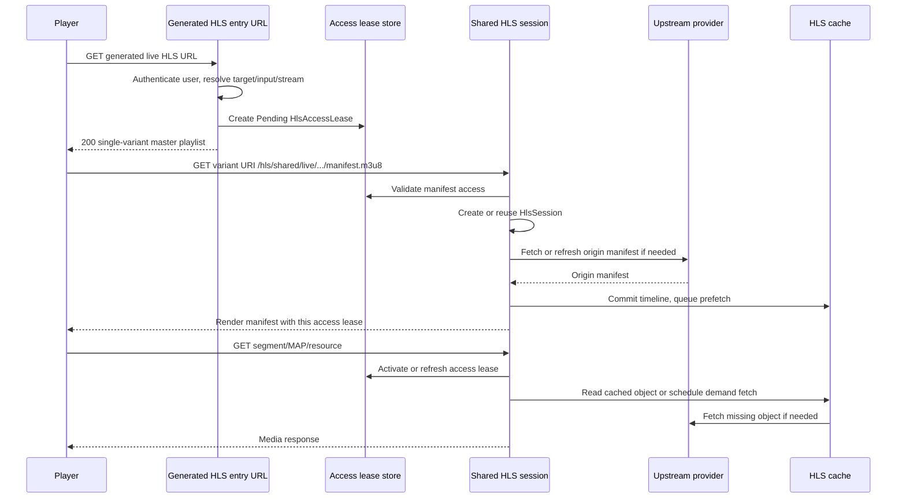
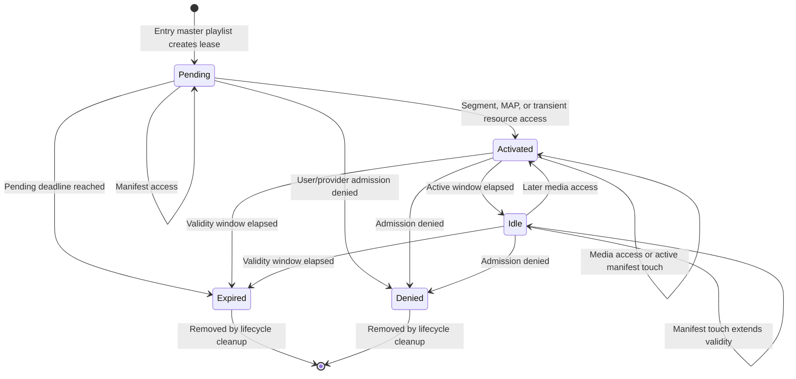
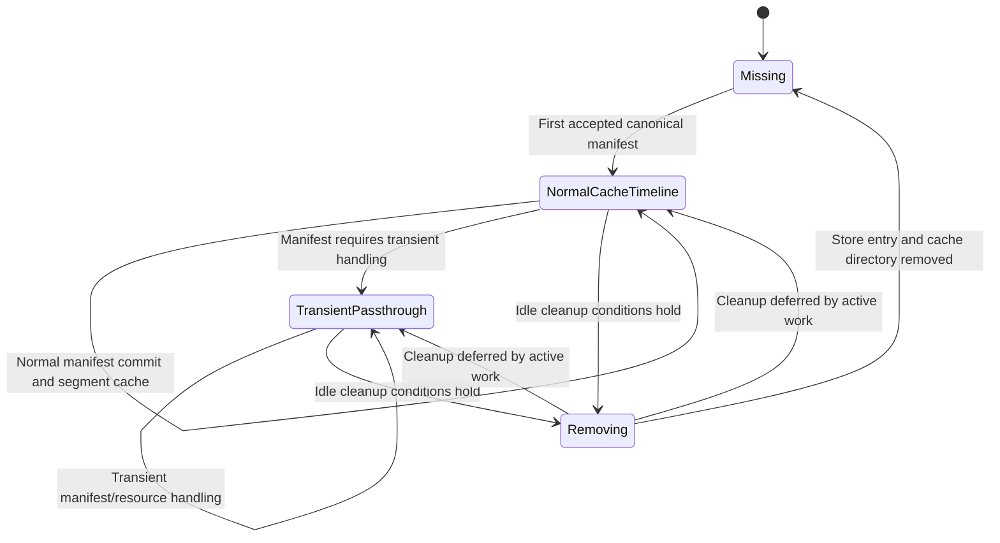

# Shared HLS Runtime Flow

This page explains what happens after a player opens a live HLS URL on a target that has Shared HLS enabled.

For the operator setup, see [Shared HLS Configuration](./shared-hls-configuration.md). For the compact state-machine
reference, see [HLS Cache State Machines](./hls-cache-state-machine.md).

## Important identifiers

| Identifier | Scope | Created by | Purpose |
| :--- | :--- | :--- | :--- |
| `HlsSessionKey` | Shared content | Built as `input:<input_id>\|hls\|<input_stream_id>`. | Stable internal key for one shared live HLS session. The input stream ID is captured before target mapping. |
| `proxy_session_id` | Public shared content URL | Derived from `HlsSessionKey` and the configured secret. | Opaque URL token for the shared session. The same input and original input stream ID produce the same public session ID while the secret stays stable. |
| `HlsPlaybackFamilyKey` | Playback family | Built from Tuliprox username and client fingerprint. | Groups related playback attempts by user and client. |
| `hls_access_lease_id` | Per playback URL | Random server-side lease ID. | Lets exactly one playback path use the shared session after Tuliprox validates the user and lease. |
| HLS cache user session token | Per playback admission | Generated for the Shared HLS entry request. | Connects the access lease to Tuliprox user session accounting and connection handling. |

The key design point is that `proxy_session_id` is shared, but `hls_access_lease_id` is not. The `stream_ref` field used
inside `HlsSessionKey` is exactly the original `input_stream_id`: an Xtream provider/origin stream ID as a decimal string,
or the parser-resolved M3U ID, including alphanumeric IDs and stable URL-derived hashes. `target_id` and `virtual_id` stay
in the routing and access context and do not affect this shared identity.

## End-to-end request flow



## Step 1: Entry request

The player first opens a generated Tuliprox live HLS URL. Tuliprox resolves the target, input, virtual ID, original input
stream ID, stream URL, and user connection permission. The original input stream ID was captured before target mapping
and is not replaced by the target's virtual ID.

If Shared HLS is enabled for the target, Tuliprox creates a fresh `Pending` `HlsAccessLease` for this playback and returns
an HTTP `200 OK` single-variant master playlist. Its only variant points to the canonical shared media-playlist path:

```text
/hls/shared/live/<proxy_session_id>/<hls_access_lease_id>/manifest.m3u8
```

The response uses `Cache-Control: private, no-store, no-cache, must-revalidate`, because the lease ID is user-specific and
should not be cached by a browser, proxy, or IPTV client. The advertised `BANDWIDTH` uses a known positive item or
persisted live bitrate with safety headroom. Unknown streams use the single-variant fallback of exactly 1 Mbit/s; normal
playback can learn a later value asynchronously from ready Shared HLS segments.

## Step 2: Canonical manifest request

The player loads the master playlist's only variant and requests the canonical media playlist. Tuliprox validates the
access lease, restores the user context, checks admission, then creates or reuses the shared `HlsSession` for the
`proxy_session_id`.

A manifest request can keep a lease alive, but it does not necessarily prove active playback. For that reason, a manifest
request for a `Pending` lease usually keeps it pending. Media requests are what activate the lease.

The manifest response is rendered with the current `hls_access_lease_id` inserted into segment, MAP, and transient
resource URLs. This is how Tuliprox keeps the shared content session while preserving per-user access control.

## Step 3: Segment, MAP, and resource requests

The player then requests media URLs from the rendered manifest:

```text
/hls/shared/live/<proxy_session_id>/<hls_access_lease_id>/<segment_file>
/hls/shared/live/<proxy_session_id>/<hls_access_lease_id>/map/<map_file>
/hls/shared/live/<proxy_session_id>/<hls_access_lease_id>/r/<resource_file>
```

For these requests, Tuliprox validates the lease again and activates or refreshes it. A valid resource request moves the
lease to `Activated`, extends its active window, and extends its validity window.

Tuliprox serves the object from one of these paths:

| Path | When used |
| :--- | :--- |
| Ready cache hit | The segment or MAP object is already committed and readable. |
| Demand fetch | The manifest references an object that is known but not ready yet. |
| Prefetch | Background work fetches likely next segments after a manifest commit. |
| Transient passthrough | The manifest contains a resource that cannot be handled as a normal cached timeline object. |

Range requests are supported for ready cached objects. This matters for clients that seek or reconnect inside an HLS
segment.

## Access lease lifecycle



Important timing rules:

| Rule | Meaning |
| :--- | :--- |
| Initial pending bootstrap window | A newly created lease can wait for the first useful media-playlist decision. The current bootstrap window is 90 seconds. |
| Pending follow-up window | After a pending manifest response, Tuliprox can shorten the pending window to `max(10 seconds, 2 * target_duration)`. |
| Active window | A media request keeps a lease active for `2 * target_duration`. If target duration is unknown, Tuliprox uses a 15-second fallback. |
| Validity window | The lease validity baseline comes from `hls_cache.session_idle_timeout`. Default: 300 seconds. |

An `Idle` lease can still validate its own URL, but it does not keep origin prefetch work active until a later media
request reactivates it.

## Shared session lifecycle

`HlsSession` is a composite runtime object rather than a single `Active` enum. Its effective state comes from store
presence, media mode, access leases, origin work, cache readers, and the garbage-collection marker.



A session can be removed only when all relevant work has drained:

- no active access lease keeps it alive;
- no origin manifest refresh is active;
- no segment or MAP fetch is active;
- no prefetch queue entries are pending;
- no ready object has an active reader;
- no transient resource reader is active;
- no temporary files block cleanup.

## Manifest commit and startup rendering

Tuliprox uses the origin manifest to build a shared internal timeline. A rendered user manifest contains only the visible
window and user-specific access-lease URLs.

Startup rendering can apply `hls_cache.strip` to hold back the initial view. This can help players that behave poorly when
they start too close to the live edge.

Manifest acceptance is conservative. Tuliprox tracks media sequence progress, host changes, and recovery signals so it can
avoid accepting a manifest that would move the shared session backwards or suddenly switch to an unsafe origin host.

Media sequence and highwater are local to an effective origin host and origin epoch. Tuliprox never treats matching
sequence numbers or similar URIs on two hosts as continuity evidence. When reserve pressure requires recovery, the first
acceptance attempt runs the complete configured burst; it does not start with a reduced probe. A cross-host winner is
staged, checked against the lease-centered handoff base, committed under its acceptance generation, and starts a new
origin epoch with a discontinuity when required.

`PublicationLate` begins at `1.5 * TARGETDURATION`, but it is only an observation that the origin is publishing late. The
runtime starts recovery and closes startup admission only when lease-specific READY reserve, full-burst recovery ETA, and
transition margin require it. For availability failures, CSV is published only after the lease's known media reserve is completely consumed and the origin remains degraded. Manifest request counts never
terminalize a lease, and initial strip contributes only the READY media actually available to that lease and its measured
start distance.

## MPEG-TS inspection and prepared terminal media

Tuliprox uses `mpeg2ts-reader` as a read-only, bounded prefix parser behind Tuliprox-owned result types. PAT/PMT tracks are
compatibility evidence for a possible splice; they are not content identity and do not weaken cross-host acceptance.
Origin, cache, and candidate media bytes are never modified by inspection.

The existing Tuliprox transport-stream writer remains narrowly scoped to terminal bundle preparation. It prepares one
bounded, generation-independent media bundle before a lease reaches cutover; no manifest or terminal-segment HTTP request
runs the parser or writer. The prepared-bundle key binds:

- the terminal asset revision and fingerprint;
- the target duration;
- the fixed terminal segment count and bundle format.

One ready bundle contains twelve small immutable terminal blocks. For block index `x`, timestamp progression is:

```text
offset_90khz(x) = x * asset_duration_ticks_90khz
offset_pcr(x) = offset_90khz(x) * 300
```

The measured terminal asset duration determines the timestamp stride and the `#EXTINF` value. The target duration is
retained as the playlist limit; a shorter asset does not introduce a timestamp gap between custom segments.
The terminal tail uses this prepared bundle while preserving the lease's live base.

## Warm terminal-tail response

A live lease starts its playback clock at the first nonempty body chunk of a qualified whole-segment GET (including a full `206 bytes=0-` response). Its estimated position advances at exactly 1x from that segment's EXTINF media start. EOF separately proves complete delivery; an aborted or in-flight body does not become completed playback history. Manifest polls, prefetch and ordinary successor requests do not restart the clock. A valid seek starts a new playback section. Without a transfer/media-time anchor the position is unknown, which does not prove exhaustion.

Contiguous READY media, completed delivery history and required MAP/key readiness determine the available horizon. This media reserve is not capped. Recovery trigger and ETA budgets are separately limited to `ceil(1.5 * session TARGETDURATION)` after workload and P95/P99 estimates. HTTP operation timeouts stay independent. An acceptance episode retains its original deadline; subsequent ETA evaluations cannot move its completion estimate beyond it.

Recovery and bundle preparation may start early, including inside the transition margin and acquisition window. Positive reserve never authorizes availability CSV publication. Immediate policy cutovers (for example preemption, maintenance or account blocking) retain their separate rules. The independent terminal observer wakes at reserve exhaustion or on new evidence, including while an origin retry is in flight and without another player poll.

At proven exhaustion with a still-degraded origin, Tuliprox evaluates the prepared bundle against the last client manifest committed to that lease. The safe suffix must include that exact manifest's last live segment, with its URI, EXTINF and bound revision unchanged. Its metadata, dependencies and revision bytes remain protected during the live lease; terminal publication atomically transfers protection to the immutable tail. A successor publication or lease end releases the previous mandatory anchor protection.

MPEG-TS terminal media still requires a compatible TS container, inactive `EXT-X-MAP`, compatible track layout, and a safe key transition. A required encryption reset is announced with `#EXT-X-KEY:METHOD=NONE`. Missing bases, invalid assets and incompatible media retain their explicit failure reason.

The canonical manifest URL then returns HTTP `200` without `Location`. Its immutable body contains the safe live tail,
the optional key reset, `#EXT-X-DISCONTINUITY`, twelve finite terminal segment references, and `#EXT-X-ENDLIST`:

```text
/hls/shared/live/<proxy_session_id>/<hls_access_lease_id>/terminal/<generation>/<index>.ts
```

The former pre-exhaustion splice deadline does not authorize an earlier commit or a standalone CSV fallback. A published live lease retains its last live segment even if that deadline has elapsed. The first eligible terminal submission starts one bounded CAS/retry budget; repeated playlist requests cannot renew it. Lease, manifest/cursor generations, origin progress, asset identity and bound revisions are revalidated at commit. Recovery or a newer client manifest supersedes a stale decision. A successful terminal publication stays immutable on replay and asset reload.

Only the lease- and generation-bound terminal route serves the live-tail splice's prepared terminal bytes and finite
full/range responses. Existing
normal segment, MAP, and `/r` URLs retain their original meaning and never redirect to a manifest or substitute slate
bytes. Terminal playback mode is sticky for the lease; later shared-session recovery can serve other or new leases but
cannot reactivate the terminal lease.

## Origin account binding

The shared session can hold an origin account binding. That binding represents the provider account or provider connection
Tuliprox uses for origin work.

Before necessary origin I/O, a session advances overlap promotion, detachment and reclaim, then re-reads the current input
configuration and binding. Account replacement is serialized per session. Missing, expired and blocked accounts share one replacement path;
blocked includes disabled accounts and runtime
health observations before persistence. Allocation stays inside the original input and follows existing capacity and
priority rules. An absent input cannot migrate to another source. A failed attempt retains its two-second backoff even
when the binding has become detached.

The HLS worker boundary uses a typed future-returning prepare callback. Its app adapter holds a weak application-state
reference. Manifest, segment, MAP, key/transient and existing background work prepare before capturing a fetch generation
or snapshot. Only authorized live work may prepare; terminal/expired leases and cache hits do not allocate.
Preparation returns the resolved entry together with its account identity, work generation and provider headers. Refresh
initialization carries that result intact; a changed binding or generation requires preparation again or rejects the start.
An unused allocation for the previous entry is released before preparing its replacement.

An account handoff advances account/work generations, invalidates waiting origin work, old cookies, recovery targets and
unfetched resource bindings, and keeps session identity, access leases, archive identity, timeline and cached objects.
Media work first requests manifest qualification through the existing refresh flow. The first request resolves the new
entry, including `provider://` entries; any subsequent recovery is bound exclusively to that new concrete HTTP(S) target.
Continuity, content-anchor and cross-host checks still apply. Old in-flight results and tagged cleanup cannot publish over
or release a successor binding. After releasing an old worker permit, the existing scheduler resumes qualified successor
work, including when only one global fetch permit exists. Allocation handles own their release responsibility across
asynchronous preparation.
Each refresh also owns a separate singleflight token. An invalidated refresh releases its own flag even after a failed
replacement, while a late completion cannot clear a successor token, including one started in the same millisecond.

Account handoff gives newly published transient resources and normal AES key references a separate resource-ID namespace.
Identical origin key URLs therefore cannot inherit cached keys from the previous account. Old published references keep
their original mappings and cached bytes; existing resource TTLs and metadata limits still govern retention. Rolling EVENT
rewrites restart at handoff and preserve the new namespace when appending subsequent manifest lines.

Origin account protection is based on successful media access:

| Protection state | Meaning |
| :--- | :--- |
| `NoMediaYet` | No segment, MAP, or transient resource response has succeeded yet. |
| `HardActive` | Recent media access is still inside the hard-active window. |
| `SoftActive` | The hard window has elapsed, but the session is still inside the soft overlap window. |
| `Expired` | The soft window elapsed and the binding is no longer protected by recent media activity. |

Upgrades to the effective origin policy apply immediately. Downgrades or clearing the policy wait for a target-duration
based grace window so active playback is not destabilized by a short pause or by brief client behavior differences.

## Transient passthrough flow

Some manifests contain objects that should not become normal cached timeline segments. Examples include certain key
resources or unsupported HLS features.

When Tuliprox detects such a manifest, the session can switch from `NormalCacheTimeline` to `TransientPassthrough`.
The rendered manifest then points user-specific `/r/<resource_file>` URLs at short-lived transient resource entries.
Tuliprox still validates the `hls_access_lease_id` before serving those resources.

## Cleanup and stale URLs

A player may keep old HLS URLs after a pause, device sleep, app restart, or network change. When the corresponding access
lease or session is gone, the old URL no longer represents a valid server-side object.

Typical outcomes are:

- a redirect to the `hls_session_or_lease_expired` custom video;
- `404 Not Found` for a stale shared HLS path;
- `503 Service Unavailable` with `Retry-After` when origin/cache work is temporarily not ready.

Players should reopen the original generated playlist entry URL when they recover from a long pause or stale HLS path.

An upgrade from `virtual_id`-based session identity also makes old canonical URLs stale when the virtual and input stream
IDs differ. New entry requests receive the new `proxy_session_id`; old cache namespaces are left for normal garbage
collection. Persisted M3U-to-Xtream data that lost a nonnumeric input ID as `provider_id = 0` must be refreshed before the
entry can safely join a shared session.
