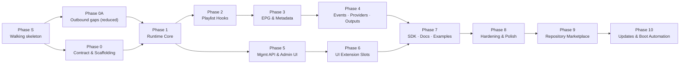

# Tuliprox Plugin System — Phases & Execution

> Companion to [`plugin-system-plan.md`](plugin-system-plan.md) (design) and [`plugin-system-history.md`](plugin-system-history.md) (history). Section
> numbers are global across the three files. Revision 4.3, 2026-10-31.

---

## 16. Phased Implementation Plan

Each phase is independently mergeable behind the `plugins.enabled: false`
default and the `plugins` cargo feature.

### Phase S — Walking Skeleton *(rev 4 — first, before 0A/0/1)*

Before building foundations, prove the whole path end to end with the least
code that can work. Phases 0, 0A and 1 then **generalize** what S proved,
instead of building three layers on assumptions.

1. `plugins/plugin-api/` with only `world base` + `world playlist-plugin` (§5). The
   rest of the WIT stays in the doc until Phase 0 freezes it.
2. Thread `P: PluginHost = NoPlugins` through the pipeline (the Phase 0 item 4
   change, done here **once**, for real), exposing **one** hook: `after-filter`,
   via the lifted async `execute_pipeline_on_items` (§7 *Sync/async boundary*).
3. Minimal `backend/plugins`: one `Engine` with epoch deadline and
   `StoreLimits`, load **one** component from `config/plugins/<id>/plugin.wasm`,
   no manifest beyond `id` + `hooks`, no registry states, no UI, no KV.
4. `plugins.enabled` + `plugins.directory` in config (DTO + runtime, §14);
   default off.
5. Outbound HTTP: `wasi:http` wired to the **existing** request client with a
   fixed attempt timeout and response cap. There is no breaker or rate limiter
   yet (Phase 0A adds them). The `network` capability is hard-required.
6. A fixture component (Rust, `cargo component`) that renames one group in
   `after-filter`, built in CI rather than committed as a binary.
   - *Exit criteria:* a real refresh with the fixture enabled shows the
     renamed group in the M3U output. Disabled, it is byte-identical to `develop`
     with no measurable refresh-time difference. `check-workspace-deps` is
     green. The four-target build result from the Phase 0 spike is known.
   - *Kill/adjust signal:* if S takes far longer than planned, or wasmtime
     async + epoch interacts badly with the pipeline's runtime, stop and
     revisit §2 before Phases 0A–8 commit to the design.
   - *W1 status (2026-10-30): items 1–6 **built and linted, untested**.*
     Exit criteria **not yet executed**: the real refresh with the fixture,
     byte-identical/timing comparison with plugins off, and the unit and
     fixture tests (`backend/plugins/tests/fixture.rs`) have not been run.
     `check-workspace-deps` is green, and the four-target result is known at
     compile level (W0). Deviations: the fixture is a plain `wasm32-wasip2` +
     `wit-bindgen` crate (`cargo component` is not needed), built by
     `bin/build_plugin_fixture.sh`, which is not yet in CI. A fresh `Store` is
     created per hook call (Phase 1 moves to per-target-run). `network` is
     always granted, with no capability gating until Phase 1. The WIT field
     `virtual-id` became `handle` (§18 *W1 amendment*).

### Phase 0A — Plugin-Free Outbound Foundations *(reduced in rev 4)*

Phase 0A builds only what `core::utils::network::request` lacks (see the §7
reuse table). The items are independent and can run as parallel lanes (§19).

1. **Durations:** add `ms` to `parse_duration_seconds` / a sibling
   `parse_duration_millis` and resolve to the existing `Millis`/`Secs`. Migrate
   one metadata `*_secs` pair without changing YAML/API representation. No new
   limit newtypes beyond what items 2–4 consume.
2. **Circuit breaker** in `core/utils/circuit_breaker.rs`: clock-injected
   (`Clock`/`ManualClock`) consecutive-failure breaker with permits, single
   half-open probe, generation-safe reset/reload, bounded diagnostics, state
   transitions and deterministic concurrency tests.
3. **Transport options** on the existing request path: HTTPS→HTTP downgrade
   rejection, request-body and header-count/bytes limits, and an explicit
   "unclassified" client for plugins (no `ResourceDestinationResolver`).
   Redirects, credential stripping, decoded-body caps and backoff are
   **reused**, not rebuilt.
4. **Policies:** token-bucket rate limit and semaphore bulkhead keyed by
   integration/plugin, plus jitter on the existing backoff. Compose them in a
   thin `OutboundExecutor` with low-cardinality metrics.
5. Migrate only the REST notification channel, adopting breaker + rate limit +
   transport options, while **retry stays in `outbox.rs`**. Preserve HMAC,
   custom methods/headers, routing, suppression, `Retry-After`, delivery
   classification and durable outbox behaviour.
   - *Exit criteria:* build, nightly clippy, fmt and `check-workspace-deps`
     green. Controlled-time tests exist for breaker transitions, concurrency,
     rate-limit queueing and deadlines. No behaviour change in any HTTP path
     other than `RestChannel`. Test runs follow §19.5.
   - ☑️ *W2 (2026-10-30): items 3–5 built + linted, untested. Controlled-time
     tests are written for the executor. The REST open-circuit test uses a
     real refused connection, not controlled time. Phase 0A is complete apart
     from test execution.*

### Phase 0 — Contract & Scaffolding *(de-risk gate)*

1. Create `plugins/plugin-api/` crate with the WIT package; generate host bindings;
   pin ABI `1.0.0`.
   - ☑️ *W2: full WIT frozen, `ABI_VERSION`/`ABI_MAJOR`, per-interface host bindings.*
2. Create `backend/plugins` (`tuliprox-plugins`) depending only on `shared` +
   `core` (+ `plugins/plugin-api`), and the `PluginHost`/`NoPlugins` seam in
   `shared/src/model/plugin.rs` (§7.0). **Gate: `bin/check-workspace-deps.sh`
   passes with only the new edges added to its allowlist.** No edge from
   `messaging`, `session` or `dvr` changes.
3. Add wasmtime (component-model) behind a `plugins` cargo feature.
   **Gate: verify compilation across all four `bin/release.sh` targets.**
   **armv7-unknown-linux-musleabihf has no Cranelift backend.** Decide between
   wasmtime's Pulley interpreter there (slower, same API) and shipping armv7
   with the feature off. x86_64-pc-windows-gnu is the other unverified target.
   Spike this **first**, since it is the cheapest way to kill the plan early.
   - *W0 status (2026-10-30):* spike done. armv7 uses Pulley automatically;
     musl/mingw link not yet proven under `cross` (history §2.6).
     **Decided (2026-10-30):** ship armv7 **with** the feature on Pulley (a run on
     hardware is still owed). Phase S accepts compile-level proof; the real
     musl/mingw links under `cross` remain a Phase 0 exit item.
4. ~~Thread `P: PluginHost`~~ — **done in Phase S** (rev 4). Phase 0 only
   widens the seam: the remaining hook-hosting fns get `P` (lifting
   `finalize_playlist_view` to async per §7), still with no new hooks, and
   benchmark parity is re-checked. The change copies the
   `M: MetadataUpdateSink = NoopMetadataSink` pattern. 67 `E: EventSink`
   bounds sit in 16 files, and the default keeps most of them untouched.
5. `manifest.rs` + exhaustive unit tests (valid/invalid ids, unknown hooks,
   capability parsing, schema presence checks); `impl Prepare` for error
   aggregation.
   - ☑️ *W2 (2026-10-30): `backend/plugins/src/manifest/` (built + linted; tests written, not run).*
6. `PluginsConfigDto` in shared + `PluginsConfig` in
   `backend/core/src/model/config/plugins.rs` as an `ArcSwapOption` section of
   `AppConfig`, defaulting to disabled, quotas typed `Bytes`/`Millis`; example
   YAML in `config/config.yml`.
   - ☑️ *W2: done. The runtime parses onto `Config.plugins`, mirrored into `AppConfig.plugins` (plan §14).*
7. ☑️ *(approved in W0, 2026-10-30; §18)* Settle §18 Q6 (`InputType`/`TargetType` plugin variants) and Q8 (`PluginHost`
   granularity). Phases 2 and 4 are blocked on them.
   - *Exit criteria:* CI green on all four release targets (or the armv7
     decision recorded); `check-workspace-deps` green; the `NoPlugins`
     monomorphisation is confirmed to compile out (benchmark parity on a
     refresh run, not just "it's a ZST"); manifest unit tests exist.

### Phase 1 — Runtime Core

1. `runtime.rs`: shared Engine, epoch ticker, `InstancePre` cache, store limits.
2. `host_fns.rs`: log (rate-limited + ring buffer), kv (`tuliprox-btree` per plugin per §18 Q10,
  \+ quotas), unrestricted-destination `wasi:http` outbound composed from the Phase 0A
  bounded transport/executor (size and header caps, cancellation, deadlines,
  redirect credential stripping, concurrency/rate limits, retry safety and
  breaker), cache-image (`image_cache.rs`, hash store + quota).
3. `registry.rs`: scan/load/introspect, enable/disable, `arc-swap` hot reload,
   circuit breaker.
4. Fixture wasm component + integration tests: each host fn, timeout trap,
   OOM trap, unrestricted public/private/loopback requests, bounded-response
   rejection, cancellation and breaker trip/reset.
   - *Exit criteria:* fixture plugin loads, all sandbox violations trap
     cleanly; HTTP calls to public, private and loopback destinations work
     within the configured bounds; rate, retry, deadline and breaker policies
     remain isolated per plugin.

### Phase 2 — Playlist Hooks

1. `convert.rs` with round-trip property tests (`PlaylistItem ⇄ channel`,
   `extra` bag fidelity).
2. `dispatch.rs`: scope pre-filter, batching, priority chaining,
    `virtual-id` merge, stats.
3. Call sites in `processor/playlist/`: `on-playlist-loaded` after the staged
    overlay; the six stage hooks in `execute_pipeline_on_items`, keyed off
    `TransformStage`; `after-sort` in `finalize_playlist_view` (per view). The
    handle is already threaded by Phase 0 item 4.
4. Filter-DSL extension: parse + registry-validate `plugin.<id>.<fn>(literal…)`
    terms as `Leaf::PluginCall` within the #946 nesting guard,
    `eval-filter-batch` decision vectors prepared before evaluation, failure ⇒
    `false` + stats. (Mapper `Expression::PluginCall` is v1.x, because it
    needs the blocking bridge.)
5. Per-target strategy hooks: `sort-key` (a `ConfigSort` variant, in
    `calculate_sort_plan`), `assign-channel-numbers`, `resolve-duplicates`
    (the **existing** post-merge pass, via `DeduplicateConfig`) and
    `merge-groups` (`prepare_eligible_catalog`). New `chno` / `group_merge`
    fields go through `TargetExecutionPlan`. All are validated against the
    registry at config load.
6. Stats into the processing report + webhook payloads.
    - *W4 status (2026-10-30): items 1–2 **built and linted, untested**.* Unit
      tests for `convert.rs` (table-driven; no `proptest` in the workspace) and
      the `dispatch.rs` merge are written, not run. A real CLI refresh with the
      `rename-group` fixture went through the dispatcher: the `News` group came
      out as `Plugin News`, and the `PluginHookStats` and fingerprint appeared in
      the `stats:` report (`TargetStats.processing.plugins`). With plugins
      disabled, the 12-round paired parity run is within noise (history §2.6).
      `after-filter` is still the only live call site. `on-playlist-loaded` is
      dispatchable, but its call site (and items 3–6) are W5.
    - *W5 status (2026-10-30): items 3–6 **built and linted, untested**.* Real
      CLI refreshes with the `pipeline-probe` and `filter-probe` fixtures
      changed the M3U output at every stage (loaded drop, before-filter drop,
      after-rename retitle, after-map regroup), and for after-sort, sort-key,
      chno, dedupe keepers, merge-groups and a `plugin.<id>.<fn>` filter term.
      In a server run against an offline Xtream mock, stage-hook counts stayed
      at the 3 input items while the view held 5 (2 resolved episodes), so they
      do not re-fire on episodes. Disabled parity is within noise. **Not run:**
      the `catalog_selection: curated` view check (it needs Trakt/TMDB).
    - *Exit criteria:* fixture plugin can drop/modify/reorder channels at every
      stage, drive a custom filter fn, sort order, chno scheme and dedupe pass
      in a real refresh — including a target with `catalog_selection: curated`,
      where finalize hooks fire per view with consistent chnos; stage hooks do
      **not** re-fire on series-episode resolution; disabled system shows zero
      overhead in a benchmark run.

### Phase 3 — EPG, Matching & Metadata Hooks

 1. EPG model conversions against the real `EpgProgramme` (categories, icon,
    flags); `on-epg-loaded` inside the streaming parser (`process_epg_file` /
    `process_ics_file`) with a bounded per-source buffer.
 2. `match-channel`: top-K candidate shortlist from `EpgIdCache.normalized` +
    phonetic index at the unresolved branch of `assign_live_channel_epg`;
    results pass through `SmartMatchRank` ambiguity rules, case adoption and
    `clear_invalid_epg_ids`.
 3. `enrich-programmes` between `process_playlist_epg` and `AfterEpg`
    mapping; verify injected programmes survive `spill_epg_to_disk` →
    `finish_into_disk` → `merge_epg_trees` unchanged and sort correctly by
    `source_ordinal`.
 4. `enrich-metadata` in `update_vod_metadata` / `update_series_metadata`
    (inline + background `metadata` worker), before persistence, non-fatal.
 5. `transform-programmes` per batch in `process_epg_file`;
    *(v1.x)* `resolve-epg-conflict` in `normalize_channel_programmes` via the
    blocking bridge, for exact-time collisions plus the new overlap detection
    (`none` ⇒ today's behaviour).
 6. All EPG and metadata hooks respect `MaintenanceGate`.
    - *Exit criteria:* fixture plugin matches a deliberately-misnamed channel,
      injects a synthetic programme visible in generated XMLTV output, rewrites
      programme categories source-wide, and amends resolved VOD metadata.
    - *W5 status (2026-10-30): items 1–4 and 6, plus the `transform-programmes`
      half of item 5, **built and linted, untested**.* In the XMLTV a server
      served, the injected programme sat in start order, and categories were
      rewritten source-wide. `on-epg-loaded` renamed a guide channel before
      matching. **Open:** `match-channel` (item 2) shortlists only guide
      channels whose programmes the streaming parser kept, so a channel that
      only a plugin would match never has programmes and cannot be offered. It
      works when another playlist channel keeps that guide channel. Fixing it
      means running the plugin pass at the buffered channel-list point, before
      programmes stream. `enrich-metadata` (item 4) ran once per newly
      resolved record and not again on re-run, but the amended field did not
      show in the served `get_vod_info`. Both are in history §2.6.
    - *v1.x note (W5 plan fix, 2026-10-30):* "wins a merge conflict" moved here
      from the exit criteria. `resolve-epg-conflict` (item 5) needs the
      blocking-thread bridge and is v1.x, so v1 Phase 3 cannot be gated on it.
      It becomes the exit criterion of the v1.x conflict-hook work.

### Phase 4 — Events, Notifications, Probes, Input & Output Providers

 1. `plugin_event_bridge.rs` in `app`: `subscribe_filtered(mask)` +
    bounded queue + consumer task, modelled on `notification_bridge.rs`
    (`spawn_notification_bridge`, `:37`). **No new emit sites at all** —
    `playlist.update`, `user.connection.changed`, `user.created` and
    `stream.probe.failed` already publish (§7, rev 4). Drop-and-count comes
    from `EventBusStats`.
 2. *(Only if a Phase 7 example needs it)* a probe-**success** `EventKind`
    carrying `MediaQuality` + `ProbeStreamStats`, coalescable or opt-in.
    Otherwise dropped from v1.
 3. `Channel::Plugin` variant in `backend/messaging`: `PluginChannel:
    NotificationChannel`, `delegate!` arms, `ChannelSet` participation and
    config-reload invalidation. Plugin-**declared** event ids (the `EventId`
    widening) are explicitly *not* in this phase — delivery first.
 4. `input_provider.rs`: provider registry, `type: plugin:<id>` validation in
    input config, routing of the download stage to `fetch-playlist`/`fetch-epg`
    with provider-scaled deadlines; results join the normal pipeline.
 5. `output_provider.rs`: `provides.output_format` registry, output
    `type: plugin:<fmt>` validation, `begin → render-batch… → finish` driver
    with atomic tmp+rename; per-output failure isolation.
 6. `header_inject.rs`: `inject-upstream-headers` at stream-session setup —
    `stream_headers` capability gate, 50 ms clamp, TTL cache, header denylist,
    fail-open.
 7. `metrics.rs`: throttled `collect-metrics` polling + snapshot cache, keys
    namespaced `<plugin-id>.<key>`, embedded in the dashboard stats payload +
    `GET /api/v1/plugins/metrics`.
 8. **Scheduled tasks** (rev 4.2): `tasks.rs`, `ScheduleTaskType::PluginTask` +
    `plugin`/`task` schedule fields, scheduler dispatch, `ScheduledTaskFailed`
    reuse, `…/tasks` + `…/tasks/{task}/run` endpoints, `kv_generation` in the
    fingerprint.
    - *Exit criteria:* fixture plugin receives `playlist.update`,
      `user.connection.changed`, `user.created` and `stream.probe.failed`; delivers a
      notification **through the outbox** with routing and suppression applied;
      serves a synthetic playlist consumed end-to-end; renders a custom output
      format byte-identical across two runs and declares its
      `TargetType::capabilities()` row; injects a header visible at a mock
      upstream; and its metrics appear in the stats payload. Plus: a plugin
      subscribed to `recording.changed` observes **fewer** events than were
      emitted, and the test asserts that rather than treating it as a bug.
      Plus: a fixture task runs on a cron fire and via "run now", a failing task
      publishes `scheduled_task.failed`, and an overlapping fire is skipped.
    - *W6a status (2026-10-31):* items 1 and 3–8 are built and linted on
      `plugin-w6a` (history §2.6 W6a). Item 2 stays dropped (no consumer).
      The exit criteria are **not yet executed**: the fixtures exist
      (`event-probe`, `notify-probe`, `provider-probe`, `edge-probe`,
      `task-probe`) but the manual checks were skipped; run them, or the
      crate tests, before calling Phase 4 done.

### Phase 5 — Management API & Admin UI *(can start after Phase 1, parallel to 2–4)*

 1. `plugins_api.rs` + upload/validation/approval flow, wired with existing
    panel auth.
 2. Frontend `PluginsView` + `plugin_service.rs` + menu/home wiring.
 3. `SchemaForm` + settings dialog + server-side schema validation on save.
 4. Per-plugin log viewer: `logs.rs` ring buffer, `…/logs` endpoint, a
    `target` filter on the existing `ws/logs` socket, `plugin_logs.rs` UI
    (filter/search/live tail).
    - *W5 status (2026-10-30): item 4 **built and linted, untested**.* On a
      live server, `target=plugin::probe-full` returned exactly the plugin's
      100 lines out of a 1,000-entry ring spanning 24 targets. `plugin::*`
      returned only the two plugin targets, and the REST backlog returned the
      same 100 lines. The Yew view has not been exercised in a browser.
    - *Exit criteria:* full install→approve→configure→enable→stats→logs→
      uninstall loop through the UI.
    - *W6b status (2026-10-31): item 1 (5.1b) **built and linted, untested**.*
      The whole exit loop ran in a served UI against `ui-demo.tlpx`: the review
      showed the network and custom-UI warnings, the secrets list and the MCP
      checkbox (off by default); approve pinned hash + capabilities + `mcp`; a
      secret round-tripped as `********`; enable, stats (rpc calls counted),
      logs, disable (slots greyed, frames gone) and uninstall with purge
      (directory, KV, pin and config entry removed). A wrong-hash approve was
      a `409`.
    - *W4 status (2026-10-30): items 2–3 **built and linted, untested**.* The
      Plugins page (list, state badges, failure reason, hook stats, tasks) and
      the SchemaForm settings dialog were served locally and exercised against
      the fixture. A masked secret round-tripped through a UI save, and an
      `${env:…}` value was kept as the reference. Schema violations come back
      as `422` with per-field errors (checked with curl). The UI number fields
      already refuse out-of-range input, so the inline server-error display was
      not triggered through the form. There are no upload, approve or enable
      controls, because those routes do not exist yet.

### Phase 6 — UI Extension Slots

 0. Prerequisite refactor: extract a channel-detail component out of
    `playlist_explorer.rs` so slot 7 has a host.
 1. `PluginSlot` + slot registration: menu, config section, config tab,
    source-editor tile, dashboard card, playlist-explorer action,
    channel-detail panel, EPG overlay, setup-wizard step (context-carrying
    slots pass their subject DTO through the bridge).
 2. Static asset route with the frame CSP (`connect-src 'none'`); `plugin_frame` + parent-side `postMessage` bridge
    (scoped rpc fetch, theme, locale, `toast` into toastr with per-plugin rate
    limit, `t()`, `context`).
 3. `rpc` endpoint → `rpc.call` for manifest-declared exports, with
    `input_schema` validation and read/write kinds.
 3a. **Plugin MCP tools** (rev 4.2): `mcp_tools.rs` snapshot, merge into
    `tools/list` / `find_tool`, the three switches (manifest, approval,
    `mcp.plugin_tools`), forced redaction, read-only hiding of write tools.
    *Exit:* with MCP in read-only mode an MCP client lists a fixture plugin's read
    tool and calls it successfully, does **not** see its write tool, and sees
    no plugin tools at all with `mcp.plugin_tools: false`.
 4. Plugin UI i18n: `plugin_i18n.rs` locale loading + fallback chain,
    `title_key` resolution for contributions, SchemaForm and metric-label
    translation, live locale switching via the bridge.
 5. Config page integration: render `config_extensions` fragments inside
    targeted built-in sections (plugin-badged, namespaced storage, batched
    save) and plugin `config_tab`s (schema-driven or sandboxed frame).
 6. Plugin metrics rendered in the existing dashboard stats/metrics cards
    (label, value, unit, severity accent).
   *W6b status (2026-10-31): items 0–6 and 3a **built and linted, untested**;
   item 7 as an unpublished package directory (`packages/plugin-ui-types/`,
   `"private": true`).* Seen working in a served UI with the `ui-demo`
   fixture: menu page, config section, schema config tab, extension field in
   Messaging, source-editor tile, dashboard card, explorer action (context
   without URLs), EPG overlay; rpc read/write, toasts, live en→es switching.
   Not seen: the channel-detail panel (the explorer has a detail view for
   series only), the wizard step (setup mode loads no plugins), a frame-backed
   config tab (the fixture's schema tab wins), metrics in the stats cards
   (needs W6a's `GET /api/v1/plugins/metrics`). History §2.6 has the details.
 7. Publish `@tuliprox/plugin-ui-types` (TS definitions for bridge incl.
    `t()`/`toast()`, slot contexts, DTOs; versioned with the host ABI major).
    - *Exit criteria:* a demo plugin renders a working tile in the source
      editor, a full menu page, an explorer context action, injected config
      fields + a config tab, localized titles in two locales, metrics in the
      dashboard cards, and raises a toast — all typed against the published
      definitions.

### Phase 7 — SDK, Docs, Example Plugins

 1. `tuliprox-plugin-sdk` crate + `#[tuliprox_plugin]` macro + mock-host test
    utils; cargo-generate template with CI + packaging script (incl. TS
    sandboxed-frame starter and locale-file layout).
 2. Build **Sports Enricher**, **HF EPG Matcher** and **Matrix Notifier**
    end-to-end; mock external APIs in integration tests. (Gotify is a built-in
    channel — see §13.)
 3. mdBook chapter set (§12).
    - *Exit criteria:* a new author can go template→installed plugin following
      only the quickstart doc.

### Phase 8 — Hardening & Polish

 1. *Deferred (excluded from W8 by owner, 2026-10-31).* Concurrency audit under parallel target processing + the event consumer;
    loom/stress tests on dispatch and queue backpressure.
 2. *Deferred (excluded from W8 by owner, 2026-10-31).* Benchmarks: 100k channels × 3 plugins (incl. plugin sort/dedupe/output
    paths); tune batch size; confirm disabled-path zero cost and session-setup
    latency budget with header injection active.
 3. ✅ *W8 (2026-10-31): built + linted; exit checks 1 and 2 run on a live server; `tuliprox-plugins`
    `cargo test -p tuliprox-plugins` passes in full after the W8 open-issue round, history §2.6 W8 rows.*
    SHA-256 pinning of installed `plugin.wasm` + re-approval if it changes
    outside an approved install/update; settings migration story (schema
    `version` field). Marketplace catalogs do not provide checksums or
    signatures.
 4. *Deferred (excluded from W8 by owner, 2026-10-31).* Docker/compose docs for mounting `config/plugins`; release notes;
    CHANGELOG.
 5. ✅ *W8 (2026-10-31): built + linted; exit check 3 run on a live server; tests run as for item 3.
    No marketplace or network code.*
    Safe package replacement foundation: validate and stage before activation,
    retain the previous package, and roll back if activation fails.

### Phase 9 — Repository Marketplace *(after Phase 8)*

 1. ✅ *W9 (2026-11-01): built + linted; manual checks 1–3 + UI run on a live server against a local test marketplace; tests T0–T5 pass (one
    pre-existing upstream crash, history §2.6 W9).*
    Define a versioned `marketplace.json` format at the root of each repository.
    A source is configured by the direct HTTPS/raw URL to that file; Tuliprox
    does not clone repositories or resolve Git-provider default branches.
 2. ✅ *W9 (2026-11-01): built + linted; manual checks 1–3 + UI run on a live server against a local test marketplace; tests T0–T5 pass (one
    pre-existing upstream crash, history §2.6 W9).*
    Catalog entries describe plugins and releases: ID, name, description,
    author, license, category, version, HTTPS package URL, and minimum
    Tuliprox/plugin API compatibility, requested capabilities, and changelog.
    No publisher-provided package hash, signing key, or signature is included.
 3. ✅ *W9 (2026-11-01): built + linted; manual checks 1–3 + UI run on a live server against a local test marketplace; tests T0–T5 pass (one
    pre-existing upstream crash, history §2.6 W9).*
    Add multiple repository sources to the existing plugin config, with
    add/edit/enable/disable/remove controls in both config and UI. Both surfaces
    update the same persisted settings. Cache catalogs and show sync time/errors.
 4. ✅ *W9 (2026-11-01): built + linted; manual checks 1–3 + UI run on a live server against a local test marketplace; tests T0–T5 pass (one
    pre-existing upstream crash, history §2.6 W9).*
    Add repository/catalog management endpoints and a Marketplace UI for
    browsing, searching, selecting a compatible release, and reviewing its
    metadata/capabilities before install. Reuse existing validation, approval,
    and enable flows; calculate the installed hash locally during approval.
 5. ✅ *W9 (2026-11-01): built + linted; manual checks 1–3 + UI run on a live server against a local test marketplace; tests T0–T5 pass (one
    pre-existing upstream crash, history §2.6 W9).*
    Record the selected source and installed version. If an ID exists in
    multiple sources, require an explicit source choice. Removing a source
    leaves its installed plugins in place.
    - *Exit criteria:* add a source through either config or UI, browse it, and
      install/approve/enable a compatible plugin; invalid or incompatible
      packages leave the existing installation untouched.

### Phase 10 — Updates and Boot Automation *(after Phase 9)*

 1. ✅ *W10 (2026-11-01): built + linted; manual checks 1–8 run on a live server against a local test marketplace (history §2.6 W10); tests
    written, not run (awaiting the owner's test approval).*
    Add manual update checks and a global `auto_update_on_boot` option, exposed
    in config and UI and defaulting to `false`. Keep version pinning available
    for plugins that should not move automatically.
 2. ✅ *W10 (2026-11-01): built + linted; manual checks 1–8 run on a live server against a local test marketplace (history §2.6 W10); tests
    written, not run (awaiting the owner's test approval).*
    On boot, check for updates to already-installed, enabled plugins from their
   configured source. Use a strict time budget without gating Tuliprox startup;
   if the check/download misses the budget or the source fails, start the
   current plugin and retry on the next boot.
 3. ✅ *W10 (2026-11-01): built + linted; manual checks 1–8 run on a live server against a local test marketplace (history §2.6 W10); tests
    written, not run (awaiting the owner's test approval).*
    Validate compatibility and package contents, stage and atomically activate
    the update, then record the new locally computed hash. Do not silently grant
    new capabilities; require the existing admin approval flow if they change.
    Roll back to the prior package if activation fails. Never install or enable
    a new plugin automatically.
    - *Exit criteria:* tests cover a successful update, offline source,
      malformed/incompatible package, capability change, interrupted
      activation, and rollback; failures preserve the previous working plugin.

**Dependency graph:** S → {0A ∥ 0} → 1 → {2 → 3 → 4, 5 → 6} → 7 → 8 → 9 → 10.

- Phase S (walking skeleton) comes first. Only the Phase 0 wasmtime
  build spike and the WIT decisions for `base` / `playlist-plugin` run before it.
- Phase 0A is plugin-free and runs **in parallel** with Phase 0. Phase 1's
  `wasi:http` outbound is its only consumer. Phase S's outbound HTTP uses the
  existing client.
- After Phase 1, the backend-hook track and the UI track run in parallel.
- Phase 3 depends on Phase 2 only for `convert.rs`/`dispatch.rs`. Its EPG call
  sites live in different files (`epg.rs`, `processing/src/parser/xmltv/*`,
  `xtream_vod/series.rs`), so it can start once `dispatch.rs` exists.

§19 turns this graph into concrete agent lanes.



---

## 19. Execution Strategy — Parallel Agents & Token Budget

Added in revision 4. This section describes how to execute §16 with an
orchestrating agent and parallel sub-agents on tiered models, keeping token
spend proportional to the work actually being done. It is tooling guidance, not
architecture. Nothing here changes a design decision above.

### 19.1 Principles

1. **The plan is the context.** A sub-agent brief points at plan sections and
   symbols (`§6 hook table, row after-sort`; `finalize_playlist_view`) and does
   not paste them. The agent reads only those sections and files. Keeping §2.6 and
   §14 accurate is what makes short briefs possible.
2. **Symbols over line numbers.** Briefs name fns, types and files. Line
   numbers are hints, and §19.4 refreshes them each phase.
3. **One owner per file per wave.** Parallel lanes never edit the same file in
   the same wave. Hot-spot files (§19.6) have a single integration owner.
4. **Return diffs and verdicts, not narratives.** Every lane returns a ≤300-word
   summary, the list of changed files, and the tail of its gate output. The
   orchestrator reviews `git diff` per lane. It never reads whole files a lane
   owns.
5. **Cheapest model that can do the job, escalate on evidence.** If a lane fails
   its gate twice on the same issue, re-run it one tier up with the failure
   output attached, rather than retrying at the same tier.
6. **Read-only discovery goes to Explore agents.** Lookups of the form "where
   is X / does Y still exist" go to an `Explore` sub-agent on Haiku, not to the
   orchestrator reading files.

### 19.2 Model tiers

**Pinned versions.** Every tier name in §19 means the 5.5 generation, and briefs
name the model ID explicitly. A bare alias may resolve to a different version
later, which would make wave-to-wave results incomparable.

| Tier name | Model | Model ID |
| --- | --- | --- |
| Opus | Claude Opus 5.5 | `claude-opus-5-5` |
| Sonnet | Claude Sonnet 5.5 | `claude-sonnet-5-5` |
| Haiku | Claude Haiku 5.5 | `claude-haiku-5-5` |
| *(optional)* Fable | Claude Fable 5.1 (the latest Fable; there is no 5.5) | `claude-fable-5-1` |

The orchestrating session runs on Opus 5.5, selected in the model picker before
the prompt is sent. Sub-agent lanes are spawned with the tier from §19.3. If a
lane's tool only accepts an alias (`opus` / `sonnet` / `haiku`), the
orchestrator checks once per session that the alias resolves to the 5.5 ID. If
it doesn't, the orchestrator stops and reports rather than silently running on
another version.

| Tier | Use it for | Examples in this plan |
| --- | --- | --- |
| **Opus 5.5** (orchestrator; Fable 5.1 only for an unattended multi-phase run) | contract and seam decisions, risky cross-cutting mechanical changes, security review, merge/integration, final phase review | WIT freeze (§5), `PluginHost` granularity (§18 Q8), `InputType` variant choice (Q6), threading `P` through the pipeline (Phase 0.4), `dispatch.rs` merge semantics, UI trust boundary / CSP / bridge review, Phase 8 concurrency audit |
| **Sonnet 5.5** | well-specified implementation against a frozen design; tests; frontend components | manifest + registry, `runtime.rs`, host fns, `convert.rs`, hook call sites, EPG hooks, `Channel::Plugin`, input/output providers, API router, `PluginsView`, `SchemaForm`, `PluginSlot`, SDK macro, example plugins |
| **Haiku 5.5** | mechanical, pattern-copying or lookup work with an unambiguous spec | re-anchoring §2.6/§14 line refs, DTOs, `plugin_service.rs` REST client fns, `ViewType`/`ConfigPage`/i18n string additions in 4 locales, `mod` registrations, the deps allowlist edit, example YAML, `plugin_event_bridge.rs` (a near-copy of `notification_bridge.rs`), first drafts of mdBook pages, fmt/clippy fix-ups |

### 19.3 Work packages and lanes

`WP` ids are stable handles for briefs. Lanes in the same **wave** run
concurrently, each in its own git worktree (`isolation: "worktree"`). Waves are
sequential. Keep ≤4 implementation lanes live at once: more lanes add
integration cost faster than they remove wall-clock time.

| Wave | WP | Scope (files owned) | Model | Depends on |
| --- | --- | --- | --- | --- |
| **W0** | ✅ 0.3-spike *(2026-10-30: wasmtime 50.0.1 checks on all 4 targets, links on armv7 only — musl/mingw links need `cross`; see history §2.6)* | wasmtime component-model + async build on all four `bin/release.sh` targets; Pulley on armv7; `wasmtime-wasi-http` / vendored-`reqwest` overlap | Sonnet | — |
| W0 | ☑️ 0.Q *(2026-10-30: memo + WIT freeze approved, applied to §5 and §18)* | **decision memo** for Q6 / Q8 / Q10; freeze `world base` + `playlist-plugin` only | Opus | — |
| **W1** | ✅ S *(built + linted, untested)* | walking skeleton (§16 Phase S) — **single lane**; owns `processing` and the new crates for this wave | Opus (threading) + Sonnet (runtime, fixture) in sequence | 0.3-spike, 0.Q |
| W1 | ✅ 0A.1 *(built + linted, untested; unitless = seconds in both parsers)* | `ms` durations → `Millis` (`shared/src/utils/time_utils.rs`, `time_units.rs`) | Haiku | — |
| W1 | ✅ 0A.2 *(built + linted, untested)* | circuit breaker (`core/utils/circuit_breaker.rs` + tests) | Sonnet | — |
| W1 | ✅ 0A.3 *(built + linted, untested; jitter not yet wired into `calculate_retry_backoff`, see W2 0A.4)* | token bucket + bulkhead + jitter (`core/utils/network/request/` new files only) | Sonnet | — |
| **W2** | ✅ 0.1 *(built + linted, untested; ABI 1.0.0, 23 export interfaces, union-world host bindings; plan §18 *W2 full freeze*)* | full WIT freeze (all capability worlds) in `plugins/plugin-api/` | Opus | S |
| W2 | ✅ 0.4 *(built + linted, untested; parity holds: median 1052 ms vs 1056 ms on `develop`, history §2.6)* | widen the seam: remaining hook-hosting fns, `finalize_playlist_view` → async — single lane on `processing` | Opus | S |
| W2 | ✅ 0.5/0.6 *(built + linted, untested; tests written, not run)* | `manifest.rs` + tests; full `PluginsConfig` (budgets, secrets) + example YAML | Sonnet | S |
| W2 | ✅ 0A.4 *(built + linted, untested; also wired into `wasi:http` at integration)* | transport options + plugin client; `OutboundExecutor` compose | Sonnet | 0A.1–3 |
| W2 | ✅ 0A.5 *(built + linted, untested)* | `RestChannel` migration | Sonnet | 0A.4 |
| **W3** | ✅ 1.x *(built + linted, untested; integration tests + fixture written, not run; plan §18 *W3 runtime freeze*)* | `runtime.rs`; `host_fns.rs` (log/kv/config/now); `wasi:http` outbound + `cache-image`; `registry.rs`; fixture component — up to 4 lanes split by file | Sonnet | W2 |
| W3 | ✅ 5.1 *(built + linted, untested; the five GET routes, `SystemRead`)* | `plugins_api.rs` router + `v1_api.rs` wiring (read-only routes first) | Sonnet | 1 registry API shape |
| **W4** | ✅ 2.1/2.2 *(built + linted, untested; real fixture refresh + parity run done, history §2.6; plan §18 *W4 seam freeze*)* | `convert.rs`, then `dispatch.rs` | Sonnet, then Opus | W3 |
| W4 | ✅ 5.2/5.3 *(built + linted, untested; page served and exercised locally; B3 settings `PUT` included)* | frontend: `plugin_service.rs` + DTOs (Haiku); `PluginsView` + `SchemaForm` (Sonnet) | Haiku + Sonnet | 5.1 |
| W4 | ✅ B3 *(built + linted, untested; checked by hand with curl and the UI)* | `PUT /api/v1/plugins/{id}/settings`: §11-subset validation, secret sentinel, `${env:…}` kept, `init` re-run before persist (`settings.rs`, `plugins_settings_api.rs`) | Sonnet | 5.1 |
| **W5** | ✅ 2.3–2.6 *(built + linted, untested; every stage/strategy fixture changed a real refresh, history §2.6; curated-view run not done: needs Trakt/TMDB)* | pipeline call sites (`processor/playlist/*`, `sort.rs`, `deduplicate.rs`) — **one lane** | Sonnet | 2.2 |
| W5 | ✅ 2.4 *(built + linted, untested; real refresh keeps/drops as expected; unknown plugin is a startup config error)* | filter `Leaf::PluginCall` (`shared/src/foundation/filter/*`) | Sonnet | 2.2 |
| W5 | ✅ 3.1–3.4, 3.6 *(built + linted, untested; inject/categories/rename verified in served XMLTV; ⚠️ 3.2 match only for guide channels another playlist channel keeps; ⚠️ 3.4 amendment not seen in served VOD info — history §2.6)* | EPG hooks (`epg.rs`, `processing/src/parser/xmltv/*`), `enrich-metadata` (`xtream_vod.rs`, `xtream_series.rs`) | Sonnet | 2.2 |
| W5 | ✅ 5.4 *(built + linted, untested; socket target filter + REST backlog verified on a live server; UI not exercised in a browser)* | log viewer + ws `target` filter | Sonnet | 5.2 |
| **W6** | ✅ 4.1 *(built + linted, untested; manual checks not run, history §2.6 W6a)* | `plugin_event_bridge.rs` + `events.rs` | Haiku | W3 |
| W6 | ✅ 4.3 *(built + linted, untested; manual checks not run, history §2.6 W6a)* | `Channel::Plugin` (`messaging/src/channels/*`) | Sonnet | W3 |
| W6 | ✅ 4.4/4.5 *(built + linted, untested; manual checks not run, history §2.6 W6a)* | input / output providers | Sonnet | 0.Q (Q6), W5 |
| W6 | ✅ 4.6/4.7 *(built + linted, untested; manual checks not run, history §2.6 W6a)* | header injection (at `create_stream_response_details` in `app`, not `session`); metrics | Sonnet | W3 |
| W6 | ✅ 4.8 *(built + linted, untested; manual checks not run, history §2.6 W6a)* | scheduled tasks (`plugins/tasks.rs`; scheduler + schedule config are hot-spots → integration owner applies those edits) | Sonnet | W3 |
| W6b | ✅ 5.1b *(built + linted, untested; full upload→review→approve→configure→enable→stats→logs→disable→uninstall+purge loop exercised in a served UI, history §2.6)* | upload / approve / enable / disable / uninstall + UI: `POST /api/v1/plugins` (`.tlpx` multipart, size cap, zip-slip-safe staging, full §4 validation, capability review), `PUT …/approve` (grants + sha256 pin + MCP approval), `PUT …/enable` / `disable`, `DELETE …?purge_kv=`, all `SystemWrite`; `plugin_upload.rs` + PluginsView controls *(W6b plan fix: §19.3 had no row for the Phase 5 mutating routes)* | Sonnet | W5 |
| W6b | ✅ 6.3a *(built + linted, untested; all three switches and read-only hiding verified against a live MCP endpoint, history §2.6)* | plugin MCP tools (`plugins/mcp_tools.rs`, `mcp_tools.rs`/`mcp_api.rs`); Opus reviews the exposure switches | Sonnet + Opus review | 6.3 (rpc) |
| W6b | ✅ 6.x *(built + linted, untested; 7 of 9 slots seen rendering (config tab schema-driven) with a live bridge, i18n en/es and toasts; ⚠️ channel-detail is series-only, wizard step unreachable, metrics wait on W6a — history §2.6)* | slots, bridge, loader, i18n, config integration | Sonnet; bridge/CSP reviewed by Opus | W4 |
| **W7** | ✅ 7.1 *(built + linted, untested; SDK unit/macro tests written, not run; API frozen in history §2.6 *W7 SDK as frozen*; template rendered + packaged + installed by the doc acid test)* | `plugins/plugin-sdk/` (`tuliprox-plugin-sdk`), `plugins/plugin-sdk-macros/`, `plugins/examples/template/`, `bin/package-plugin.sh`, `bin/new-plugin.sh`, `make plugin-examples` | Sonnet (S), Haiku (T) | W5, W6 |
| W7 | ✅ 7.2 *(built + linted, untested; mock-host unit tests written, not run; all three exercised on a live server with local mocks, history §2.6 *W7 Examples, real runs*; ⚠️ E1 epg-overlay frame not reached, ⚠️ `stream.probe.failed` not run (no ffprobe))* | `plugins/examples/{sports-enricher,hf-epg-matcher,matrix-notifier}/` | Sonnet, one lane each | 7.1 |
| W7 | ✅ 7.3 *(docs build + markdownlint green; exit criterion met: a fresh Haiku agent went template → installed plugin → renamed group in the M3U from quickstart.md alone, 2 rounds, both unaided successes; round 1 friction (shell state, plugins dir, config rewrite, unbounded waits, nohup) and round 2 gaps (create `$QUICKSTART`, the unused secret) fixed in the page; the round-2 fixes were not re-run)* | `docs/src/plugins/*.md` (9 pages) + `SUMMARY.md` entry | Haiku draft → Sonnet edit | 7.2 |
| **W8** | ✅ 8.3 *(built + linted; live exit checks 1–2 + `tuliprox-plugins` tests, history §2.6 W8)* | sha256 pin integrity + settings-schema `version` / `settings.migrate` (`registry.rs`, `settings.rs`, `migration.rs`, SDK) | Sonnet (C) | W7 |
| W8 | ✅ 8.5 *(built + linted; live exit check 3 + tests)* | staged update, capability diff, one retained prior, auto + manual rollback (`install.rs`, `plugins_install_api.rs`, Plugin Manager) | Sonnet (D) | W7 |
| W8 | ✅ verification debt *(W6a checks 3–4, E1 epg-overlay, frozen-clock metrics verified; `stream.probe.failed` unverified, no ffprobe)* | `state.rs`/`metrics.rs` tests, live runs | Sonnet (F) | W7 |
| W8 | 8.1 / 8.2 / 8.4 *deferred (excluded from W8 by owner, 2026-10-31)* | concurrency audit; benchmarks; Docker docs, release notes, CHANGELOG | — | W7 |
| **W9** | ✅ 9.1–9.2, 9.5 provenance | `marketplace.json` v1 + JSON Schema, compatibility, HTTPS/size/classifier fetch, catalog cache, `ApprovalPin.origin`, marketplace staging (`backend/plugins/src/marketplace/*`, `install.rs`), publisher docs (plan §18 *W9 seam freeze*) | Sonnet (F) | W8 |
| W9 | ✅ 9.3 | `plugins.repositories` config DTO/runtime/Prepare, as-written persistence | Sonnet (S) | W8 |
| W9 | ✅ 9.4 API | repositories CRUD + sync, marketplace browse + install (`plugins_marketplace_api.rs`) | Sonnet (A) | F, S |
| W9 | ✅ 9.4 UI | Marketplace tab, sources management, release picker, install → existing review | Sonnet (U) | seam DTOs |
| W9 | ✅ docs | operator page *Plugin marketplace* | Haiku (D) | F |
| **W10** | ✅ 10.1–10.3 discovery *(built + linted; live checks 1–8; tests written, not run)* | update candidates, eligibility, staging, settings dry run (`marketplace/updates.rs`, `migration.rs`; plan §18 *W10 seam freeze*) | Sonnet (K) | W9 |
| W10 | ✅ 10.2–10.3 activation | activation journal + startup recovery + crash knob, unattended activation, drain, boot runner + report (`activation.rs`, `boot_update.rs`, `install.rs`, `tasks.rs`, `plugin_state.rs`, `plugin_boot_update.rs`) | Opus (B) | K |
| W10 | ✅ 10.1 API | update routes + as-written update fields (`plugins_updates_api.rs`) | Sonnet (P) | K, B |
| W10 | ✅ 10.1 UI | Plugin Manager updates, badges, policy selector, boot toggle + budget (also on the config page), boot report (`plugin_updates.rs`, `plugins_view.rs`) | Sonnet (U) | seam DTOs |
| W10 | ✅ docs | operator *Plugin marketplace* → Updates; crash knob on the developer page | Haiku (D) | K, B |

The critical path is W0 (spike + 0.Q) → W1 S → W2 0.1/0.4 → W3 → W4 2.2 → W5. Everything
else hangs off it, so Opus attention is spent where it shortens that path.
The marketplace path is W8 → W9 → W10; boot automation follows manual
repository installs.

### 19.4 Per-phase loop

Each wave follows the same five steps, and each step has a bounded cost:

1. **Re-anchor (Haiku, Explore, read-only).** Re-verify only the §2.6 / §14
   rows the wave touches, and return a row-level diff. This is how drift between
   rev 2 and rev 4 would have been caught for a few thousand tokens instead of a
   whole re-review.
2. **Freeze (Opus).** Resolve any open question the wave depends on, and edit
   the plan in place. Briefs reference the frozen text.
3. **Implement (lanes).** Each lane gets the brief template (§19.7), works in
   its own worktree, and runs the **scoped** gate (`cargo check -p <crate>`,
   then clippy on that crate). Full-workspace builds per worktree are slow and
   are not needed for a lane verdict.
4. **Integrate (Opus).** Merge lanes in dependency order, review each lane's
   `git diff` (optionally `/code-review` at medium), and run the **full** gate
   once on the merged tree.
5. **Record.** Tick the WP in §16, and add any newly discovered fact to §2.6 so
   the next wave's briefs stay short.

### 19.5 Verification gates

Lane gate (scoped, run inside the worktree):

```sh
# macOS hosts: export CARGO_TARGET_AARCH64_APPLE_DARWIN_LINKER=cc
# toolchain = PINNED_NIGHTLY_TOOLCHAIN in the Makefile (nightly-2026-09-21 at rev 4)
cargo check -p <crate> --all-targets
cargo +"$NIGHTLY" clippy -p <crate> --all-targets -- -D warnings
make fmt-check
git diff --check
```

Integration gate (once per wave, on the merged tree):

```sh
cargo build --workspace --all-targets
make lint                            # nightly clippy, -D warnings
make fmt-check
make architecture-check              # bin/check-workspace-deps.sh
```

The integration gate does not run the test suite. Lanes still **write**
tests. Test execution (`bin/test.sh`, `make test`) is a deliberate, opt-in step
at phase exits. The HLS availability suite has known environment-dependent
deadlocks in some checkouts, so compare any failing set against the base
commit before attributing it to plugin work. A phase whose exit criteria were
not executed is reported as **built and linted, untested**, never as "done".

### 19.6 Contention hot-spots

These files are touched by several phases. Each wave has **one** owner for
them, normally the integration step, and lanes needing a change describe it in
their report instead of making it:

- `Cargo.toml` (workspace members and deps) and `bin/check-workspace-deps.sh`
- `backend/processing/src/processor/playlist/{ingest,target,transform}.rs`
- `backend/app/src/api/endpoints/v1_api.rs`, `main_api.rs`, `model/app_state/mod.rs`
- `shared/src/model/view_type.rs`, `frontend/src/app/components/home.rs`, `sidebar.rs`
- `frontend/public/assets/i18n/*.json`: batch all string additions per wave into one Haiku lane
- `config/config.yml` and the three plan files (design / phases / history)
- `backend/app/src/api/tasks/scheduler.rs`, `shared/…/schedule.rs` and `backend/app/src/api/endpoints/mcp_*.rs` (rev 4.2)

### 19.7 Brief template

Each lane is started with a brief of about 150–250 words, roughly:

```text
Goal: <WP id> — <one sentence>.
Read: plugin-system-plan.md §<n> (<rows/headings>) [+ plugin-system-history.md §2.6 rows <…> only if re-anchoring]. Nothing else.
Own (may edit): <files>. Do not edit: everything else; hot-spot changes → describe in report.
Anchors: <fn/type names> (line hints: <…>).
Constraints: <defaulted generics / no new crate edge / fail-open / …>.
Already decided: <frozen choices>; ruled out: <…>.
Gate: §19.5 lane gate for crate <x>. Write tests; do not run the suite.
Return: ≤300 words, changed-file list, gate output tail, open issues. No file dumps.
```

### 19.8 What not to parallelize

- **Phase 0.4** (threading `P`) is one lane. Splitting a generic-signature
  change across agents produces conflicting half-migrations.
- **WIT edits** after W1 are serialized through the Opus owner. Every guest and
  host binding regenerates from the WIT.
- **`dispatch.rs`** merge semantics (priority chain, `virtual-id` echo,
  per-view context) need one author. Its call sites (W5) can then fan out.
- Do not run two lanes that both need a full workspace build at the same
  time on one machine. They contend on CPU and disk with no token benefit.
