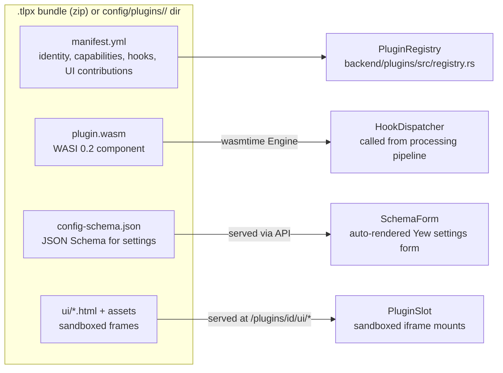
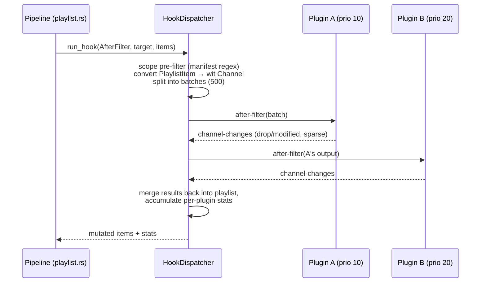
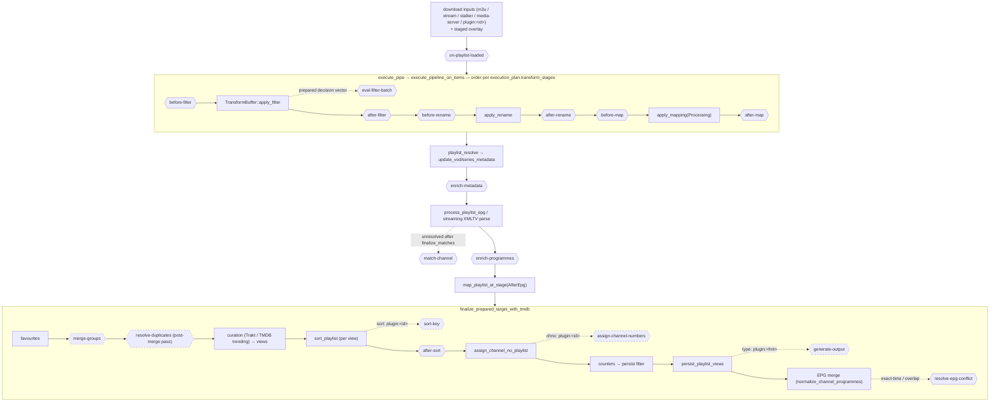
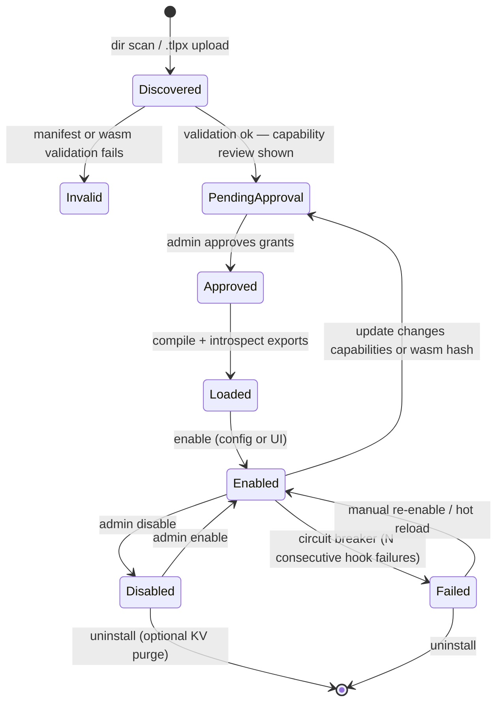
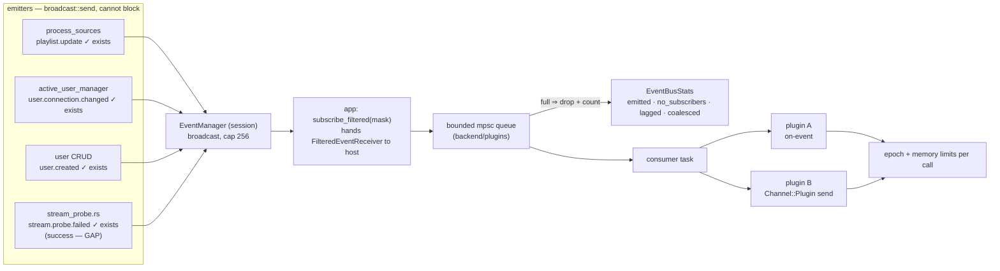
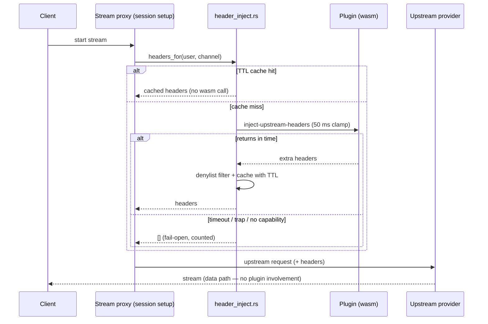
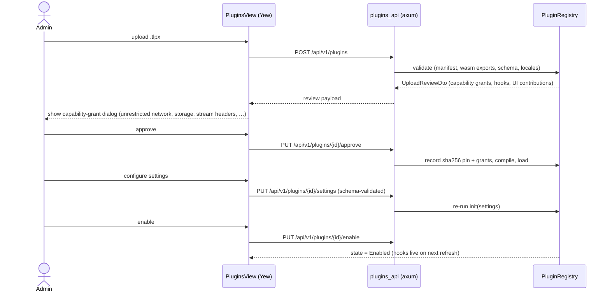
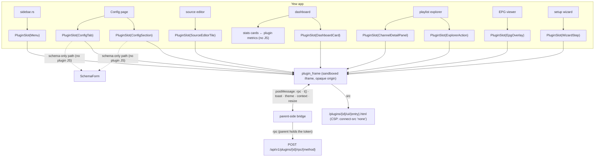

# Tuliprox Plugin System — Architecture

> Status: **Proposal / Draft — revision 4.3** (verified against `develop` at
> v3.3.170, `a8653d09`, 2026-10-30). W1–W7 implementation is complete; W8–W10
> remain planned (see the companion phases document).
> Target: WebAssembly (WASI 0.2 Component Model) plugin system with backend processing
> hooks (playlist, EPG, channel↔EPG matching, VOD metadata enrichment, lifecycle
> events, custom input providers, notification providers) and frontend UI extension
> points (menu, config section, source-editor tile, dashboard card,
> playlist-explorer actions, channel-detail panel, EPG overlay, setup-wizard step)
> rendered in sandboxed frames.

## Document map

The plan is split into three files (rev 4.3). **Section numbers are global**:
`§16` always means the phases, wherever it is referenced from.

| File | Holds | Read it when |
| --- | --- | --- |
| [`plugin-system-plan.md`](plugin-system-plan.md) | the **current design**: §1–§15, §17, §18 | designing or implementing anything |
| [`plugin-system-phases.md`](plugin-system-phases.md) | **what to do, in what order**: §16 phases, §19 agent execution strategy | planning or running a phase/wave |
| [`plugin-system-history.md`](plugin-system-history.md) | **why it looks like this**: revision notes, §2.5, §2.6 (every correction and the code fact behind it) | re-verifying against the code, or questioning a decision |

Agent briefs (§19.7) name the file and section. The design file carries no revision
history, so an agent reading it gets only the current design.

---

## Table of Contents

1. [Goals & Non-Goals](#1-goals--non-goals)
2. [Why WebAssembly Components](#2-why-webassembly-components) (§2.5/§2.6 → [history](plugin-system-history.md))
3. [System Overview](#3-system-overview)
4. [Plugin Package Format](#4-plugin-package-format)
5. [The Hook Contract (WIT)](#5-the-hook-contract-wit)
6. [Hook Placement in the Existing Pipeline](#6-hook-placement-in-the-existing-pipeline)
7. [Backend Runtime Design](#7-backend-runtime-design)
8. [Host Functions (what plugins can call)](#8-host-functions-what-plugins-can-call)
9. [Security & Resource Model](#9-security--resource-model)
10. [Management HTTP API](#10-management-http-api)
11. [Frontend Design (Yew)](#11-frontend-design-yew)
12. [Plugin Author Experience (SDK)](#12-plugin-author-experience-sdk)
13. [Example Plugins](#13-example-plugins)
14. [Complete File Change Inventory](#14-complete-file-change-inventory)
15. [Built-in Features That Could Migrate to Plugins](#15-built-in-features-that-could-migrate-to-plugins)
16. [Phased Implementation Plan](plugin-system-phases.md#16-phased-implementation-plan) → phases file
17. [Risks & Mitigations](#17-risks--mitigations)
18. [Open Questions](#18-open-questions)
19. [Execution Strategy](plugin-system-phases.md#19-execution-strategy--parallel-agents--token-budget) → phases file

---

## 1. Goals & Non-Goals

### Goals

- **Sandboxed, crash-safe extensions.** A misbehaving plugin must never crash,
  hang, or corrupt the tuliprox server. WASM gives memory isolation for free;
  epochs/fuel give CPU isolation.
- **Typed, versioned, professional contract.** Plugin authors code against a
  stable WIT interface, not ad-hoc JSON blobs. The host refuses plugins built
  against an incompatible ABI major version.
- **Multi-language authoring.** Rust first-class (SDK crate + macro), but the
  WIT world is equally implementable from TinyGo, Python (componentize-py),
  and JavaScript (ComponentizeJS).
- **Hooks into the real pipeline** — not a parallel toy pipeline:
  - channel list processing (before/after the filter, rename and map stages,
    after sort, on load),
  - EPG ingestion and programme enrichment,
  - channel↔EPG matching (augment or override the built-in `EpgIdCache`
    smart/fuzzy matcher),
  - VOD/series metadata enrichment during resolve (TMDB-style augmentation),
  - custom filter functions callable from the existing filter DSL,
  - per-target strategy hooks: sort keys, channel-number assignment,
    duplicate resolution, group merging,
  - EPG programme transforms and merge conflict resolution,
  - custom output formats (`type: plugin:<fmt>` in target outputs),
  - upstream header/token injection at the stream-session edge (bounded),
  - lifecycle events (refresh complete, stream start/stop, user created) and
    stream health probe results as async fire-and-forget notifications,
  - notification providers (custom messaging channels beyond Telegram/Discord),
  - custom input providers (fetch/parse proprietary provider formats),
  - dashboard metrics contributed into the existing stats cards.
- **UI extensibility without forking the frontend:**
  - zero-code path: a JSON Schema that the Yew app auto-renders as a settings form,
  - advanced path: plugin HTML/JS in **sandboxed iframes** (opaque origin, `postMessage` bridge — §9) mounted into
    named extension slots (menu, config section, source-editor tile, dashboard
    card, playlist-explorer action, channel-detail panel, EPG overlay,
    setup-wizard step), with published TypeScript definitions for the bridge API
    and per-plugin i18n (locale files resolved by the host).
- **Zero overhead when disabled.** `plugins.enabled: false` (the default) must
  short-circuit before any data conversion or dispatch work happens.

### Non-Goals (v1)

- No plugin marketplace / remote registry in the initial plugin-system release
  (install is file upload or directory drop). A repository-based marketplace is
  planned after Phase 8 in Phases 9–10.
- No plugin-to-plugin communication.
- No synchronous hooks inside the streaming/proxying data path. Stream
  start/stop are exposed only as **async fire-and-forget events** on a queue —
  a plugin can observe streams but can never block or delay them. The single
  exception is `inject-upstream-headers`, which runs once at **session setup**
  (never per-chunk) under a hard 50 ms clamp with a TTL cache and fail-open
  semantics.
- No native (`.so`/`.dylib`) plugins — WASM only.

### Post-v1 marketplace direction

The marketplace is a separate management feature; it does not change the frozen
plugin ABI. Each configured source points directly to the HTTPS/raw URL of a
root-level `marketplace.json` in that repository. The catalog lists plugin
metadata and releases, including package URLs and host/API compatibility; it
does not contain package checksums or signatures. Configured repositories are
trusted by the administrator. The UI and config file manage the same repository
settings.

Marketplace installs reuse package validation, capability review and approval.
The host computes and records its own installed `plugin.wasm` hash at approval;
this detects later on-disk changes, not publisher identity. Repository removal
does not uninstall plugins. Boot-time auto-update is a separate, default-off
option and must preserve the current plugin if an update cannot be validated or
activated. See §16, Phases 9–10.

---

## 2. Why WebAssembly Components

| Option | Sandbox | Typed contract | Multi-language | Ops risk | Verdict |
| --- | --- | --- | --- | --- | --- |
| **wasmtime + WIT components** | ✅ memory + CPU | ✅ WIT, versioned | ✅ Rust/Go/Py/JS | wasmtime is Bytecode Alliance-maintained, used by Fastly/Fermyon | ✅ **chosen** |
| Extism | ✅ | ⚠️ stringly JSON in/out | ✅ | extra abstraction layer we don't control | rejected — weaker contract |
| `libloading` native | ❌ none | ⚠️ raw ABI | ❌ Rust only, exact-compiler match | plugin crash = server crash | rejected |
| Embedded scripting (Rhai/Lua) | ⚠️ partial | ❌ | ❌ | fine for snippets, wrong for "call HuggingFace with an HTTP client" plugins | rejected |

Additional reasons the Component Model specifically (vs. core-wasm + manual ABI):

- **Records, options, results, lists cross the boundary natively** — no manual
  pointer/length juggling, no hand-written (de)serializers on either side.
- **`wit-bindgen` generates both sides**: host trait impls in the backend,
  guest bindings in the SDK. The WIT file *is* the documentation.
- **WASI 0.2 is the ecosystem direction**; tooling (`cargo component`,
  `wasm-tools`, `componentize-py`) is stable.

---

## 3. System Overview

A plugin is a bundle of up to three artifacts. All are optional except the
manifest, so a plugin can be backend-only, UI-only, or both.



Runtime data flow for a playlist refresh with two active plugins:



Key structural decisions:

- **Batching + scoping.** Playlists can exceed 100k items. The host never sends
  the full unscoped playlist into guest memory. The manifest `scope` (group /
  name / type regexes) is applied host-side; matching items are streamed in
  batches (default 500, tunable).
- **Priority chaining.** Plugins declare a priority; for the same hook, plugin
  B receives plugin A's output. Deterministic, debuggable.
- **Fail-open.** A trapped/erroring hook logs, increments a failure counter,
  and the pipeline continues with unmodified data. After N consecutive failures
  the plugin is auto-disabled (circuit breaker). A plugin may opt into
  `fail_mode: abort-target` if its transformation is correctness-critical.

---

## 4. Plugin Package Format

Distributed as `.tlpx` (a zip with a fixed layout) or dropped unpacked into
`config/plugins/<id>/`:

```text
sports-enricher/
├── manifest.yml           # required
├── plugin.wasm            # optional — backend hooks
├── config-schema.json     # optional — drives auto-generated settings form
└── ui/                    # optional — custom UI
    ├── sports-guide.html  # frame entry documents (one per contribution or shared)
    ├── ui.js              # loaded by the entry documents; may define custom elements inside the frame
    └── assets/…           # css, images, fonts
```

### manifest.yml — full annotated example

```yaml
id: sports-enricher            # unique, ^[a-z][a-z0-9-]{2,40}$
name: Sports Channel Enricher
version: 1.2.0                 # semver, plugin's own version
api_version: 1                 # host ABI major version this was built against
author: Jane Doe <jane@example.com>
homepage: https://github.com/janedoe/tuliprox-sports-enricher
description: >
  Groups sport channels by sport, enriches EPG with live fixture data.
min_tuliprox_version: "3.4.0"  # optional gate

capabilities:                  # explicit grants — admin approves at install time
  network: true                # unrestricted HTTP/HTTPS destinations once granted
  storage: true                # per-plugin persistent KV store
  epg_write: true              # may inject/modify programmes
  image_cache: true            # may use the host image cache (cache-image host fn)
  notifications: false         # may register as a notification provider
  stream_headers: true         # may inject headers into upstream requests (session edge)

hooks:                         # must match the wasm component's exports (table below)
  - playlist.after-filter
  - playlist.after-sort
  - playlist.enrich-metadata   # VOD/series metadata enrichment
  - playlist.sort-key          # custom sort strategy (opt-in per target)
  - playlist.assign-chno       # custom channel-number strategy (opt-in per target)
  - playlist.resolve-duplicates # pick keepers among duplicate channels
  - playlist.merge-groups      # custom group-merge strategy (opt-in per target)
  - filter.eval-fn             # custom functions for the filter DSL
  - stream.inject-headers      # upstream header injection (session edge, bounded)
  - epg.enrich-programmes
  - epg.match-channel
  - epg.transform-programmes   # global per-source programme transform
  - epg.resolve-conflict       # EPG merge conflict resolution
  - events.on-event            # lifecycle events; which ones is `events:` below
  - metrics.collect            # contribute metrics to the dashboard stats cards
  - tasks.run                  # scheduled background work (see tasks: below)
  - rpc.call                   # functions named in ui.rpc_exports (UI frames, MCP)

events:                        # EventKind wire names (43 today); required iff events.on-event
  - playlist.update            # a finished refresh
  - user.connection.changed    # stream start/stop
  - stream.probe.failed        # dead streams (NotFound | Unreachable)

tasks:                         # scheduled plugin tasks (§7) — run by the host scheduler
  - id: refresh-fixtures       # ^[a-z][a-z0-9-]{1,40}$, unique per plugin
    title: "Refresh fixture cache"
    default_schedule: "0 0 4 * * *"   # suggestion only; the operator's config decides
    max_exec_ms: 60000         # tasks get their own, larger deadline (host-clamped)
    concurrency: skip          # skip (default) | queue — if the previous run is still going
    respect_maintenance: true  # default; skip fires during global maintenance

# provides:                    # optional registrations (§18 Q6: unit variant + id field)
#   input_type: true           #   source.yml: `type: plugin` + `plugin: <this id>`
#   output_format: my-format   #   target output: `type: plugin` + `plugin: <this id>`, format id my-format

scope:                         # host-side pre-filter; omit = all items
  groups: ["(?i)sport"]        # regex on group
  item_types: [live]           # live | movie | series | ...

ui:
  config_section:
    schema: config-schema.json # rendered by SchemaForm, zero JS needed
  config_extensions:           # inject extra fields into EXISTING config sections
    - section: webhooks        # built-in section id (webhooks | proxy | schedules | …)
      schema:                  # inline JSON-Schema fragment, rendered inside that section
        type: object
        properties:
          notify_sports_events: { type: boolean, title: "Notify on sport events" }
  config_tab:                  # a full new tab on the Config page
    title: "Sports"            # or title_key
    icon: trophy
    schema: sports-tab-schema.json   # schema-driven tab …
    # element: ui/sports-tab.html    # … or a sandboxed frame (mutually exclusive)
  locales: [en, de, fr]        # translation files at ui/locales/<lang>.json; en is the fallback
  contributions:               # advanced: sandboxed frames from ui/*.html
    - slot: menu               # menu | config-section | config-tab | source-editor-tile
                               # | dashboard-card | playlist-explorer-action
                               # | channel-detail-panel | epg-overlay | setup-wizard-step
      title: "Sports Guide"    # literal fallback
      title_key: menu.title    # optional i18n key resolved from ui/locales/*
      icon: trophy             # existing svg_icon name or plugin asset path
      element: ui/sports-guide.html
    - slot: source-editor-tile
      title: "Sports Enricher"
      element: ui/sports-tile.html
  rpc_exports:                 # functions callable via POST …/rpc/{method} (UI frames, MCP)
    - name: get-fixtures
      kind: read               # read | write — write needs SystemWrite and is never MCP-exposed read-only
      mcp: true                # offer as an MCP tool (§7); still off until the admin enables it
      description: "Upcoming fixtures for the tracked leagues"
      input_schema: rpc/get-fixtures.schema.json   # JSON Schema for the payload; required when mcp: true

resources:
  max_memory_mb: 64            # StoreLimits cap (host clamps to plugins.max_memory)
  max_exec_ms: 5000            # per-hook-call epoch deadline (host clamps to plugins.max_exec)
  max_instances: 4             # concurrent instances of this plugin (host clamps to plugins.max_instances)
  fail_mode: continue          # continue (default) | abort-target
```

**Hook ids (frozen W2, 2026-10-30).** Every `hooks:` id maps to exactly one WIT
interface (§5). The manifest must list an id **iff** the component exports its
interface (§5 *How the host loads*). `lifecycle` is always exported and has no
id.

| `hooks:` id | WIT interface (`tuliprox:plugin/…@1.0.0`) | Also requires |
| --- | --- | --- |
| `playlist.{before,after}-{filter,rename,map}` (6 ids) | `playlist-hooks` (`on-stage`) | — |
| `playlist.loaded` | `source-hooks` | — |
| `playlist.after-sort` | `sort-hooks` | — |
| `playlist.enrich-metadata` | `metadata-hooks` | — |
| `playlist.sort-key` | `sort-key-hooks` | — |
| `playlist.assign-chno` | `chno-hooks` | — |
| `playlist.resolve-duplicates` | `dedupe-hooks` | — |
| `playlist.merge-groups` | `group-merge-hooks` | — |
| `filter.eval-fn` | `filter-hooks` | — |
| `stream.inject-headers` | `stream-hooks` | `capabilities.stream_headers` |
| `epg.loaded` | `epg-load-hooks` | — |
| `epg.transform-programmes` | `epg-transform-hooks` | `capabilities.epg_write` |
| `epg.enrich-programmes` | `epg-enrich-hooks` | `capabilities.epg_write` |
| `epg.match-channel` | `epg-match-hooks` | — |
| `epg.resolve-conflict` | `epg-conflict-hooks` | — |
| `events.on-event` | `event-hooks` | a non-empty `events:` list |
| `metrics.collect` | `metrics-hooks` | — |
| `notifications.send` | `notification-hooks` | `capabilities.notifications` |
| `input.fetch` | `input-provider` | `provides.input_type` |
| `output.render` | `output-generator` | `provides.output_format` |
| `rpc.call` | `rpc` | a non-empty `ui.rpc_exports` |
| `tasks.run` | `tasks` | a non-empty `tasks:` list |

The six stage ids share one interface. Listing any of them means the component
exports `playlist-hooks`, and the host calls `on-stage` only for the listed
stages. Ids are case-sensitive. Phase S's bare `after-filter` spelling is
retired: a bare stage name is a load error that names the dotted form.

Validation performed at install/load time:

1. YAML parse + field constraints (id regex, semver, known slots/hooks, the
   "Also requires" column above, `events:` wire names via
   `EventKindMask::from_wire_names`, unique task ids and rpc export names).
   Errors aggregate (`impl Prepare`), so one load reports every problem.
2. `api_version` == host ABI major (`1`). A newer major is rejected, and so is
   an older one: there is no older one.
3. If `plugin.wasm` present: component introspection — every declared hook must
   exist as an export, and every exported hook interface the host knows needs a
   declared hook id (§5 *How the host loads*: "iff"; a load error). Exports the
   host does not know are ignored. *(W6b re-anchor: rev 4 said undeclared
   exports were ignored with a warning; the W3 code, kept since, rejects them.)*
4. If `config-schema.json` present: must be a valid JSON Schema (draft 2020-12
   subset — see §11); secret properties (`writeOnly` / `format: password`) must
   not carry a `default` (§9).
5. If `ui.locales` present: each declared locale file must exist and parse as a
   flat string map; `title_key`s must resolve in the fallback locale.
6. If `ui.config_extensions` present: every `section` id must be a known
   built-in config section; schema fragments obey the same SchemaForm subset.
   `ui.config_tab` must declare exactly one of `schema` / `element`.
7. Capability review payload is generated for the admin UI (unrestricted
   network access, storage, epg write, image cache, stream-header injection,
   notification-provider, input-type and output-format registration the
   plugin wants).

*(W6b re-anchor, 2026-10-30.)* Steps 1–3 exist. Step 4 checks secret
defaults only. Step 5 checks locale codes, not the files, and step 6 checks the
section id syntax, not the id against the built-in list (`unknown_config_sections`
has no caller). Step 7 does not exist. W6b 5.1b completes 4–7, both at upload
and at load (§18 *W6b seam freeze*).

---

## 5. The Hook Contract (WIT)

A new workspace crate `plugins/plugin-api/` owns the WIT package. It is the single
source of truth; both host bindings (backend) and guest bindings (SDK) are
generated from it.

> **Frozen W2 (2026-10-30), ABI `1.0.0`.** The block below is a copy of
> [`plugins/plugin-api/wit/tuliprox-plugin.wit`](plugins/plugin-api/wit/tuliprox-plugin.wit),
> which wins on any difference. §18 *W2 full freeze* lists every change
> against the rev 4 draft.

```wit
// Tuliprox plugin contract, ABI 1.0.0 — FROZEN (W2, 2026-10-30).
//
// Source of truth: plugin-system-plan.md §5 and §18 "WIT freeze" (W0 memo,
// W1 amendment `channel.virtual-id` -> `handle`, W2 full freeze).
// "Frozen" means no breaking edits from here on. A 1.x addition is a NEW
// interface (e.g. `sort-hooks-v1-1`) plus a new world; existing interfaces,
// records and worlds never change. Every WIT edit goes through the W2 owner.
//
// The `wasi:*@0.2.12` packages under `deps/` are copied verbatim from
// wasmtime-wasi-http 50.0.1, which is the host runtime the contract is pinned to.
//
// Conventions:
// - Every hook returns `result<_, string>`. `err` is treated exactly like a
//   trap: fail-open (or abort under `fail_mode: abort-target`), logged, counted.
// - `handle` is a host-issued per-call index, meaningless across calls. Results
//   naming an unknown handle are logged and ignored; for a repeated handle the
//   first entry wins.
// - Within one interface every function is mandatory, so interfaces stay
//   single-purpose and a plugin exports only what it implements.
package tuliprox:plugin@1.0.0;

// FROZEN W0. Only the types base + playlist-plugin need; it never grows.
interface types {
  enum item-type {                 // == shared::model::PlaylistItemType (11)
    live, video, series, series-info, catchup,
    live-unknown, live-hls, live-dash,
    local-video, local-series, local-series-info,
  }
  enum cluster { live, video, series }   // == XtreamCluster
  enum log-level { trace, debug, info, warn, error }

  record channel {
    handle: u32,                   // host-issued, unique within one call; read-only (W1 fix)
    name: string,
    title: string,
    group: string,
    url: string,
    epg-id: option<string>,        // PlaylistItemHeader.epg_channel_id
    logo: string,
    chno: option<u32>,             // PlaylistItemHeader.chno; 0 <-> none
    item-type: item-type,          // read-only
    cluster: cluster,              // read-only
    input-name: string,            // read-only
    input-stream-id: string,       // read-only (frozen origin id)
    extra: list<tuple<string, string>>,  // host->guest only in 1.0; ignored on return
  }

  // Sparse result: ids not mentioned are kept unchanged.
  variant channel-change {
    drop(u32),                     // handle
    modified(channel),             // identified by channel.handle
  }
}

// Shared by the dashboard metric and notification records.
interface status {
  enum severity { info, warn, error }
}

// EPG records, shared by the epg-* hooks and input-provider.
interface epg-types {
  record epg-channel {
    id: string,                    // compared case-insensitively
    names: list<string>,           // XMLTV display-names
    icon: option<string>,
  }

  record epg-category { value: string, lang: option<string> }

  // == shared::model::EpgProgramme. The channel id is transient host-side
  // (#[serde(skip)]); the host re-attaches it on return.
  record epg-programme {
    channel: string,               // epg channel id; compared case-insensitively
    start: s64,                    // unix seconds
    stop: s64,
    title: option<string>,
    description: option<string>,   // EpgProgramme.desc
    categories: list<epg-category>,
    catchup-id: option<string>,
    icon: option<string>,
    is-live: bool,
    is-new: bool,
    previously-shown: bool,
    extra: list<tuple<string, string>>,  // host->guest only in 1.0; ignored on return
  }
}

// ——— functions the HOST provides to every plugin (FROZEN W0) ———
interface host {
  use types.{log-level};

  variant kv-error { quota-exceeded, key-too-large, value-too-large, unavailable(string) }

  log: func(level: log-level, msg: string);   // rate-limited; excess dropped + counted
  kv-get: func(key: string) -> result<option<list<u8>>, kv-error>;
  kv-set: func(key: string, value: list<u8>) -> result<_, kv-error>;
  kv-delete: func(key: string) -> result<_, kv-error>;
  get-config: func() -> string;    // settings JSON, secrets resolved, own instance only
  now-unix: func() -> s64;         // tuliprox_core::utils::clock::Clock
  cache-image: func(url: string) -> result<string, string>;  // -> locally served URL
}

// ——— lifecycle: every plugin exports this (FROZEN W0) ———
interface lifecycle {
  // once per instantiation with the settings JSON; err disables the instance
  init: func(settings: string) -> result<_, string>;
}

// ——— playlist pipeline (FROZEN W0) ———
// manifest: playlist.{before,after}-{filter,rename,map}
interface playlist-hooks {
  use types.{channel, channel-change};

  // Closed by TransformStage {Filter, Rename, Map}. A new stage is a new interface.
  enum stage { before-filter, after-filter, before-rename, after-rename, before-map, after-map }

  // Called only for stages the manifest `hooks:` lists (`after-filter`, ...).
  // The host may batch: several calls per stage per target, disjoint subsets.
  on-stage: func(stage: stage, target: string, channels: list<channel>)
      -> result<list<channel-change>, string>;
}

// manifest: playlist.loaded — after an input downloaded, before target processing
interface source-hooks {
  use types.{channel, channel-change};
  on-playlist-loaded: func(input-name: string, channels: list<channel>)
      -> result<list<channel-change>, string>;
}

// manifest: playlist.after-sort — once per finalized view (base, and Xtream when curated)
interface sort-hooks {
  use types.{channel};
  // Handles in the new order. Handles not listed keep their relative order
  // after the listed ones; the returned order is authoritative for the batch.
  after-sort: func(target: string, channels: list<channel>) -> result<list<u32>, string>;
}

// manifest: playlist.enrich-metadata — inside update_vod_metadata /
// update_series_metadata, before persistence; non-fatal like TMDB failures
interface metadata-hooks {
  use types.{channel};
  // `metadata-json` is the resolved TMDB-style info; return amended JSON or none
  enrich-metadata: func(item: channel, metadata-json: string)
      -> result<option<string>, string>;
}

// ——— per-target strategies, opt-in via target config (prepare -> apply) ———
// manifest: playlist.sort-key
interface sort-key-hooks {
  use types.{channel};
  // index-aligned with `channels`; the host stable-sorts by the returned keys
  sort-key: func(target: string, channels: list<channel>) -> result<list<string>, string>;
}

// manifest: playlist.assign-chno
interface chno-hooks {
  use types.{channel};
  // (handle, chno) pairs; unlisted channels keep host numbering; chno 0 is ignored
  assign-channel-numbers: func(target: string, channels: list<channel>)
      -> result<list<tuple<u32, u32>>, string>;
}

// manifest: playlist.resolve-duplicates — overrides the post-merge content
// dedup pass only (DeduplicateConfig), before curation
interface dedupe-hooks {
  use types.{channel};
  record duplicate-group {
    key: string,                   // normalized dedupe key (name/url based)
    channels: list<channel>,
  }
  // handles to KEEP in preference order; the rest of the group is dropped.
  // An empty list means "host default" for that group.
  resolve-duplicates: func(target: string, group: duplicate-group)
      -> result<list<u32>, string>;
}

// manifest: playlist.merge-groups
interface group-merge-hooks {
  // canonical group name -> member group names merged under it
  merge-groups: func(target: string, groups: list<string>)
      -> result<list<tuple<string, list<string>>>, string>;
}

// manifest: filter.eval-fn — decisions are materialized before the sync
// built-in Filter evaluator runs (Leaf::PluginCall)
interface filter-hooks {
  use types.{channel};
  // result positions correspond to input positions
  eval-filter-batch: func(name: string, channels: list<channel>, args: list<string>)
      -> result<list<bool>, string>;
}

// ——— EPG: one interface per hook, so a matcher need not stub a transformer ———
// manifest: epg.loaded — per source, on the parsed channel list, before
// register_guide_names / match_epg_channel_candidates
interface epg-load-hooks {
  use epg-types.{epg-channel};
  // sparse: channels not returned are kept; a returned id replaces names/icon
  on-epg-loaded: func(source: string, channels: list<epg-channel>)
      -> result<list<epg-channel>, string>;
}

// manifest: epg.transform-programmes — per bounded batch while the streaming
// parser builds a source, never the whole source in guest memory
interface epg-transform-hooks {
  use epg-types.{epg-programme};
  // returns the batch to keep, in order (may drop, rewrite or add)
  transform-programmes: func(source: string, programmes: list<epg-programme>)
      -> result<list<epg-programme>, string>;
}

// manifest: epg.enrich-programmes — inject/modify one channel's programmes
interface epg-enrich-hooks {
  use epg-types.{epg-programme};
  enrich-programmes: func(channel-id: string, programmes: list<epg-programme>)
      -> result<list<epg-programme>, string>;
}

// manifest: epg.match-channel — second pass over the channels the built-in
// matcher left unresolved; results go through the same ambiguity and
// case-adoption rules (§7 prepare -> apply)
interface epg-match-hooks {
  use types.{channel};
  use epg-types.{epg-channel};
  record match-request {
    chan: channel,
    candidates: list<epg-channel>, // top-K shortlist from the built-in index
  }
  // index-aligned with `requests`: the winning epg-channel id, or none
  match-channels: func(requests: list<match-request>)
      -> result<list<option<string>>, string>;
}

// manifest: epg.resolve-conflict — v1.x (needs the blocking-thread bridge, §7)
interface epg-conflict-hooks {
  use epg-types.{epg-programme};
  // The host only collapses EXACT start/stop collisions today (priority
  // backfill); partial overlaps are all kept. `overlap` is new with this hook.
  enum conflict-kind { exact-time, overlap }
  record epg-conflict {
    channel-id: string,
    kind: conflict-kind,
    candidates: list<epg-programme>,
  }
  // candidate index to keep, or none for the host default
  resolve-conflict: func(conflict: epg-conflict) -> result<option<u32>, string>;
}

// ——— session edge: strictly bounded (50 ms clamp, TTL-cached, fail-open) ———
// manifest: stream.inject-headers (capability stream_headers)
interface stream-hooks {
  record upstream-request {
    // At the session edge virtual ids DO exist: this is the persisted
    // VirtualId from the stream URL, unlike the pipeline `handle`.
    virtual-id: u32,
    url: string,
    headers: list<tuple<string, string>>,
    user: string,                  // requesting api-user name
  }
  // extra headers; connection-control headers are dropped by the host
  inject-upstream-headers: func(req: upstream-request)
      -> result<list<tuple<string, string>>, string>;
}

// ——— async lifecycle events (fire-and-forget, queued, never block emitters) ———
// manifest: events.on-event + `events:` wire names
interface event-hooks {
  record event {
    kind: string,                  // EventKind::as_wire_name(), e.g. "playlist.update"
    payload: string,               // EventMessage::payload() — JSON
    timestamp: s64,                // unix seconds
  }
  on-event: func(ev: event) -> result<_, string>;
}

// ——— dashboard metrics: polled (throttled) by the host ———
// manifest: metrics.collect
interface metrics-hooks {
  use status.{severity};
  record metric {
    key: string,                   // namespaced by the host as <plugin-id>.<key>
    label: string,                 // display label or ui/locales i18n key
    value: string,                 // preformatted
    unit: option<string>,
    severity: option<severity>,    // drives the card accent
  }
  collect-metrics: func() -> result<list<metric>, string>;
}

// ——— notification channel (Channel::Plugin) ———
// manifest: notifications.send (capability notifications)
interface notification-hooks {
  use status.{severity};
  record notification {
    title: string,
    body: string,
    severity: severity,
    payload: string,               // raw event JSON for rich formatting
  }
  // maps onto messaging's Delivery; the outbox owns all retrying
  variant delivery-error {
    transient(string),             // Delivery::Retry, outbox backoff
    retry-after(u32),              // Delivery::Retry with an explicit delay (seconds)
    permanent(string),             // Delivery::Permanent
  }
  send-notification: func(msg: notification) -> result<_, delivery-error>;
}

// ——— custom input type: `type: plugin` + `plugin: <id>` in source.yml ———
// manifest: input.fetch (provides.input_type)
interface input-provider {
  use types.{channel};
  use epg-types.{epg-channel, epg-programme};
  record input-request {
    input-name: string,
    url: string,
    username: option<string>,
    password: option<string>,
    options: list<tuple<string, string>>,
  }
  // returned handles are ignored; the host issues its own
  fetch-playlist: func(req: input-request) -> result<list<channel>, string>;
  // ok([]) when the provider has no EPG
  fetch-epg: func(req: input-request)
      -> result<list<tuple<epg-channel, list<epg-programme>>>, string>;
}

// ——— custom output format: `type: plugin` + `plugin: <id>` in a target output ———
// manifest: output.render (provides.output_format). One instance per output
// file, so begin/render/finish may keep state.
interface output-generator {
  use types.{channel};
  record output-request {
    target: string,
    format: string,                // provides.output_format
    options: list<tuple<string, string>>,
  }
  begin-output: func(req: output-request) -> result<list<u8>, string>;  // header bytes
  render-batch: func(channels: list<channel>) -> result<list<u8>, string>;
  finish-output: func() -> result<list<u8>, string>;                    // trailer bytes
}

// ——— rpc: functions named in manifest ui.rpc_exports (UI frames + MCP tools) ———
// manifest: rpc.call
interface rpc {
  // method = rpc_exports[].name; payload/result are JSON, the payload already
  // validated by the host against the declared input_schema
  call: func(method: string, payload: string) -> result<string, string>;
}

// ——— scheduled tasks: run by the host scheduler, outside any pipeline run ———
// manifest: tasks.run + `tasks:`
interface tasks {
  record task-context {
    task-id: string,               // manifest tasks[].id
    scheduled-at: s64,             // the cron fire time (unix seconds); now for a manual run
    last-success-at: option<s64>,  // host-tracked, for incremental work
  }
  // ok(summary) is shown in the UI and stats; err publishes scheduled_task.failed
  run: func(ctx: task-context) -> result<string, string>;
}

// ——— worlds: ONE PER CAPABILITY ———
// `base` carries the imports + lifecycle; each capability world adds exactly
// one export. A plugin needing several capabilities declares a small composite
// world itself (or uses `enricher-plugin`). The host never assumes a world: it
// binds per interface and discovers exports at load time.
world base {
  import host;
  import wasi:http/outgoing-handler@0.2.12;  // = wasmtime-wasi-http 50.0.1
  export lifecycle;
}
world playlist-plugin      { include base; export playlist-hooks; }
world source-plugin        { include base; export source-hooks; }
world sort-plugin          { include base; export sort-hooks; }
world metadata-plugin      { include base; export metadata-hooks; }
world sort-key-plugin      { include base; export sort-key-hooks; }
world chno-plugin          { include base; export chno-hooks; }
world dedupe-plugin        { include base; export dedupe-hooks; }
world group-merge-plugin   { include base; export group-merge-hooks; }
world filter-plugin        { include base; export filter-hooks; }
world epg-load-plugin      { include base; export epg-load-hooks; }
world epg-transform-plugin { include base; export epg-transform-hooks; }
world epg-enrich-plugin    { include base; export epg-enrich-hooks; }
world epg-match-plugin     { include base; export epg-match-hooks; }
world epg-conflict-plugin  { include base; export epg-conflict-hooks; }
world stream-plugin        { include base; export stream-hooks; }
world event-plugin         { include base; export event-hooks; }
world metrics-plugin       { include base; export metrics-hooks; }
world notifier-plugin      { include base; export notification-hooks; }
world input-plugin         { include base; export input-provider; }
world output-plugin        { include base; export output-generator; }
world rpc-plugin           { include base; export rpc; }
world task-plugin          { include base; export tasks; }

// convenience composite shipped with the SDK (authors may define their own)
world enricher-plugin {
  include playlist-plugin;
  include metadata-plugin;
  include epg-enrich-plugin;
  include event-plugin;
  include task-plugin;
  include rpc-plugin;
}
```

**How the host loads any of these.** The host does not bind against one world.
`plugins/plugin-api` generates ONE set of host bindings over a host-only union world
(`tuliprox:host/union`, defined inline in `plugins/plugin-api/src/lib.rs` and never
shipped to guests) that includes every capability world. That gives one set of
types and one `host::Host` impl. The union's world-level `UnionPre` is never
used, because it demands every export. At load time the registry instead calls
`exports::tuliprox::plugin::<iface>::GuestIndices::new(&instance_pre)` for each
entry of `plugin_api::EXPORT_INTERFACES`. A "no exported instance" error means
the hook family is absent. Exports it does not recognise are warned about and
ignored. The manifest `hooks:` list must match the discovered exports (§4 *Hook
ids*), and a mismatch is a load error, so manifest review stays honest. Export
names match exactly (`…@1.0.0`), so 1.x additions arrive as new interfaces,
never as minor bumps of existing ones.

Contract properties, explained:

- **`handle` echo (W1 fix).** The host keys items by a handle it issues for
  each call (the item's index in the batch), not by the persisted virtual id:
  virtual ids are assigned at persistence, after every pipeline hook. Plugins
  must return the handle unchanged. Results with unknown handles are dropped
  and logged. This makes result-merging O(1) and immune to reordering bugs.
  Handles are meaningless across calls, so durable plugin state keys on
  `input-stream-id` or `url` instead.
- **`extra` bags.** New host fields can be exposed without a WIT major bump —
  they appear in `extra` first, get promoted to typed fields in the next major.
- **Sparse `channel-change` results (W0 freeze).** A plugin returns only what
  it changed: `drop(handle)` removes an item and `modified(channel)` replaces
  one. Ids it does not mention are kept. Unknown ids are logged and ignored, and
  for a repeated handle the first entry wins. Host-owned fields (`handle`,
  `item-type`, `cluster`, `input-name`, `input-stream-id`) and `extra` are
  ignored on return. Hooks return `result<…, string>`, and the host treats
  `err` exactly like a trap (fail-open, logged, counted).
- **All hooks optional — by world composition, not stubs.** A plugin exports
  only the interfaces of the worlds it targets. The registry introspects
  component exports at load time and builds a dispatch table, and hooks the
  plugin doesn't export cost nothing. Within one interface every function is
  mandatory, which is why interfaces stay small and single-purpose. If an
  interface grows a function in 1.x, it ships as a *new* interface
  (`playlist-hooks-v1-1`) rather than a breaking change to the old one.
- **`init` is the fallible entry point** — bad settings (e.g. malformed HF token)
  fail loudly at load/settings-save time, not mid-pipeline.

---

## 6. Hook Placement in the Existing Pipeline

Current pipeline, re-verified at revision 4 in the `tuliprox-processing` crate.
`PL` = `backend/processing/src/processor/playlist`, `P` = `backend/processing/src/processor`:

```text
ProcessingRun::<E,B,M>::run → exec_processing()     PL/mod.rs:129 / :314
process_sources::<E,M>()                 PL/ingest/jobs.rs:520
  └─ process_source::<E,M>()             jobs.rs:251 — download_input (ingest/acquisition.rs:265:
      │                                    m3u/xtream/stalker/library/media-server/staged) → staged overlay
      └─ process_targets::<E,M>()        PL/target.rs:90 (serial or parallel)
          ├─ prepare_playlist_for_target::<E,M>()   target.rs:255   (per input)
          │    ├─ load_target_bouquet               (cluster/group prefilter)
          │    ├─ execute_pipe()                    PL/transform.rs:476 — drains source into memory
          │    │    ├─ bouquet reject + pre-transform UUID dedup (remove_duplicates, memory sources only)
          │    │    └─ execute_pipeline_on_items()  :466 — loop over execution_plan.transform_stages
          │    │         ├─ Filter → TransformBuffer::apply_filter        :359
          │    │         ├─ Rename → apply_rename                         :371
          │    │         └─ Map    → apply_mapping(Processing)            :385
          │    │         (execute_pipeline_on_groups :465 is reused by xtream_series.rs:140)
          │    ├─ playlist_resolve::<E,M>()         target.rs:604 — series → vod → playlist_probe(:684);
          │    │                                      skips inputs in maintenance
          │    ├─ process_playlist_epg()            P/epg.rs:962, called at target.rs:331 (EpgIdCache::collect_epg_id :299)
          │    ├─ map_playlist_at_stage(AfterEpg)   target.rs:336 (&mut PlaylistSource)
          │    └─ adopt_guide_live_epg_id_case :345 / clear_invalid_live_epg_ids :348 (after the AfterEpg mapping)
          └─ finalize_prepared_target::<E,M>()      target.rs:494 → _with_tmdb :509
               ├─ process_favourites()              target.rs:867
               ├─ prepare_eligible_catalog()        target.rs:427 — flatten_groups (transform.rs:604)
               │    └─ deduplicate_playlist()       P/deduplicate.rs:48 (post-merge content dedup)
               ├─ prepare_target_playlist_views()   target.rs:932 → evaluate_curation (curation/coordinator.rs:35)
               │    └─ build_curated_playlist_views :906 → base view + optional Xtream view
               ├─ finalize_playlist_view() ×views   target.rs:454 — flatten_groups ("appearance merge", :461), then
               │    │                                 FINALIZATION_ORDER.skip(2) over FinalizationStage (:221/:229)
               │    ├─ Sort                         P/sort.rs:393 → calculate_sort_plan :316 / apply_sort_plan :384
               │    ├─ AssignChannelNumbers         assign_channel_no_playlist transform.rs:39
               │    └─ AssignCounters               map_playlist_counter transform.rs:299
               │    (apply_persist_filter target.rs:237 is not an arm; it runs after the loop)
               ├─ retain_epg_referenced_by_groups → spill_epg_to_disk (:375) → merge_epg_trees (processing/src/parser/xmltv/merge.rs:427)
               ├─ persist_playlist_views()          repository/src/playlist_repository/persist.rs:48 (M3U/Xtream/Strm/HDHR)
               └─ process_watch()                   target.rs:1109
```

Structural facts about this pipeline that the hook design has to respect.
Revision 4 corrected the second and third:

- **Every stage is generic over `E: EventSink + Clone + 'static` and
  `M: MetadataUpdateSink`.** There is no `Option` to branch on and no trait
  object in the chain. The plugin handle threads the same way, as a third
  defaulted generic (see §7.0).
- **Transform stages operate on an in-memory `TransformBuffer`.** `execute_pipe`
  drains the (possibly disk-backed) source into a `Vec<PlaylistItem>` before
  the first stage. Stage hooks therefore take `&mut TransformBuffer`, and scoping
  exists to bound **guest** memory, not host memory. Two sites still see a
  `PlaylistSource`: `on-playlist-loaded` (before `execute_pipe`) and the
  `AfterEpg` mapping stage. A hook that changes `header.group` must leave the
  buffer to regroup (`GroupingPolicy` / `reorder_for_grouping`) rather than
  moving items between groups itself. Stage hooks must not be anchored in
  `execute_pipeline_on_groups`, because `xtream_series.rs:140` reuses it for
  resolved episodes and the hook would fire twice.
- **Deduplication is two passes.** Pre-transform UUID dedup runs inside
  `execute_pipe` (`remove_duplicates`). Post-merge content dedup runs in
  `prepare_eligible_catalog` through
  [`deduplicate_playlist`](backend/processing/src/processor/deduplicate.rs#L48),
  driven by `options.deduplicate: DeduplicateConfig { match_by: Caption | Name
  | Title, keep: BestQuality | First, match_as_ascii }`. `resolve-duplicates`
  overrides the **post-merge** pass's *keep* decision. It neither introduces
  a pass nor touches UUID dedup.
- **Curation sits between dedup and sort**, and can replace the catalog
  and produce a second view. Everything in `finalize_playlist_view` (sort,
  `after-sort`, chno, counters, persist filter) runs **once per view**.
- **Bouquet prefilter and maintenance run before the hooks.** Items rejected by
  the target bouquet never reach `before-filter`. Inputs in maintenance skip
  download, resolve and probe, and the plugin fetch, enrich and EPG hooks must
  check the same `MaintenanceGate`.
- **Filters and mapper scripts remain synchronous and local.** Future external
  decisions must be prepared as index-aligned batches before these evaluators
  run. No WASM or async call belongs inside `Filter::filter()` or
  `MapperScript::eval()`.
- **Sorting has a calculation/application boundary.** Built-in rules calculate
  a `SortPlan`; the host validates and applies its permutations. A future
  strategy hook supplies data to that same host-owned application step.

The same pipeline with every hook insertion point (hexagons = plugin hooks,
dashed = opt-in per target via config):



Hook insertion points (each is a 3–5 line dispatcher call):

| Hook | Insertion point | Notes |
| --- | --- | --- |
| `on-playlist-loaded` | end of `download_input`, **after** the staged overlay, before `prepare_playlist_for_target()` | per-input; runs once even if many targets consume the input; sees a `PlaylistSource` (may be disk-backed — scope before materializing) |
| `before-filter` | `execute_pipeline_on_items()` (`transform.rs:466`), immediately before the `TransformStage::Filter` arm | keyed off `TransformStage`, so it works for every `transform_stages` order. Bouquet-rejected items never arrive |
| `after-filter` | same loop, immediately after `apply_filter` | this is where the sports plugin regroups channels — via the buffer's regrouping, not by moving items itself |
| `on-epg-loaded` | inside the streaming parser — `process_epg_file` (`processing/src/parser/xmltv/xml.rs:170`) / `process_ics_file` (`calendar.rs:11`) — per source, before `register_guide_names` / `match_epg_channel_candidates` | the `EpgIdCache` is already seeded; channel names normalized here still influence matching. Needs a small buffered per-source pass because the parser streams |
| `match-channel` | the unresolved branch of `assign_live_channel_epg` (`epg.rs:781`) / `assign_smart_epg_id` (`:691`), after `finalize_matches` | top-K shortlist from `EpgIdCache.normalized` + DoubleMetaphone (`EpgIdCache.phonetics` / `.metaphone`, epg.rs:94/:103). A plugin result passes through the same `SmartMatchRank` ambiguity rules, `adopt_guide_live_epg_id_case` and `clear_invalid_live_epg_ids` as a built-in match |
| `enrich-programmes` | after `process_playlist_epg` (`target.rs:331`), before `AfterEpg` mapping (`:336`) | injected programmes flow into the unchanged `spill_epg_to_disk` → `finish_into_disk` → `merge_epg_trees` path. Injected channels need a `source_ordinal`, because XMLTV output is now ordered by it (`epg_repository.rs:41`) |
| `before-rename` / `after-rename` | same loop, around `apply_rename` | stage-anchored like filter |
| `before-map` / `after-map` | same loop, around `apply_mapping(MappingStage::Processing)` | the `AfterEpg` mapping stage is covered by the EPG hooks instead |
| `enrich-metadata` | inside `update_vod_metadata` (`xtream_vod.rs:552`) / `update_series_metadata` (`xtream_series.rs:652`), after the provider fetch and TMDB fact patch, before `persist_input_vod_info*` | these two fns serve both the inline resolve and the background `metadata` worker, so one hook covers both. Non-fatal, like TMDB since #886. Ordered before `playlist_probe` |
| `eval-filter-batch` | before synchronous filter retention | plugin receives a scoped channel batch and returns an index-aligned decision vector; the host validates its length, then combines it with built-in filter results. Failure follows the configured fail-open/fail-closed policy without calling WASM per item. Applies to `StagedFilter.processing`. The `persist` filter runs after counters and is out of scope for v1 |
| `merge-groups` | `flatten_groups` inside `prepare_eligible_catalog` (`target.rs:427`), when the target declares `group_merge: plugin:<id>` | pre-curation, so curation sees merged groups. The second `flatten_groups` in `finalize_playlist_view` is an appearance merge and is not hooked |
| `resolve-duplicates` | the **existing post-merge** pass, `deduplicate_playlist` (`deduplicate.rs:48`), when `options.deduplicate` selects `plugin:<id>` | the host groups by its quality-token-normalized key; the plugin replaces the `DeduplicateKeep` decision, returning keepers in preference order. Runs per cluster, before curation |
| `sort-key` | `calculate_sort_plan` (`sort.rs:316`) when `ConfigSort` selects `plugin:<id>` | plugin returns index-aligned keys; the host calculates/validates a permutation and applies it through the same `apply_sort_plan` boundary as built-in `SortPlan` values. Runs per view |
| `after-sort` | `finalize_playlist_view` (`target.rs:454`), between the Sort and AssignChannelNumbers arms | reordering hook; runs before channel numbers so custom order gets correct chnos. **Fires once per view** (base + curated Xtream) |
| `assign-channel-numbers` | replaces `assign_channel_no_playlist()` (`transform.rs:39`) when the target declares `chno: plugin:<id>` | unlisted channels fall back to host numbering. Must be stable across both views of a target |
| `transform-programmes` | `process_epg_file`, per batch as programmes are built (`EpgProgramme::new_all`, `xml.rs:143`) | batched like playlist hooks; never the whole source at once |
| `resolve-epg-conflict` | `normalize_channel_programmes` in `processing/src/parser/xmltv/merge.rs`, per channel | `none` ⇒ today's behaviour (exact-time collapse with priority backfill; overlaps kept). Overlap detection is new work the hook brings |
| `generate-output` (`begin` / `render-batch` / `finish`) | `persist_playlist_views` (`repository/src/playlist_repository/persist.rs:48`) for outputs declared `type: plugin:<fmt>` | host streams scoped channel batches and writes returned bytes to the target output file; a failed generation marks only that output as failed |

Most of these insertion points are **synchronous** functions. How each one
reaches an async plugin call (lifted loop, prepare → apply, or blocking bridge)
is fixed in §7 *Sync/async boundary*. A row here never implies awaiting inside
a sync fn.

Hooks **outside** the per-target pipeline:

| Hook | Emission point | Semantics |
| --- | --- | --- |
| `on-event(playlist.update)` | **already emitted.** `EventKind::PlaylistUpdate` carries `PlaylistUpdateSummary { state, stats, error }` at the end of a run | the plan's "refresh-complete": subscribe, nothing to emit |
| `on-event(user.connection.changed)` | **already emitted** from `backend/session/src/active_user_manager/{observability,expiry}.rs` and `connection_manager/cleanup.rs` as `ActiveUserConnectionChange::{Updated, Disconnected, DisconnectedStream, Connections}` | the plan's "stream-start/stop". Already off the data path — emitters call `broadcast::send`, which cannot block |
| `on-event(user.created / user.updated / user.deleted)` | **already emitted** (rev 4) — `EventMessage::UserLifecycle` from [`v1_api_user.rs:206/298`](backend/app/src/api/endpoints/v1_api_user.rs#L206) | subscribe; nothing to build |
| `on-event(stream.probe.failed)` | **already emitted** (rev 4) — `StreamProbeFailed(StreamProbeFailure { input, unique_id, url, reason })` from [`stream_probe.rs:165`](backend/processing/src/processor/stream_probe.rs#L165), NotFound / Unreachable only | covers "alert on dead stream" today via `on-event` |
| `on-probe-result` (success + stats) | **remaining gap** — the success arm of `stream_probe.rs` writes quality to the item store and publishes nothing | needs a shared `EventKind` carrying `MediaQuality` + `ProbeStreamStats` (§5). Add it with its first consumer — not speculatively. Until then the typed export is unnecessary; `on-event` suffices |
| `collect-metrics` | polled by the status/stats endpoint when the dashboard requests data (throttled, cached ~10 s) | read-only pull; a slow/failing plugin yields an empty metric set for that cycle |
| `send-notification` | a `Channel::Plugin` variant in [`backend/messaging/src/channels/`](backend/messaging/src/channels/mod.rs), reached through the same `delegate!` dispatch as the eight built-in channels | plugins with the `notifications` capability become selectable channels, inheriting routing, suppression, rate limiting and the outbox (§7) |
| `inject-upstream-headers` | upstream request construction at stream-session start (proxy edge), once per session. *Re-anchored W6a:* that is `create_stream_response_details` (`backend/app/src/api/api_utils/streaming.rs`), which feeds `ProviderStreamFactoryParams` → `ProviderStreamFactoryOptions::new` → `get_request_headers` (`provider_stream_factory/options.rs`) → `prepare_client` (`request.rs`). It is in `app`, not `session` | synchronous but hard-clamped (50 ms); result cached per (plugin, user, channel) with TTL; failure/timeout ⇒ no extra headers; requires the `stream_headers` capability |
| `fetch-playlist` / `fetch-epg` | the input download stage — inputs declared as `type: plugin:<id>` in source.yml bypass the built-in downloaders and route to the providing plugin | returned channels/EPG enter the normal pipeline exactly like a built-in input |

Strategy hooks (`sort-key`, `assign-channel-numbers`, `resolve-duplicates`,
`merge-groups`) and plugin outputs are **opt-in per target**, validated against
the registry at config load. Two of them extend config that already exists
rather than adding fields (rev 4):

- `sort-key`: a `plugin:<id>` variant of the existing `ConfigSort` /
  `ConfigSortDto` (`target.sort`).
- `resolve-duplicates`: a `plugin:<id>` keep strategy inside the existing
  `options.deduplicate: DeduplicateConfig`.
- `assign-channel-numbers` and `merge-groups`: new optional fields
  `chno: plugin:<id>` and `group_merge: plugin:<id>`.
- outputs: `type: plugin:<fmt>`.

Every new field also needs a slot in `TargetExecutionPlan`, so the
precomputed plan stays the single source of truth for what runs. Unlike the
always-on stage hooks, these never run unless a target explicitly selects them.

Curation (`evaluate_curation`) is **not** hooked in v1. It is a source-neutral
kernel with adapters, so a plugin curation source would be a third adapter
behind its own interface. That is listed in §18, not designed here.

---

## 7. Backend Runtime Design

### 7.0 Crate placement and the static-dispatch seam

Revision 1 put everything in `backend/src/plugins/`. That module no longer has a
crate to live in: four separate crates call into the plugin host, and the
verified dependency edges are

```text
shared        ← (none)                  mpegts, btree ← (none)
media-server  ← shared
core          ← shared, media-server, mpegts
parser        ← shared, core
curation      ← shared, core                                  (new since rev 2)
library       ← shared, core
messaging     ← shared, core            (no session edge — kept clean on purpose)
repository    ← shared, btree, core, parser
session       ← shared, core, mpegts, repository              (owns EventManager)
iptv          ← shared, core, parser, repository
auth          ← shared, core, repository
config-loader ← shared, core, repository
hls           ← shared, core, mpegts, parser, session
dvr           ← shared, core, auth, messaging, repository
processing    ← shared, core, curation, iptv, library, media-server, parser, repository, session
metadata      ← shared, core, processing, repository, session
app           ← all of the above except btree/parser          (composition root)
frontend      ← shared
```

Edges are not a convention: [`bin/check-workspace-deps.sh`](bin/check-workspace-deps.sh)
holds an explicit allowlist of every `normal`/`dev` edge between workspace
packages and fails CI on an undeclared **or** a stale edge. New edges are added
to that allowlist in the same change.

A single `tuliprox-plugins` crate that both `messaging` and `processing` depend
on would have to sit below `messaging`, i.e. depend on **nothing but
`shared` + `core`**. But the event subscriber needs `EventManager`, which lives
in `session`. Putting it in the host crate would drag a `session` edge into
`messaging` (and through `dvr`, which now depends on `messaging`) — the exact
kind of edge the static-dispatch work removed.

The split that avoids it mirrors what `EventSink` already did for events:

| Where | What | Depends on |
| --- | --- | --- |
| `shared/src/model/plugin.rs` | the **seam**: `PluginHost` trait (the bound the pipeline is generic over), `NoPlugins` ZST, hook id enums, `PluginHookStats`, DTOs | nothing new |
| `backend/plugins/` (`tuliprox-plugins`) | registry, manifest, wasmtime runtime, host fns, dispatch, convert, stats, logs, image cache — the whole host, implementing `PluginHost` | `shared`, `core` |
| `backend/app/src/api/…` + `backend/app/src/plugins_boot.rs` | composition: `EventManager::subscribe_filtered` subscriber task, the axum router, UI asset serving | everything |

`processing`, `messaging`, `session` and `iptv` depend on `shared` for the
trait and take the concrete host by generic parameter from `app`. The bus
subscriber is handed a `FilteredEventReceiver` by `app` rather than reaching for
`EventManager` itself, so the host crate never needs a `session` edge.

**Threading the handle.** Revision 1 said "pass `PluginSystem` handle through
existing context structs", meaning an `Option<Arc<PluginSystem>>`. The pipeline
no longer works that way. [`PlaylistProcessingContext`](backend/processing/src/processor/playlist/ingest.rs#L79)
is `PlaylistProcessingContext<E: EventSink, M: MetadataUpdateSink = NoopMetadataSink>`
with a plain `events: E` field and `metadata_manager: Option<Arc<M>>`, and
every pipeline fn is generic over both. The plugin handle takes the identical,
already-proven shape — a **defaulted** third parameter, injected through the
`ProcessingRun` builder (struct `playlist/mod.rs:129`, `with_metadata_manager` `:244`; the context itself is assembled in `exec_processing`, `:314`/`:385`):

```rust
pub struct PlaylistProcessingContext<
    E: EventSink,
    M: MetadataUpdateSink = NoopMetadataSink,
    P: PluginHost = NoPlugins,          // NoPlugins when the feature is off or unconfigured
> {
    pub events: E,
    pub metadata_manager: Option<Arc<M>>,
    pub plugins: P,
    …
}
// ProcessingRun::new(…).with_metadata_manager(m).with_plugins(p).run()
```

The default matters for diff size. There are 67 `E: EventSink` bounds across
16 files in `tuliprox-processing`. With `P = NoPlugins` defaulted, only
signatures that spell out `PlaylistProcessingContext<E, M>` and the fns that
actually call a hook need `P`. Everything else keeps compiling unchanged.

`NoPlugins` is a ZST whose every hook method is an empty function. Monomorphised
against it, the call sites compile to nothing — which is how the plan's
**"zero overhead when disabled"** goal is actually met. Revision 1 proposed to
meet it with a `plugins.enabled` short-circuit at the top of each dispatcher
call; that is a runtime branch on every stage of every target, and it is now
strictly worse than what the surrounding code already does.

Revision 2 called `metadata_manager: Option<Arc<dyn MetadataUpdateSink>>` the
pattern to move away from. That move has since happened: `MetadataUpdateSink`
now returns `impl Future` and is reached only through `M`, so it is the
**precedent** for `P`, not a counter-example. The one remaining trait object in
the context is `maintenance: Option<Arc<dyn MaintenanceGate>>`.

`PluginHost` must stay object-safe-agnostic: like `NotificationChannel`, its
methods can return `impl Future` because they are only ever reached through the
generic bound. Dynamism over *N loaded plugins* lives **inside** the host
implementation, where it costs nothing at the seam.

### 7.1 Module tree

Inside `backend/plugins/src/`:

```text
backend/plugins/src/
├── lib.rs           # public facade: PluginSystem { registry, dispatcher }; impl PluginHost
├── manifest.rs      # Manifest structs, parse + validation, capability model
├── registry.rs      # discovery, load, enable/disable, hot reload, circuit breaker
├── runtime.rs       # wasmtime Engine, Linker, InstancePre cache, Store limits
├── host_fns.rs      # host interface impl: log/kv/get-config/now/cache-image
├── http.rs          # wasi:http send_request hook → plugin client + OutboundExecutor
├── dispatch.rs      # HookDispatcher: batching, scoping, priority chain, merge
├── convert.rs       # PlaylistItem/Epg ⇄ WIT record conversions
├── events.rs        # bounded queue + fan-out worker, fed a FilteredEventReceiver by `app`
├── metrics.rs       # throttled collect-metrics polling + snapshot cache for the dashboard
├── input_provider.rs# routes `plugin:<id>` inputs to fetch-playlist/fetch-epg
├── output_provider.rs# `plugin:<fmt>` output registry + batch-streaming generation driver
├── header_inject.rs # session-edge inject-upstream-headers: 50 ms clamp + TTL cache
├── image_cache.rs   # content-hash image store backing cache-image
├── logs.rs          # per-plugin log ring buffer (admin log viewer + ws tail)
├── stats.rs         # per-plugin per-hook counters for the processing report
└── api.rs           # handler bodies for the management endpoints (router mounted in `app`)
```

`plugins/plugin-api/` (the WIT crate, §14) sits beside `shared` at the workspace root
and is depended on by `backend/plugins` for host bindings and by the SDK for
guest bindings. Expect `#![recursion_limit = "256"]` on both new crates — seven
existing crates need it for the nightly clippy gate, and generated component
bindings nest deeply. `plugins/plugin-api/` is **not** covered by the `backend/*` glob
and needs its own `members` entry in the workspace `Cargo.toml`.

### Engine & instances

- **One shared `wasmtime::Engine`** (component model + epoch interruption
  enabled), created at startup only if `plugins.enabled`.
- A background thread ticks the epoch every ~10 ms; each hook call sets an
  epoch deadline derived from `max_exec_ms`. Deadline hit ⇒ trap ⇒ fail-open.
- **`InstancePre` per plugin** (validated + linked once); a fresh `Store` +
  instance is created **per target run**, not per hook call. Rationale:
  instantiation is cheap (~µs), per-run instances guarantee no state leaks
  across runs, and in-run state (e.g. an HTTP session cache) survives across
  the run's hook calls. Durable state belongs in the KV store.
- **Parallel targets** (`process_targets` may run targets concurrently): each
  target run gets its own instance — `Store` is `!Sync`, so this is also the
  only correct design.
- **Memory budget (rev 4).** Per-run instances multiply memory. The worst
  case is `Σ(enabled plugins) × concurrent target runs × max_memory_mb`, plus
  event, metrics and rpc instances. Three plugins at 64 MiB across 8 parallel
  targets is already 1.5 GiB of potential guest memory. The host bounds it
  explicitly:
  - **Global instance budget.** `plugins.max_total_memory: ByteSize` (default
    512 MiB) is enforced by a `tokio::Semaphore` whose permits are MiB.
    Instantiating takes `max_memory_mb` permits and dropping the `Store`
    returns them. A target run that cannot get permits **waits**, bounded by
    the hook deadline. If the wait times out it runs the hook fail-open (or
    aborts under `fail_mode: abort-target`). It never over-commits.
  - **Per-plugin instance cap.** `resources.max_instances` (default
    `min(4, parallel targets)`). Excess target runs queue for that plugin only.
  - **Lazy instantiation.** A target run instantiates a plugin on its first
    hook that actually matches scope, not at run start, so plugins scoped away
    from a target cost nothing there.
  - **Pooling with reset, not reuse.** `InstancePre` plus wasmtime's pooling
    allocator (`PoolingAllocationConfig`, sized from the same budget) makes
    re-instantiation cheap. Each run still gets a **fresh** instance, so the
    no-state-leak guarantee holds.
  - The budget, permits in use and queue wait time are exported in plugin stats,
    so a starved budget is visible rather than showing up as slow refreshes.

### Registry lifecycle

```text
scan(config/plugins/*) ─▶ parse manifest ─▶ validate ─▶ compile wasm (once)
      ─▶ introspect exports ─▶ build dispatch table ─▶ state: Loaded/Disabled/Failed
```



- Hot reload mirrors the existing config hot-reload pattern (`arc-swap` of the
  registry snapshot); a file watcher on the plugins dir triggers re-scan.
- Circuit breaker: N (default 5) consecutive hook failures ⇒ plugin moves to
  `Failed(reason)`, skipped by dispatch, surfaced in API/UI, re-enabled manually
  or on reload.

### Dispatcher

```rust
// called from pipeline call sites — the entire integration surface
pub async fn run_playlist_hook(
    &self,
    hook: PlaylistHook,               // OnLoaded | Before/AfterFilter | Before/AfterRename | Before/AfterMap | AfterSort
                                      // + strategy entry points: sort_keys / assign_numbers / resolve_duplicates / merge_groups
    ctx: &HookCtx<'_>,                // target/input/view name, config handles
    items: &mut TransformBuffer,      // stage hooks; on-playlist-loaded takes &mut PlaylistSource
) -> PluginHookStats;
```

- **Stage hooks take `&mut TransformBuffer`** (rev 4). Revision 2's
  `&mut PlaylistSource` argument rested on the source being disk-backed in-pipe.
  `execute_pipe` now drains it into memory before the first stage, so that
  rationale is gone. Scoping still matters: it bounds what crosses into
  **guest** memory, and only scoped items are converted to WIT records. Merged
  results go back through the buffer, so regrouping after a `group` change stays
  host-owned. `on-playlist-loaded` runs before the drain and still takes
  `&mut PlaylistSource`. For disk sources it converts only the scoped subset.
  The finalize-side hooks (`after-sort`, strategy hooks) take the per-view
  group slice, and `HookCtx` carries which view (base / curated Xtream) is
  running.
- Short-circuits at compile time when the host is `NoPlugins` (§7.0); at
  runtime, immediately if no enabled plugin exports this hook.
- Applies manifest `scope` regexes host-side; only matching items convert.
- Converts to WIT `channel` records in batches (default 500).
- Chains plugins by priority; merges sparse `channel-change`s back by `handle`.
- Accumulates `PluginHookStats { kept, dropped, modified, errors, duration }`
  which flow into the existing processing report and webhook stats payloads.

### Determinism, caching and change tracking *(rev 4)*

Plugin output is persisted into target playlists, and
**playlist watch** (`process_watch`, `playlist.watch.changed`) diffs each run
against the previous persisted state. A plugin that is non-deterministic, or
whose version or settings change, would show up as catalog churn. Operators
would get "channels changed" notifications for changes no provider made.
The host makes plugin influence explicit:

- **Plugin fingerprint.** Each target run records, per plugin that ran a hook
  on it, `{id, version, wasm_sha256, settings_hash, abi}` plus a combined
  `plugin_fingerprint`. It goes into the target's persisted run metadata and
  into `PlaylistUpdateSummary` (via `TargetStats`). `settings_hash` is over
  the settings **after** `${env:…}` resolution, so rotating a secret counts.
- **Watch attribution.** When the fingerprint differs from the previous run,
  watch still diffs, but the `playlist.watch.changed` payload carries
  `cause: plugin_changed` and the fingerprint delta. Operators can then route
  or suppress those notifications with the existing per-channel subscriptions.
  An option `watch.suppress_on_plugin_change` (default `false`) skips
  notification for that one run.
- **Determinism contract.** Hooks must be a pure function of
  `(input batch, settings, KV state, host clock)`. That covers time from
  `now-unix`, which is freezable via `ManualClock`, and network results the
  plugin caches in KV. The SDK docs say so. The fixture suite runs every example
  plugin twice on the same input with a frozen clock and asserts
  byte-identical output. A plugin that fails this check is marked
  `nondeterministic` in stats, and the UI shows it.
- **Caches keyed by fingerprint.** Any host-side cache of plugin-processed
  data includes the fingerprint in its key: the memory-cache output
  (`use_memory_cache`), `enrich-metadata` results persisted with VOD info, and
  `match-channel` decisions. A plugin upgrade then invalidates exactly what it
  produced. Metadata already persisted with a different fingerprint is
  re-enriched lazily, through the existing background `metadata` worker, never
  inline.

### Sync/async boundary *(rev 4, defect fix)*

Plugin calls are **async**. wasmtime runs with async support and epoch-based
yielding, and the host's `wasi:http` and KV functions await. (W0 spike: in
wasmtime 50, `Config::async_support` is a deprecated no-op. Async comes from the
`async` cargo feature, with `call_async` and `add_to_linker_async`.)
Most of the hook sites in §6 are **synchronous** functions, verified at rev 4:

| Sync (cannot `.await`) | Async (can `.await`) |
| --- | --- |
| `execute_pipeline_on_items`, `finalize_playlist_view`, `prepare_eligible_catalog`, `calculate_sort_plan`, `deduplicate_playlist`, `assign_channel_no_playlist`, `assign_live_channel_epg` / `assign_smart_epg_id`, `normalize_channel_programmes` / `merge_epg_trees`, `Filter` eval, `MapperScript::eval` | `prepare_playlist_for_target`, `finalize_prepared_target(_with_tmdb)`, `process_playlist_epg`, `process_epg_file` / `process_ics_file`, `update_vod_metadata` / `update_series_metadata`, `download_input` |

**Rule 0: never bridge with `block_on`.** Calling `Handle::block_on` or
`futures::executor::block_on` on a runtime worker thread deadlocks or panics
under load. Code review and a clippy `disallowed_methods` entry for the
`processing` and `plugins` crates enforce it. *(W2 re-anchor: no `clippy.toml`
and no `disallowed_methods` entry exist yet. `processing` uses
`runtime.block_on` legitimately in ~20 sync `#[test]` fns (`processor/epg.rs`
tests, `probe_handle_guard.rs`), and `app` has production
`futures::executor::block_on` calls in `stream_history_api.rs:486/555`. A
workspace `clippy.toml` would therefore need `#[allow]` on those sites. This
lands with Phase 1 (`plugins` crate first). Until then, code review is the
only guard.)*

Each hook site uses one of three patterns, cheapest first.

1. **Lift the loop, keep the work sync.** Where the sync fn is a thin loop that
   *calls* sync stages, make the loop `async` and await hooks between stages.
   The stage bodies are unchanged. With `NoPlugins` each hook is an
   immediately-ready future, so the cost is one poll.
   - `execute_pipeline_on_items` → async (the stage hooks).
     `execute_pipeline_on_groups` wraps it and stays hook-free, which also
     prevents re-firing on series episodes.
   - `finalize_playlist_view` → async (`after-sort`, and the chno hook point).
2. **Prepare → apply.** The async caller computes plugin decisions *before*
   the sync fn and passes them in as plain data. The sync fn gains one optional
   parameter and never knows plugins exist.
   - `sort-key` → `PluginSortKeys`, consumed by `calculate_sort_plan`.
   - `resolve-duplicates` → `PluginKeepers`. The duplicate groups are computed
     first by a pure `group_duplicates()` split out of `deduplicate_playlist`.
   - `assign-channel-numbers` → `PluginChnoMap`.
   - `merge-groups` → `PluginGroupMerge`.
   - `eval-filter-batch` → decision vectors consumed by `Leaf::PluginCall`
     (already the design in §6).
   - `match-channel` → **two-pass**. `process_playlist_epg` (async) runs the
     built-in matcher, collects the unresolved channels, awaits one batched
     plugin call, and then applies the results through the same sync rules
     (`SmartMatchRank` ambiguity checks, `adopt_guide_live_epg_id_case`, `clear_invalid_live_epg_ids`).
3. **Blocking-thread bridge** (only where decisions cannot be known in
   advance). Run the sync fn on `spawn_blocking`. It sends requests over a
   bounded `tokio::mpsc` channel to an async task that calls the plugin and
   replies on a `oneshot`. The blocking thread waits with `blocking_recv`,
   which is legal off the runtime workers. A per-call deadline turns into the
   default decision.
   - `resolve-epg-conflict` (conflicts exist only inside
     `normalize_channel_programmes`).
   - mapper `Expression::PluginCall` (arguments exist only mid-evaluation).

   Both are therefore **v1.x, not v1**. The bridge costs a thread hop per
   batch, and its deadlock behaviour (a full channel plus a shutdown) needs its
   own tests (Phase 8 loom).

The async EPG file processors (`process_epg_file`, `process_ics_file`) await
`on-epg-loaded` and `transform-programmes` directly, per bounded batch,
between parse chunks. No bridge is needed.

### Event queue (lifecycle events & notifications)

> **Revised twice.** Revision 1 specified a second, independent event bus with
> its own emit call sites and drop counters. Revision 1.5 put the plugin queue
> *behind* the existing `EventManager` instead. Revision 2 corrects what was
> still listed as outstanding: **three of the four event kinds already exist on
> the bus**, including the stream lifecycle that 1.5 still called a gap.

- The host subscribes to the existing bus with
  [`EventManager::subscribe_filtered(mask)`](backend/session/src/event_manager.rs#L229),
  where `mask` is the union of every loaded plugin's `events.*` manifest
  entries — parsed by
  [`EventKindMask::from_wire_names`](shared/src/model/event/kind.rs#L335), which
  returns the names that matched nothing alongside the mask, so a typo in a
  manifest is a load-time error rather than a silently narrower subscription.
  If no loaded plugin subscribes to anything, the mask is empty
  (`EventKindMask::is_empty`) and no subscriber task is spawned at all.
  The mask is a `u64` bitset over the **43** current `EventKind` variants
  (rev 4; it was widened from `u32` since revision 2). 21 bits of headroom are
  left.
- The `app` crate owns the `subscribe_filtered` call and hands the resulting
  `FilteredEventReceiver` to the host, so `backend/plugins` needs no `session`
  dependency (§7.0).
- `events.rs` keeps a bounded `tokio::mpsc` queue, but only between that
  subscriber and the WASM fan-out. Backpressure isolation is unchanged: a
  full queue still drops and counts, and a slow plugin still cannot reach an
  emitter. What changes is that the guarantee is now structural — emitters
  call `broadcast::send`, which cannot block — rather than a convention each
  emit site has to honour.
- Events reach plugins as `(EventKind::as_wire_name(), EventMessage::payload())`.
  Both live on the event in `shared`, so a new variant is plugin-visible
  without touching plugin code, and there is no second `match` over the
  taxonomy in the host. The wire names are documented as stable *because*
  plugins compile against them — treat them as released API from day one.
- Drop and lag counters come from `EventBusStats`, which the bus already keeps
  for every subscriber. Its doc comment names this plan as the consumer: *"the
  plugin system's promised drop counters have somewhere to come from."* It
  tracks `emitted` (per kind), `no_subscribers`, `lagged` and `coalesced`;
  subscribers report their own gap via `record_lag` from the `Lagged` arm,
  because a broadcast channel drops for the receiver, not the sender.
- **Coalescing is visible to plugins.** `RecordingChanged` and
  `RecordingRulesChanged` are coalesced within a 250 ms window
  (`EventKind::is_coalescable`, `COALESCE_WINDOW`), so a plugin subscribed to
  those receives fewer events than were emitted, by design. Document it in the
  hook reference — it is the one place where the bus is not one-in-one-out.
- Bus capacity is `DEFAULT_EVENT_CHANNEL_CAPACITY = 256` and configurable. The
  notification bridge's own doc (`notification_bridge.rs:18`) still says
  "capacity 10". That comment is stale and the constant is authoritative.
- A dedicated consumer task fans events out to plugins exporting `on-event`
  (W2: `on-probe-result` is not in 1.0, see §18 Q12),
  each call under the normal epoch/memory limits with a dedicated instance.
- **What already exists**, and needs no work beyond subscribing:

  | Revision-1 name | Actual `EventKind` | Wire name | Payload |
  | --- | --- | --- | --- |
  | `refresh-complete` | `PlaylistUpdate` | `playlist.update` | `PlaylistUpdateSummary { state, stats: Vec<SourceStats>, error, run_id, execution_order }` |
  | `stream-start` / `stream-stop` | `ActiveUser` | `user.connection.changed` | `ActiveUserConnectionChange::{Updated(StreamInfo), Disconnected(addr), DisconnectedStream { addr, uid }, Connections(users, conns)}` |
  | `user-created` | `UserCreated` / `UserUpdated` / `UserDeleted` (`EventMessage::UserLifecycle`) | `user.created` / `user.updated` / `user.deleted` | `UserLifecycleEvent` — rev 4 |
  | `probe-result` (failure) | `StreamProbeFailed` | `stream.probe.failed` | `StreamProbeFailure { input, unique_id, url, reason: NotFound \| Unreachable }` — rev 4 |

  Revision 1.5's claim that stream start/stop "is on the streaming hot path, so
  it needs a deliberate decision" is moot: `active_user_manager` already
  publishes on every connect, stream update and disconnect, and has done so
  since before this plan. There is no per-stream emission decision left to take.

- **Genuinely outstanding — one gap** (rev 4; `user-created` and probe
  *failure* both landed since revision 2):

  - probe **success**: `stream_probe.rs` writes `MediaQuality` and
    `ProbeStreamStats` to the item store and publishes nothing. If a plugin
    needs it, add a shared `EventKind` (e.g. `stream.probe.completed`) beside
    `StreamProbeFailed` in `shared/src/model/event/kind.rs`. It is not a
    plugin-private taxonomy, and it should not be added ahead of a consumer.
    Probe volume is high, so it must be coalescable or opt-in, which makes it a
    genuine design decision rather than a mechanical addition.

### Notification providers — a `Channel` variant, not a fan-out

Revision 1 said plugins "receive `send-notification` alongside the built-in
Telegram/Discord/REST channels". The messaging crate has since been rebuilt and
that description no longer fits anything:

- There are **eight** built-in channels — telegram, discord, rest, pushover,
  ntfy, **gotify**, slack, command — with per-channel routing, suppression,
  rate limiting, an outbox, precompiled templates and HMAC-signed webhooks.
- [`NotificationChannel::send`](backend/messaging/src/channel.rs#L163) returns
  `impl Future<Output = Delivery>`. That makes the trait **non-object-safe by
  construction**, and its own doc says so: *"that is what keeps the send path
  allocation-free, and it is why this trait is not object safe — implementations
  are reached through `Channel`, never a trait object."*
- Implementations are therefore reached only through the closed
  [`Channel` enum](backend/messaging/src/channels/mod.rs#L37) and its
  `delegate!` macro, built into a `ChannelSet` cached in a
  `OnceLock<RwLock<…>>` and invalidated on config reload.

So a plugin notification provider is a **new enum variant**, not a parallel
dispatch path:

```rust
pub enum Channel {
    Telegram(…), Rest(…), Pushover(…), Discord(…),
    Ntfy(…), Gotify(…), Slack(…), Command(…),
    Plugin(PluginChannel),   // new — joins every delegate! arm
}
```

`PluginChannel` implements `NotificationChannel` like any other: `id()` returns
the plugin's stable wire id (the outbox persists it, so it must not change),
`routing()` and `wants()` come from the plugin's settings so operators get
severity floors, quiet hours and rate limits **for free**, and `send()` awaits
the wasm call under the normal epoch limit, mapping a trap or timeout to
`Delivery::Retry` so the outbox handles it rather than the emitter. Work items:

1. Add the variant and its `delegate!` arms.
2. Make plugin channels participate in `ChannelSet` construction and in the
   config-reload cache invalidation, so enabling a plugin refreshes the set.
3. Widen `EventId`. It is backed by `&'static str` today and its doc records
   the blocker verbatim: *"Plugin-registered events would need an owned variant;
   that is deliberately deferred until the plugin host exists."* Resolving that
   deferral — an owned or interned variant that keeps `EventId: Copy` cheap —
   is a prerequisite for plugins that **emit** notification events, though not
   for plugins that only **deliver** existing ones. Split accordingly: delivery
   in Phase 4, plugin-declared event ids after it.

Per-plugin delivery failures are logged and counted; they never retry into the
emitter's path — the outbox owns retry.



### Input providers

- `input_provider.rs` registers plugins that declare `provides.input_type`.
  The input download stage resolves `type: plugin:<id>` inputs to the plugin's
  `fetch-playlist` / `fetch-epg` exports; returned data is converted and enters
  the pipeline identically to a built-in M3U/Xtream input (including caching
  and the `on-playlist-loaded` hook).
- Provider calls get a larger default deadline (`max_exec_ms` × provider
  multiplier) since they perform full downloads.

### Output providers

- `output_provider.rs` registers plugins that declare `provides.output_format`.
  Target outputs declared `type: plugin:<fmt>` drive a
  `begin-output → render-batch… → finish-output` sequence: the host streams
  scoped channel batches into the plugin and appends the returned bytes to the
  output file (atomic tmp-file + rename, like built-in outputs). A trap or
  error marks only that output as failed; other outputs of the target proceed.

### Scheduled plugin tasks *(rev 4.2)*

Pipeline hooks should be fast and read mostly from KV. Slow external work,
such as refreshing a fixture cache, pre-computing embeddings or pruning KV,
belongs in a **task** that the existing scheduler runs off the refresh path.

- **Scheduler integration.** The scheduler is `api/tasks/scheduler.rs`
  (`exec_scheduler` / `start_scheduler`). Its config is `ScheduleConfig {
  schedule, task_type, targets }`, with `ScheduleTaskType ∈ {PlaylistUpdate,
  LibraryScan, GeoIpUpdate}`, a closed `Copy` enum (same constraint as §18 Q6).
  So tasks are a **unit** variant `ScheduleTaskType::PluginTask` plus two
  optional fields on the schedule entry, validated together in `Prepare`
  against the registry:
  ```yaml
  schedules:
    - schedule: "0 0 4 * * *"
      type: plugin_task
      plugin: sports-enricher
      task: refresh-fixtures
  ```
  The manifest `default_schedule` only prefills the UI. Nothing runs until
  the operator adds the schedule entry, the same opt-in rule as strategy hooks.
- **Execution.** A task gets its own instance (from the §7 memory budget),
  with the manifest `max_exec_ms` clamped by the global
  `plugins.max_task_exec`. It has the same host functions as hooks
  (`wasi:http` outbound, KV, `cache-image`) and **no** access to playlist data.
  A task that needs catalog data reads what hooks stored in KV.
  `concurrency: skip` drops a fire while the previous run is still going.
  `queue` allows one pending fire, never more.
- **Maintenance and reload.** Fires are skipped while the plugin is
  Disabled or Failed. Fires are also skipped during global maintenance, if the
  manifest says `respect_maintenance: true` (the default). A registry reload
  cancels a running task at its next epoch check.
- **Results.** `Ok(summary)` records last-run time, duration and summary in
  plugin stats. `Err` publishes the **existing** `ScheduledTaskFailed`
  (`scheduled_task.failed`) event with `task = "plugin:<id>/<task>"`, so
  operators' notification routing for failed tasks covers plugins with no new
  event kind. A trap or timeout counts toward the plugin's circuit breaker.
- **Manual run.** `POST /api/v1/plugins/{id}/tasks/{task}/run` (`SystemWrite`)
  runs a task now and returns the summary. The plugin manager shows each
  task's schedule, last result and a "Run now" button.
- **Determinism.** A task's KV writes change what later hooks return, so task
  runs bump a per-plugin `kv_generation` that is part of the plugin
  fingerprint (§7 *Determinism*). Playlist watch then attributes the resulting
  churn to the plugin.

### Plugin functions as MCP tools *(rev 4.2, opt-in)*

The MCP server (`api/endpoints/mcp_api.rs`) dispatches `tools/call` into the
`/api/v1` router under the caller's own `Authorization`. Its tools are a
**static** table, `MCP_TOOLS: &[McpTool]` (`mcp_tools.rs:58`), with
`kind: Read | Write` and `redact_secrets`. A read-only mode also applies
whenever `mcp.read_only` is set or web auth is off (`effective_read_only`).
Plugin `rpc_exports` can join that surface without a second dispatch path:

- **Dynamic tool source.** `tools/list` and `find_tool` read
  `MCP_TOOLS` **plus** a registry-derived `Arc<[OwnedMcpTool]>` that is
  rebuilt on plugin enable, disable, reload or approval change. It is published
  through `arc-swap`, like the registry snapshot. Each plugin tool maps to
  `POST /api/v1/plugins/{id}/rpc/{method}`, so the existing permission layer,
  rate limit and payload cap apply unchanged.
- **Naming.** Tools are named `plugin_<id>_<method>`, with `-` replaced by
  `_` and length clamped. A plugin tool can never shadow a built-in tool;
  a clash is a load error.
- **Description and schema.** The description comes from the manifest and is
  prefixed `[plugin <id>@<version>]`. `input_schema` is required for
  `mcp: true`, and its own file is validated with the SchemaForm subset rules.
- **Three switches, all off by default.**
  1. The manifest declares `mcp: true` on the export.
  2. The admin approves "expose to MCP" in the capability review. It is
     listed separately because AI assistants can call these tools unattended.
  3. A global `mcp.plugin_tools: false` (default) gates all of them.
- **Read/write.** `kind: read` exports appear as `McpToolKind::Read`.
  `kind: write` exports are hidden whenever MCP is effectively read-only, and
  otherwise require `SystemWrite` like every write tool. Plugin tasks are
  **never** exposed as MCP tools in v1, because "run now" is an
  operator-intent action.
- **Output hygiene.** Plugin tool results always go through `mcp_redact`
  (`redact_secrets: true` is forced). They are also capped at the rpc result
  size limit and tagged with the plugin id. The tool description is
  plugin-authored text shown to an AI model, so it is stripped of control
  characters, length-limited (512 chars) and shown verbatim in the capability
  review.
- **Prompt-injection note.** A plugin's output reaches an AI assistant as
  data. A malicious or compromised plugin could return instructions aimed at
  the assistant. The plan does not try to sanitize meaning. It documents this
  as part of what the admin approves in switch 2, keeps write tools behind
  read-only mode, and recommends MCP clients that confirm write calls.

### Session-edge header injection

- `header_inject.rs` runs `inject-upstream-headers` once per stream-session
  setup under a **hard 50 ms clamp** (separate, tighter epoch deadline than
  pipeline hooks). Results are cached per (plugin, user, channel) with a
  configurable TTL (default 60 s), so steady-state sessions hit the cache and
  never touch wasm. Timeout/trap/missing capability ⇒ the request proceeds
  with no extra headers. Header names are validated against a denylist
  (`Host`, `Content-Length`, transfer/connection headers are rejected).



### Filter-DSL extension

- The filter parser accepts `plugin.<id>.<fn>(args…)` terms. At config load,
  referenced plugin/function pairs are resolved against the registry
  (unknown ⇒ config error, same UX as an unknown built-in). Results come from
  `eval-filter-batch` decision vectors prepared **before** evaluation; errors
  evaluate to `false` and increment the plugin's failure stats.
- Where it lands (rev 4): the grammar is `#[grammar_inline]` in
  `shared/src/foundation/filter/parser.rs:13`, a new `comparison` alternative.
  Evaluation adds a `Leaf::PluginCall` variant in `filter/expression.rs:127`.
  The filter is an arena, so a leaf kind is cheap. Arguments are **literals
  only**, with no nested calls, so the #946 guarantees still hold:
  `MAX_NESTING_DEPTH = 256` and a non-recursive evaluator (`eval.rs`).
- `shared` also builds for the wasm frontend and cannot see the backend host.
  The leaf therefore resolves through a lookup generic over a small caller
  trait (`NoPluginCalls` ZST by default). It never names `tuliprox-plugins`.
  *(W5 re-anchor: `ValueProvider` (`shared/src/foundation/value_provider.rs:158`)
  is a struct `{ pli, match_as_ascii }`, not a trait, so the lookup travels
  beside it into the evaluator rather than through it.)*
- **Mapper functions** are the same shape. #945 added 19 built-ins as a closed
  `BuiltInFunction` enum (`shared/src/foundation/mapper/builtins.rs`), with a
  hard-coded `function_name` alternation in `mapper/parser.rs:39`. Plugin
  mapper functions become a sibling `Expression::PluginCall { plugin, func,
  args }` (`mapper/ast.rs:79`), and the grammar gains `identifier ~ ("." ~
  identifier)+`. Do not widen `BuiltInFunction`; it would lose its
  exhaustiveness. Its arguments exist only mid-evaluation, so it needs the
  blocking bridge (§7 *Sync/async boundary*). That makes it **v1.x**, not v1.

### Image cache

- `image_cache.rs` backs the `cache-image` host fn by **reusing the existing
  [`LRUResourceCache`](backend/core/src/utils/lru_cache.rs#L40)** (`AppState.cache`,
  configured by `reverse_proxy.cache`) rather than adding a second store.
  It downloads through the plugin outbound client, inserts by content hash, and
  returns a URL on the existing resource route
  (`/api/v1/playlist/resource/{resource}`, `api_utils/resources.rs::resource_response`).
  It adds per-plugin accounting on top for the quota. If the operator has
  disabled the resource cache, `cache-image` returns `Err` and the plugin keeps
  the upstream URL.

### Per-plugin logs

- `logs.rs` keeps a ring buffer (default 1 000 entries) per plugin fed by the
  `log` host fn in addition to the normal backend logger. Exposed via REST for
  the admin log viewer. Live tail reuses `{web_ui_path}/ws/logs`
  (`log_ws_api.rs`). Today that socket streams the single global ring
  (`LOG_BUFFER_CAPACITY` 1000, `core/utils/logging.rs`) filtered by level only,
  so it gains a `target` filter. Plugin records are logged under target
  `plugin::<id>`. Through the same `log` path they also reach the UDP syslog
  sink (#951) with no extra work.

### Dashboard metrics

- `metrics.rs` polls `collect-metrics` on plugins exporting it whenever the
  dashboard/status endpoint asks for data, throttled to at most once per ~10 s
  with a cached snapshot in between. Metric keys are namespaced
  `<plugin-id>.<key>`; a slow or trapping plugin simply contributes nothing
  that cycle (counted in its stats). Metrics ride the existing stats payload —
  no new polling loop on the frontend.

### Plugin-free outbound resilience foundation

> **Revision 4 — reduced scope.** Revision 3 specified this foundation as if
> no outbound HTTP machinery existed. Most of it does, in
> [`backend/core/src/utils/network/request/`](backend/core/src/utils/network/request/)
> (~3.4k lines). Phase 0A now **extends** that module and builds only what is
> genuinely missing:
>
> | Revision 3 component | Already in the repo | Phase 0A work now |
> | --- | --- | --- |
> | manual redirects, loop limit, cross-origin credential stripping | `request/redirect.rs`: `same_origin`, `strip_sensitive_headers_for_cross_origin_redirect`, `is_failover_redirect` | add an HTTPS→HTTP downgrade check as an option |
> | decoded-body caps, no untrusted `Content-Length` preallocation | `request/body.rs`, `network/content_coding.rs::read_utf8_limited` (`:316`, one level above `request/`), `max_decoded_bytes` | add request-body and header-count/bytes limits to `RequestFetchOptions` |
> | retry + exponential backoff | `request/retry.rs`: `calculate_retry_backoff`, `perform_backoff`, provider failover | add jitter and `Retry-After` date parsing where missing. **No retry layer under the messaging outbox**, which already owns durable retry |
> | proxy/TLS/UA-inheriting client | `request/client.rs::create_client_with_redirect`, `app_state/http_clients.rs` | one more named client for plugins, built **without** `ResourceDestinationResolver` |
> | duration newtypes | `Millis`/`Secs` (`shared/src/model/config/time_units.rs`), `parse_duration_seconds(value, require_unit)` (`shared/src/utils/time_utils.rs:16`, s/m/h/d) | add `ms` to the parser and resolve to `Millis`. Defer the ~15-type limits zoo until a consumer needs a type |
> | consecutive-failure breaker | none. `LoginThrottle` (`auth/src/login_throttle.rs`) is the closest analogue | **build** (`core/utils/circuit_breaker.rs`), clock-injected via `Clock`/`ManualClock` |
> | token-bucket rate limit + bulkhead | messaging has a sliding window (`messaging/src/rate_limit.rs`); reverse-proxy rate-limit config exists | **build** a token bucket and a semaphore bulkhead keyed by integration/plugin |
>
> The subsections below keep the revision-3 behavioural spec, which is still
> the target behaviour. Read "add `BoundedHttpClient`" as "expose these
> guarantees through the existing request module".

Before the plugin runtime, provide three reusable facilities in `shared` and
`tuliprox-core`, then prove them by migrating only the REST notification
channel. They remain independent pieces composed by an `OutboundExecutor`:

```text
caller → circuit permit → concurrency permit → rate-limit permit
       → retry/backoff runner → bounded HTTP attempt
       → final outcome classification → circuit update + metrics
```

#### Typed resource limits

Keep config-facing spellings separate from resolved runtime values, following
the existing `ByteSize` / `Bytes` pattern. Add distinct newtypes rather than a
single catch-all limits enum:

- `ConfigDuration`, supporting `ms`, `s`, `m`, `h` and `d`, with canonical
  formatting and an option to require an explicit unit;
- `AttemptTimeout` and `OperationDeadline` (one attempt versus the complete
  queue/retry/backoff operation);
- `ExecutionTimeout`, `CacheTtl`, `BatchSize`, `ResponseBodyLimit`,
  `RequestBodyLimit`, `FailureThreshold`, `RetryAttempts`, `RedirectLimit`,
  `ConcurrencyLimit`, `RateLimitCapacity`, `RateLimitPeriod`,
  `ErrorMessageLimit` and `JitterPercent` (`0..=100`);
- reusable min/max bounds, checked integer conversions and cross-field
  validation through `Prepare` / `PrepareAll`;
- global ceiling plus per-consumer requested-value resolution, with diagnostics
  retaining both values when a request is clamped.

Invalid user input is rejected or deliberately normalized by the containing
config's `Prepare` implementation; constructors do not silently choose
defaults. YAML/UI-facing DTOs retain human-readable values while runtime
structs hold only resolved newtypes. The first migration replaces one metadata
string-plus-`_secs` pair, then proceeds through worker idle timeouts, TMDB
cooldowns, resolve/probe retry durations and probe byte limits without changing
their serialized representation.

#### Circuit breaker

Add a clock-injected consecutive-failure breaker to `tuliprox-core` with
`Closed`, `Open` and `HalfOpen` states. It provides permit-based admission,
one half-open probe by default, probe lease expiry, generation tokens that
make stale permits harmless after reset/reload, manual reset, administrative
force-open, and a read-only state snapshot. Administrative disable remains a
separate state from an operationally open circuit.

The breaker consumes a shared outcome classification:

```text
success · transient · rate-limited · permanent · local-rejection · cancelled
```

Policies decide which classes count. Cancellation and local resource rejection
do not count by default. The breaker observes the final result of the complete
retry operation, not every HTTP attempt. It stores only bounded, sanitized
diagnostics (failure kind, first/last failure time, opened time, total opens and
rejected calls), emits state-transition events/metrics only when state changes,
and saturates all counters. Its design leaves room for a rolling failure-ratio
strategy later, but v1 implements consecutive failures only.

This does **not** replace `LoginThrottle`, HLS manifest failure state or
per-item metadata retry counts; those encode domain-specific abuse, freshness
and item lifecycle semantics.

#### Bounded HTTP transport

Add `BoundedHttpClient` beside the existing core network utilities. It performs
one logical HTTP/HTTPS request, including redirects, exactly once. All public,
private and loopback hosts are allowed; there is no host allowlist or DNS/IP
destination policy. The client still enforces transport invariants:

- attempt timeout, total caller deadline and cancellation across connect,
  response-header wait, redirects and body streaming;
- optional connect/first-byte/body-idle phase limits where the underlying
  transport supports them;
- manual redirects over a no-redirect `reqwest::Client`, with loop detection,
  method/body semantics for 301/302/303/307/308 and a hard redirect limit;
- cross-origin removal of authorization, cookies, proxy credentials and
  caller-marked sensitive headers even though every destination is allowed;
- HTTPS-to-HTTP downgrade rejection by default, with an explicit override;
- request body, decoded response body, header count/bytes, URL length and
  error-snippet bounds; oversized bodies stop streaming immediately and never
  preallocate from an untrusted `Content-Length`;
- replayable owned request bodies (`Empty`, `Bytes`, `Json`, `Form`) so retry
  safety is explicit; arbitrary streaming bodies stay single-attempt;
- structured kind-plus-sanitized-message errors with a `RetryHint` (`Never`,
  `Immediately`, `After`, `Backoff`), while HTTP statuses remain inspectable
  responses so callers can read `Retry-After` and provider headers;
- inheritance of the application's proxy, TLS roots, user agent, DNS and
  connection-pool configuration; no hidden fallback client and no body/header
  logging by default.

Destination authorization is deliberately outside this transport. Because all
hosts are allowed, plugin `wasi:http` outbound receives the same unrestricted
destination policy after the admin grants the plugin's `network` capability.

This is a **plugin-specific** choice, not the repo norm (rev 4). Provider and
EPG resource fetches already classify destinations through
`ResourceDestinationResolver` (`ResourceDestination {Public, Private, Blocked}`,
`core/utils/network/request.rs:43`), which blocks loopback, link-local
(including cloud metadata), multicast and broadcast. Plugin traffic must
therefore use its own client and never the resource client. The classifier
can back an optional, narrower `network: public` grant later.

#### Outbound executor policies

Backoff, rate limiting and circuit state do not live inside
`BoundedHttpClient`. `OutboundExecutor` composes independently testable
policies around it:

- retry policy with max attempts, exponential backoff, maximum delay, injected
  full/equal jitter, `Retry-After` seconds/date support and a shared retry
  budget that prevents retry storms;
- explicit retry safety (`Safe`, caller-confirmed `Idempotent`,
  `WithIdempotencyKey`, `Never`), with POST not retried merely because its body
  is replayable;
- token-bucket rate limiting keyed by integration/plugin, with cancellation and
  bounded queue wait; server rate headers are exposed but adaptive limiting is
  deferred;
- a semaphore bulkhead per integration/plugin, because concurrency and request
  rate are separate limits;
- one operation deadline covering queue waits, all attempts and all backoff;
  breaker state is rechecked after a long wait;
- low-cardinality metrics for queue/rate wait, attempts, retries, redirects,
  duration, bytes, timeouts, cancellation, limit rejection and circuit
  transitions, plus sanitized tracing fields and an operation id.

Clock, jitter source, HTTP transport and metrics recorder are injected. Tests
use controlled time rather than sleeping and cover cancellation during queue,
backoff and body reads; reset/reload during an active request; one half-open
probe under concurrency; replay/idempotency rules; redirect credential
stripping; redirect loops; decoded oversized/chunked/compressed bodies;
deadline monotonicity; overflow/saturation; and secret-safe errors.

The proving consumer is `RestChannel` (`messaging/src/channels/rest.rs:73`):
preserve custom methods/headers, HMAC, content type, `Retry-After`, routing and
the outbox while replacing its direct `reqwest::RequestBuilder::send`. It adopts
the **breaker, rate limiter and bounded transport only**. Its retry stays in
`outbox.rs`, because stacking executor retries under the outbox would change
delivery semantics. Count final connection/timeout exhaustion,
rate-limit exhaustion and retryable 5xx outcomes; do not count cancellation,
local validation or local size-limit rejection. An open circuit returns
`Delivery::Retry`, leaving durable scheduling with the existing outbox.

Deferred until demanded by a real consumer: rolling-ratio breakers, adaptive
provider rate limits, persistent breaker state, request caching/coalescing,
hedged requests and streaming-upload retries.

---

## 8. Host Functions (what plugins can call)

| Function | Backing implementation | Constraints |
| --- | --- | --- |
| `log(level, msg)` | backend logger, prefixed `[plugin:<id>]` | rate-limited (max ~100 msgs/sec/plugin) to prevent log flooding |
| `wasi:http/outgoing-handler` (standard import, rev 4) | `wasmtime-wasi-http` with the host's **`send_request` hook overridden**: every guest request is converted to the plugin client's request and run through `OutboundExecutor` over the bounded HTTP client (inherits proxy/DNS/TLS config). The guest never gets a socket | requires the unrestricted `network` capability; all HTTP/HTTPS hosts, including private and loopback destinations, are allowed; request/decoded-response caps, deadlines, cancellation, redirect credential stripping, concurrency/rate limits, retry safety and circuit breaking still apply |
| `kv-get / kv-set / kv-delete` | one `tuliprox-btree` file per plugin, `data/plugins/<id>/kv.db` (`BPlusTree<String, Vec<u8>>`), one mutex-guarded handle shared by the plugin's instances, IO on `spawn_blocking`, committed at each hook-call boundary (§18 Q10 answer; `redb` only if the Phase 1 bench fails) | per-plugin size quota (default 50 MiB, a running Σ key+value bytes, `compact()` past 2×); keys ≤ 1 KiB; values ≤ 1 MiB |
| `get-config()` | the plugin's settings JSON from `config.yml`, already validated against `config-schema.json` | read-only snapshot per instantiation |
| `now-unix()` | host clock | injected so tests can freeze time |
| `cache-image(url)` | the existing `LRUResourceCache` via `image_cache.rs`: download, content-hash insert, served on the existing `/api/v1/playlist/resource/…` route | requires `image_cache` and unrestricted `network` capabilities; per-plugin storage quota; image size cap (default 2 MiB); `Err` when the resource cache is disabled |

Deliberately **not** provided in v1: filesystem access, raw sockets, WASI CLI
env/args, spawning. WASI imports beyond `host` and `wasi:http/outgoing-handler`
(plus the `wasi:io` / `wasi:clocks` it transitively needs) are stubbed or denied.

**Why `wasi:http` rather than a custom `http-fetch` (rev 4 decision).**

- With the standard import, authors use ordinary HTTP clients: `waki`/`wstd`
  in Rust, `net/http` via `wasi-go`, `httpx`-style shims in componentize-py,
  and `fetch` in ComponentizeJS. With a custom function, every language needs
  a hand-written wrapper and the multi-language goal quietly fails.
- Streaming request and response bodies come for free, so large provider
  downloads in `input-provider` don't have to fit in one `list<u8>`.
- **Control is not given up.** `wasmtime-wasi-http` routes every outgoing
  request through a host `send_request` hook. tuliprox overrides it to check
  the `network` capability, then run the request through the plugin client and
  `OutboundExecutor`. Timeouts, body caps, rate limits, the breaker and
  redirect credential stripping all apply there. A denied or limited request
  returns a `wasi:http` `ErrorCode`, so guest libraries surface it as a normal
  HTTP error.
- Cost (verified in the W0 spike, wasmtime 50.0.1): `hyper` 1.12, `http` 1.5,
  `h2`, `rustls` and `tokio-rustls` unify with the vendored `reqwest`, so they
  add no duplicates. Build `wasmtime-wasi-http` **without** its default
  `default-send-request` feature. That feature adds `ring` and `webpki-roots`,
  and it calls `rustls::ClientConfig::builder()`. With both `ring` and
  `aws-lc-rs` in the graph, rustls cannot pick a default crypto provider, so
  that call would **panic at runtime**. Without the feature, the host must
  implement `WasiHttpHooks::send_request`, which is the override this section
  already requires. The WIT is pinned to the wasmtime version
  (`wasi:http@0.2.12` for 50.0.1).

---

## 9. Security & Resource Model

- **Memory**: `StoreLimits` from `resources.max_memory_mb`, clamped by a global
  `plugins.max_memory` (`ByteSize`) ceiling. Exceeding ⇒ allocation trap ⇒ fail-open.
- **CPU**: epoch deadline per hook call (`max_exec_ms`, global clamp). Runaway
  loops trap deterministically.
- **Network**: capability-gated but destination-unrestricted. Once an admin
  grants `network`, a plugin may call any HTTP/HTTPS public, private or loopback
  destination, including across redirects. Attempt/operation deadlines,
  cancellation, body/header limits, redirect credential stripping,
  concurrency/rate limits, retry safety and circuit breaking remain enforced.
  The approval UI must describe this as unrestricted network access.
- **Storage**: quota-enforced, namespaced per plugin id, deleted on uninstall
  (with confirmation).
- **Plugin secrets (rev 4).** HF tokens, API keys and homeserver tokens follow
  the same rules as provider credentials.
  - **Declaring.** A settings-schema property is a secret when it has
    `"writeOnly": true` (standard JSON Schema). `"format": "password"` is
    accepted as an alias. Manifest validation rejects a schema whose secret
    property has a `default`.
  - **Storing.** Values support `${env:VAR}` interpolation, resolved by the
    existing `resolve_env_var` (`core/utils/file/config_reader.rs:26`) at load
    and reload. The `.env` support applies too. The docs recommend env
    references for every secret, and saving a literal secret through the UI
    shows a warning. The pre-publish checklist in
    `docs/src/configuration/secrets.md` gains a plugin section.
  - **Returning.** `GET …/settings` returns secrets masked, with a sentinel
    plus a `set: true/false` flag. A `PUT` that echoes the sentinel keeps the
    stored value, so the UI round-trips without ever holding the secret.
    `${env:…}` references are shown as the reference, never as the resolved
    value. The same masking applies in the runtime config report
    (`config-loader/src/runtime_config_report.rs` redaction) and in MCP
    responses (`mcp_redact.rs`).
  - **Delivering.** Only `get-config()` inside the plugin's own instance
    sees resolved values. They are never written to plugin logs (the `log`
    host fn redacts known secret values before buffering), never put in
    `extra` bags, and never sent to the UI frame bridge.
  - **Approving.** The capability review lists which settings are secrets, so
    the admin sees "this plugin asks for an API token" before approving.
- **Install integrity**: SHA-256 of `plugin.wasm` is recorded at approval;
  changed hash on disk ⇒ warning + requires re-approval. Marketplace updates
  calculate a new local pin when an approved update is activated. This pin
  detects post-approval changes; it does not authenticate a publisher.
  Marketplace catalogs do not use signatures, trusted keys, or publisher-
  provided package checksums.
- **UI trust boundary (rev 4, defect fix).** Revision 3 ran plugin custom
  elements in the admin page and relied on CSP plus a "scoped" bridge. That
  cannot work. Same-origin script shares the page's JS realm, so it can read
  the admin token (stored in `LocalStorage` under `TOKEN_KEY`,
  `frontend/src/services/requests.rs:156`), walk the DOM and call any
  `/api/v1/*` route with the user's credentials. CSP governs what a page may
  *load*, not what one loaded script may do to another. The design is now:
  - **Plugin UI runs only inside `<iframe sandbox="allow-scripts">`**, with
    **no** `allow-same-origin`. The frame gets an opaque origin: it cannot
    read the parent's storage, cookies or DOM, and its requests carry no
    tuliprox credentials. `allow-forms`, `allow-popups` and top navigation
    are not granted.
  - Frame documents are served from `/plugins/{id}/ui/*` with
    `Content-Security-Policy: default-src 'none'; script-src 'self';
    style-src 'self' 'unsafe-inline'; img-src 'self' data:;
    connect-src 'none'; frame-ancestors 'self'`. `connect-src 'none'` means
    the frame cannot fetch anything. All data goes through the bridge.
    *(W6b amendment: the header also carries `sandbox allow-scripts`.)* The
    frame route cannot require auth, because an iframe `src` carries no
    token. Without the directive, opening `/plugins/{id}/ui/x.html` as a
    top-level page would run plugin script at the tuliprox origin, where it
    could read the token from `LocalStorage`. The CSP `sandbox` directive
    gives that document an opaque origin too.
  - **Navigation is not covered by CSP.** A frame can still leak what it holds
    by navigating itself (`location = …`), whatever its `network` grant. Slot
    contexts therefore never carry stream or catch-up URLs, which embed
    provider credentials (§18 *W6b seam freeze*). The custom-UI warning in the
    install dialog says so.
  - The only channel out is `postMessage`. The parent-side bridge checks
    `event.source` against the frame it created, ignores
    `event.origin` (which is always `"null"`, so it can't be trusted), and
    accepts only a closed message set: `rpc`, `toast`, `resize`,
    `ready`. Every `rpc` is executed by the **parent** against
    `/api/v1/plugins/{id}/rpc/{method}` for a manifest-declared method, with
    a per-plugin rate limit and a payload size cap.
  - Even so, an approved plugin UI can do whatever its declared `rpc_exports`
    allow, so the install dialog still warns that custom UI is present.
    Schema-driven forms involve **no** plugin JS and remain the default.
  - A single-script, in-page "trusted" mode is **not offered**. It is the
    revision-3 design under another name.
- **Session-edge containment**: `inject-upstream-headers` is the only
  synchronous touchpoint near streaming. It is gated behind the
  `stream_headers` capability (explicit admin approval), runs once per session
  setup under a 50 ms clamp with TTL caching, is fail-open, and cannot set
  connection-control headers. It can never run per-chunk.
- **Fail-open by default**, `abort-target` opt-in — a broken enrichment plugin
  degrades gracefully; a correctness-critical dedupe plugin can demand abort.

---

## 10. Management HTTP API

New axum router following the current registration pattern (rev 4). There is
no single "panel auth middleware". [`v1_api_register`](backend/app/src/api/endpoints/v1_api.rs#L169)
merges each feature as `*_api_register_with_permissions(app_state)` when web
auth is enabled, or `*_unprotected()` otherwise, and guards routes with
`permission_layer!(app_state, Permission::…)` (`auth_middleware.rs:361`).
`maintenance_api` is the closest template. Reads use `Permission::SystemRead`
and every mutating route uses `SystemWrite`. Settings DTOs mask secrets with
the same redaction helpers as `mcp_redact.rs`.

The MCP server (`mcp_api.rs`, `MCP_TOOLS`) dispatches into `/api/v1` under the
caller's auth. Plugin read routes can be exposed as MCP tools later by listing
them in `MCP_TOOLS`. Mutating plugin routes (upload, approve, rpc) must not be.

| Method & path | Purpose |
| --- | --- |
| `GET  /api/v1/plugins` | list: manifest summary, state (enabled/disabled/failed), health, hook stats |
| `POST /api/v1/plugins` | upload `.tlpx`; returns validation result + capability grant summary (install completes only after `PUT …/approve`) |
| `PUT  /api/v1/plugins/{id}/approve` | admin approves capabilities; plugin becomes installable/loadable |
| `GET  /api/v1/plugins/{id}/staged` | *(W8)* the review of the package staged for an installed id (an update), re-validated; `SystemWrite` |
| `POST /api/v1/plugins/{id}/rollback` | *(W8)* swap the installed package and the one retained prior version (pins + settings entry), activation-checked, undone on failure; `SystemWrite`, never an MCP tool |
| `PUT  /api/v1/plugins/{id}/enable` / `disable` | toggle without uninstall |
| `DELETE /api/v1/plugins/{id}` | uninstall (+ optional KV purge flag) |
| `GET  /api/v1/plugins/{id}/settings` | current settings JSON + the schema |
| `PUT  /api/v1/plugins/{id}/settings` | save; server-side schema validation; triggers `init` re-run |
| `GET  /api/v1/plugins/{id}/stats` | per-hook counters, last errors, circuit-breaker state |
| `GET  /api/v1/plugins/{id}/logs` | ring-buffer log entries (level/time filters); live tail via the existing websocket event channel |
| `GET  /api/v1/plugins/metrics` | aggregated `collect-metrics` snapshot for all plugins (also embedded in the existing dashboard stats payload) |
| `POST /api/v1/plugins/{id}/rpc/{method}` | invoke a manifest-declared `rpc_exports` function (`rpc.call`) — from the plugin's UI frame via the parent bridge, or as an MCP tool; payload validated against the export's `input_schema`; `kind: write` needs `SystemWrite` |
| `GET  /api/v1/plugins/{id}/tasks` | declared tasks with configured schedules, last run, duration, summary/error (rev 4.2) |
| `POST /api/v1/plugins/{id}/tasks/{task}/run` | run a task now (`SystemWrite`); returns the summary — never exposed via MCP |
| `GET  /plugins/{id}/ui/{path…}` | static plugin UI assets (correct MIME, CSP headers, cache-busted by plugin version) |
| ~~`GET /plugins/images/{hash}`~~ | removed in rev 4 — `cache-image` serves through the existing `/api/v1/playlist/resource/{resource}` route |

Install & approval flow:



---

## 11. Frontend Design (Yew)

> **Re-verified 2026-10-30 (rev 4).** All named primitives still exist, flat in
> `frontend/src/app/components/`. Corrections:
>
> - The page enum is `ViewType` in `shared/src/model/view_type.rs` (17 variants), not
>   an enum in `home.rs`. Adding `Plugins` is therefore a `shared` change.
> - Config tabs are the `ConfigPage` enum (`config/config_page.rs`, 15 pages
>   including `Mcp`), rendered by a `TabSet` in `config_view.rs`.
> - The source editor is a canvas, not a tile grid (`source_editor/block_view.rs`, `layout.rs`).
> - **No channel-detail component exists**. Detail rendering is inline in
>   `playlist/playlist_explorer.rs`, so slot 7 needs a host component
>   extracted first. Explorer actions go through `popup_menu.rs`.
> - The EPG viewer is `playlist/epg_view/`, refactored in #901.
> - The setup wizard is a `SetupStep` enum (`setup/setup_context.rs`) with
>   `step_sources.rs` and `step_finish.rs`.
> - Locale files moved to `frontend/public/assets/i18n/*.json` (en, ru, ar, es).
> - Nothing in the frontend loads external JS modules or custom elements yet,
>   so the loader is greenfield.
>
> Revision 2's note follows. The modularization work was backend-only. The
> modularization work was backend-only, so every path and every UI primitive
> named below still exists: `input.rs`, `number_input.rs`, `toggle_switch.rs`,
> `select.rs`, `tag_list.rs`, `accordion_panel.rs`, `field_explanation.rs`,
> `content_dialog.rs`, `hide_content.rs`, plus `sidebar.rs`, `home.rs` and
> `toastr.rs`. [`frontend-split-plan.md`](frontend-split-plan.md) is **not
> approved**, so this work targets today's single `frontend` crate; if that
> split ever lands, the plugin components belong in `ui-kit` (SchemaForm,
> PluginSlot) and a `view-plugins` crate (the manager page).

### New page: Plugin Manager

- New variant in the Home view enum + sidebar menu entry ("Plugins").
- List with state badges, hook stats, failure reasons.
- Upload dialog → shows the capability grant summary (unrestricted network access, storage,
  epg write, image cache, notifications, input types, custom UI present?) →
  explicit approve step.
- Per-plugin settings dialog rendered by `SchemaForm`.
- **Per-plugin log viewer**: filterable table over `…/logs` with live tail via
  the existing websocket service (level filter, search, auto-scroll toggle).

### SchemaForm — zero-code plugin settings

A new reusable component that renders a JSON Schema (draft 2020-12 **subset**)
using the existing UI primitives:

| Schema construct | Rendered as |
| --- | --- |
| `type: string` | `Input`; secrets (`writeOnly: true` or `format: password`) → masked via `hide_content`, showing a "set / not set" state and an env-reference hint (§9) |
| `type: number` / `integer` (`minimum`/`maximum`) | `NumberInput` |
| `type: boolean` | `ToggleSwitch` |
| `enum` | `Select` |
| `type: array` of scalars | `TagList` / list editor |
| `type: object` (one level nesting) | `AccordionPanel` group |
| `title`, `description`, `default` | label, `FieldExplanation`, prefill |

Out-of-scope schema features (oneOf/allOf/$ref/conditionals) are rejected at
manifest validation time so authors get an immediate, clear error.

### Extension slots

A `PluginSlot { slot: SlotId }` component placed at nine locations:

1. **Menu** — sidebar iterates `contributions(slot=menu)`; each adds a route
   `/#/plugin/{plugin_id}/{element}` rendering the plugin frame full-page.
2. **Config section** — the Config page appends plugin config sections after
   the built-in ones (schema forms and/or plugin frames).
3. **Config tab** — a full new tab on the Config page (see § Config page
   integration below).
4. **Source-editor tile** — the source editor's block/tile grid renders plugin
   tiles alongside input/target blocks.
5. **Dashboard card** — dashboard grid appends plugin cards. Independently of
   custom cards, **plugin metrics** from `collect-metrics` render as native
   entries in the existing stats/metrics cards (label, value, unit, severity
   accent) — no plugin JS involved.
6. **Playlist-explorer action** — contributed entries in the explorer's
   row/group context menu; the bridge receives the selected channel(s) and the
   element opens in a `ContentDialog`.
7. **Channel-detail panel** — extra panel rendered in the channel detail view,
   receiving the channel DTO via a bridge property.
8. **EPG overlay** — panel over the PlaylistEpg viewer, receiving the focused
   channel + programme (e.g. "show live match stats").
9. **Setup-wizard step** — optional extra step appended to the setup wizard
   between Sources and Finish (e.g. guided plugin configuration).

Context-carrying slots (6–8) pass their subject (channel/programme DTO) through
the bridge property, so plugin UIs stay stateless and re-render on selection
change.



### Config page integration (fields & tabs)

Plugins can extend the Config page at three escalating levels:

| Level | Manifest key | Rendering | Storage |
| --- | --- | --- | --- |
| **Own settings section** | `ui.config_section` | SchemaForm section appended after the built-in sections, badged with the plugin name | plugin settings namespace (`plugins.plugins[].settings`) |
| **Fields injected into an existing section** | `ui.config_extensions` | schema fragment rendered *inside* the targeted built-in section (webhooks, proxy, schedules, …), visually grouped under a plugin-badged divider | same plugin settings namespace — **never merged into core config structs**; the plugin reads them via `get-config()` |
| **Full new tab** | `ui.config_tab` | new tab in the Config page tabset: schema-driven (SchemaForm) or a sandboxed frame | plugin settings namespace; frame tabs may also use `rpc` |

Design rules:

- Injected fields are stored and validated in the plugin's namespace, keyed
  `ext.<section>.<field>` — core config parsing is untouched and uninstalling
  the plugin cleanly removes them.
- The Config page save flow batches core-config and plugin-extension saves;
  plugin-extension validation errors surface inline on the injected fields.
- Disabled/failed plugins render their sections/tabs greyed-out with the
  failure reason instead of silently disappearing.

### Plugin UI i18n

- Plugins ship flat string maps at `ui/locales/<lang>.json` (declared via
  `ui.locales`; `en` is the required fallback).
- The host resolves the active locale from the existing i18n context, loads the
  matching locale file (fallback chain: exact → language → `en`), and uses it
  for: contribution `title_key`s (menu entries, tiles, cards), SchemaForm
  `title`/`description` values that look like i18n keys, and metric labels.
- Custom elements get the resolved map plus a `t(key, params?)` helper on the
  bridge; locale switches re-set the bridge property so elements re-render
  without reload.

### Sandboxed-frame bridge *(rev 4 — replaces the in-page custom-element bridge)*

For contributions backed by `ui/`:

- `PluginSlot` renders `<iframe sandbox="allow-scripts"
  src="/plugins/{id}/ui/{entry}.html?slot={slot}">` into a Yew `NodeRef`. The
  manifest `element:` field names the entry document instead of a custom-element
  tag (`ui/sports-guide.html`). Authors may still use custom elements *inside*
  their own frame.
- The frame loads a tiny host-provided client (`/plugins/_sdk/bridge.js`,
  served by tuliprox) that exposes a `tuliprox` object built on
  `parent.postMessage`: `{ pluginId, locale, theme, context, rpc(method,
  payload), toast(severity, message), t(key, params?), resize(height) }`.
  - `rpc` is a request/response pair with correlation ids. The **parent**
    performs the authenticated call, and the frame never holds a token.
  - `toast` routes into toastr (rate-limited, prefixed with the plugin name).
  - `t` resolves the plugin's locale map, which the parent sends at `ready`.
  - `context` carries the slot subject (channel/programme).
  - `fetchAsset` is gone. The frame loads its own assets by relative URL under
    its CSP.
- The parent pushes `theme`, `locale` and `context` changes as messages, and
  the frame re-renders. Frame height follows `resize` messages, clamped.
- Yew treats the iframe as an opaque node, so there is no VDOM interference.
  Inactive slots unmount their frame, and nothing persists between mounts
  except plugin KV through `rpc`.
- The message protocol ships as **`@tuliprox/plugin-ui-types`** (TypeScript
  definitions for the bridge object, message envelopes, slot contexts and
  DTOs), versioned with the host ABI major.
- Cost: there is no shared styling with the host app. The bridge passes theme
  tokens (CSS custom-property values) so frames can match. Menu-slot pages are
  frames that fill the content area.

---

## 12. Plugin Author Experience (SDK)

### Rust (first-class)

Published crate `tuliprox-plugin-sdk`:

```rust
use tuliprox_plugin_sdk::prelude::*;

struct SportsEnricher;

#[tuliprox_plugin]                       // generates world export glue + init wiring
impl PlaylistHooks for SportsEnricher {
    // the manifest lists `hooks: [after-filter]`, so only that stage arrives
    fn on_stage(_stage: Stage, _target: &str, channels: Vec<Channel>) -> Result<Vec<ChannelChange>, String> {
        Ok(channels.into_iter()
            .filter_map(|mut c| {
                let sport = classify(&c.name)?;
                c.group = format!("⚽ {sport}");
                Some(ChannelChange::Modified(c))
            })
            .collect())
    }
}

#[tuliprox_plugin_settings]              // typed settings deserialized from get-config()
struct Settings { api_key: String, refresh_hours: u32 }
```

- SDK re-exports generated guest bindings, ergonomic wrappers for `host::*`
  (e.g. a re-export of a `wasi:http`-backed client such as `waki`/`wstd`,
  a `kv` module with serde helpers, an `images` helper over `cache-image`,
  typed event/notification/probe payload structs, a `metrics!` helper for
  `collect-metrics`), and test utilities (mock host).
- `cargo generate` template: manifest + schema + `cargo component build` CI +
  a packaging script that zips the `.tlpx`.
- For custom UI: the `@tuliprox/plugin-ui-types` npm package (see §11) plus a
  vanilla-TS sandboxed-frame starter (bridge client wired) in the template.

### Other languages

Documented recipes (same WIT world, no host changes needed):

- **TinyGo** via `wit-bindgen-go`
- **Python** via `componentize-py`
- **JavaScript/TypeScript** via `ComponentizeJS`

### Documentation (mdBook, `docs/src/plugins/`)

1. Overview & architecture
2. Quickstart (Rust template → running plugin in 10 minutes)
3. Hook reference (per hook: when it fires, input/output, batching semantics)
4. Host API reference
5. Settings schema guide (incl. config-section extensions and config tabs)
6. Custom UI guide (sandboxed frames and their limits, the `postMessage` bridge + TypeScript types, slots, toasts, i18n/locale files)
7. Event, notification-provider and input-provider guide (incl. probe results and dashboard metrics)
8. Packaging & publishing checklist
9. Security model (what admins approve, what authors must declare)

---

## 13. Example Plugins

All three are built as part of this project — they validate every subsystem and
double as integration tests and reference implementations.

### A. Sports Enricher (playlist + EPG + network + custom UI)

| Feature | Mechanism |
| --- | --- |
| Detect & regroup sport channels (`⚽ Football`, `🏀 NBA`, …) | `after-filter` with `scope.groups: ["(?i)sport"]`, returns `modified` results |
| Custom channel ordering (by league, then match time) | `after-sort` |
| Pull fixtures from an external sports API | unrestricted-capability `wasi:http` outbound + `kv` response cache with TTL keys |
| Team/league logos on channels without artwork | `cache-image` → stable local URLs written into `channel.logo` |
| Richer VOD metadata for sports documentaries | `enrich-metadata` during resolve |
| Generate EPG for channels with none ("Liverpool vs Arsenal — 20:45") | `enrich-programmes` |
| "Sports Guide" page + source-editor tile + EPG overlay with live match stats | sandboxed `ui/*.html` frames (typed via `@tuliprox/plugin-ui-types`), data via `rpc_exports: [get-fixtures]` |
| "Fixtures refreshed" toast after each playlist refresh | `on-event(playlist.update)` + the bridge `toast` API |
| Dashboard metrics: fixtures cached, API calls today, channels enriched | `collect-metrics` → native entries in the existing stats cards |
| Fully localized UI + menu titles (en/de/fr) | `ui/locales/*.json`, `title_key`, bridge `t()` |
| Settings: API key, leagues to track, group emoji toggle | `config-schema.json` → auto SchemaForm |

### B. HuggingFace EPG Matcher (matching + settings-only UI)

| Feature | Mechanism |
| --- | --- |
| Match channel names to EPG ids with an embedding/LLM model | `match-channel`: builds request from channel name + top-K candidate names, calls HF Inference API, returns best id above confidence threshold |
| Only runs where the built-in matcher failed | default `match-channel` semantics (miss-only invocation) |
| Cache decisions (model called once per unknown name) | `kv`: `name-hash → epg-id` entries |
| Settings: model id, HF token (masked), threshold, batch size | schema-only — **zero lines of UI code** |

### C. ~~Gotify Notifier~~ → Matrix Notifier (notification provider, minimal)

> **Replaced.** Gotify is a **built-in channel** now
> ([`channels/gotify.rs`](backend/messaging/src/channels/gotify.rs)), as are
> ntfy, Pushover, Slack and Command. Building it as the reference plugin would
> demonstrate the system by duplicating a feature that already ships. Matrix is
> the same shape and genuinely absent.

| Feature | Mechanism |
| --- | --- |
| Deliver tuliprox notifications to a Matrix room | `Channel::Plugin` variant → `send-notification`, with the `notifications` capability |
| Inherit severity floors, quiet hours, suppression and hourly ceilings | `NotificationChannel::routing()`/`wants()` from plugin settings — no plugin code |
| Survive an unreachable homeserver without stalling the emitter | trap/timeout ⇒ `Delivery::Retry` ⇒ the existing outbox retries |
| React to playlist runs and stream connections | `on-event` on `playlist.update` and `user.connection.changed` — both already on the bus |
| Alert on a failed stream probe | `on-event` on `stream.probe.failed` — **unblocked** (rev 4; the event exists) |
| Settings: homeserver, room id, access token (masked), min severity | schema-only |

This example is deliberately the acid test for the `Channel::Plugin` variant:
if a plugin channel cannot reuse routing, suppression, templates and the outbox,
the integration is wrong.

---

## 14. Complete File Change Inventory

### New workspace crate

| File | Purpose |
| --- | --- |
| `plugins/plugin-api/Cargo.toml` | new crate; deps: `wit-bindgen`/`wasmtime::component::bindgen` feature-split for host vs guest |
| `plugins/plugin-api/wit/world.wit` | the WIT package from §5 (may be split into `types.wit`, `host.wit`, `hooks.wit`) |
| `plugins/plugin-api/src/lib.rs` | generated bindings re-export, ABI version constant, shared helper types |

### New files — backend

Paths reflect the 18-crate workspace and the split in §7.0. Revision 1's
`backend/src/plugins/…` does not exist as a location any more.

| File | Purpose |
| --- | --- |
| `shared/src/model/plugin.rs` | **the seam**: `PluginHost` trait, `NoPlugins` ZST, hook id enums, `PluginHookStats`, status/stats DTOs. Lives here for the same reason `EventSink` does — every caller already sees `shared` |
| `backend/plugins/Cargo.toml` | new crate `tuliprox-plugins`; deps `shared`, `tuliprox-core`, `plugins/plugin-api`, wasmtime, zip, `tuliprox-btree` (§18 Q10) |
| `backend/plugins/src/lib.rs` | `PluginSystem` facade + `impl PluginHost for PluginSystem`; `#![recursion_limit = "256"]` |
| `backend/plugins/src/manifest.rs` | manifest model, parsing, validation, capability types; `impl Prepare` so errors aggregate with the rest of config |
| `backend/plugins/src/registry.rs` | discovery, lifecycle states, `arc-swap` hot reload, circuit breaker |
| `backend/plugins/src/runtime.rs` | Engine setup, epoch ticker thread, `InstancePre` cache, `StoreLimits` |
| `backend/plugins/src/host_fns.rs` | host interface impl (log, kv, config, `Clock`-backed now, cache-image) |
| `backend/plugins/src/http.rs` | `wasi:http` `send_request` hook: guest request → plugin client via `OutboundExecutor` (unrestricted destinations, all bounds enforced, capability-gated); returns `ErrorCode` variants on limit hits |
| `backend/plugins/src/dispatch.rs` | `HookDispatcher`: scoping, batching, priority chain, merge, stats |
| `backend/plugins/src/convert.rs` | `PlaylistItem`/`Epg*` ⇄ WIT records; per-call `handle` issue and lookup at the boundary (W1). `VirtualId` appears only in `stream-hooks.upstream-request` |
| `backend/plugins/src/events.rs` | bounded queue + consumer task; takes a `FilteredEventReceiver` handed in by `app` (no `session` dep — §7.0) |
| `backend/plugins/src/metrics.rs` | throttled `collect-metrics` polling, snapshot cache, key namespacing |
| `backend/plugins/src/input_provider.rs` | `plugin:<id>` input registry, routes to `fetch-playlist`/`fetch-epg` |
| `backend/plugins/src/output_provider.rs` | `plugin:<fmt>` output registry, batch-streaming generation driver, `TargetType::capabilities()` declaration |
| `backend/plugins/src/header_inject.rs` | session-edge header injection: 50 ms clamp, TTL cache, header denylist |
| `backend/plugins/src/image_cache.rs` | per-plugin `Bytes` quota + content-hash keying **over the existing `LRUResourceCache`** (rev 4 — revision 2's "greenfield" was wrong) |
| `backend/plugins/src/logs.rs` | per-plugin log ring buffer; tail rides the existing `log_ws_api.rs` websocket rather than a new channel |
| `backend/plugins/src/stats.rs` | per-plugin/per-hook counters for report + API |
| `backend/plugins/src/api.rs` | handler bodies for §10 + `.tlpx` upload parsing |
| `backend/plugins/tests/plugin_runtime.rs` | integration tests: host fns, traps, unrestricted public/private/loopback HTTP, bounded responses, cancellation, rate/retry limits and circuit breaker |
| `backend/plugins/tests/fixtures/test-plugin/` | tiny fixture wasm component source + prebuilt `.wasm` |
| `backend/app/src/api/endpoints/plugins_api.rs` | axum router following the existing `endpoints/` convention; delegates to `tuliprox_plugins::api` |
| `backend/app/src/api/tasks/plugin_event_bridge.rs` | `subscribe_filtered(mask)` subscriber, modelled directly on the existing [`notification_bridge.rs`](backend/app/src/api/tasks/notification_bridge.rs) — same `Lagged`/`Closed` handling, same `record_lag` |
| `shared/src/model/config/plugins.rs` | `PluginsConfigDto` (YAML/UI-facing), following the DTO → runtime `From` pattern of `rate_limit.rs` |
| `backend/core/src/model/config/plugins.rs` | runtime `PluginsConfig` (`enabled`, `directory`, global clamps as `Bytes`/`Millis`, per-plugin entries: id/enabled/priority/settings); `impl Prepare` with a chosen `Ctx<'a>`. **Frozen W2 schema** (YAML key → runtime type, default): `enabled` → `bool`, `false`; `directory` → `String`, `plugins` under the config dir (Phase S); `max_total_memory` → `Bytes`, `512MB`; `max_memory` → `Bytes`, `128MB` (per-instance ceiling); `max_exec` → `Millis`, `5s`; `max_task_exec` → `Millis`, `10m`; `max_instances` → `u16`, `4`; `plugins: [{id, enabled (true), priority (100, lower runs first), settings (JSON object, string values may be `${env:VAR}`)}]`. Runtime keeps settings **unresolved**. `resolved_settings()` expands `${env:…}` through `resolve_env_var` at instantiation, so the runtime config report and the DTO round-trip never see resolved secrets |
| `backend/messaging/src/channels/plugin.rs` | `PluginChannel`: `impl NotificationChannel`, joins the `Channel` enum and its `delegate!` arms (§7) |
| `backend/plugins/src/tasks.rs` | task registry from manifests, `run_task` with task deadline + concurrency policy, `kv_generation` bump, stats (rev 4.2) |
| `backend/plugins/src/rpc.rs` | `rpc.call` dispatch: export lookup, `input_schema` validation, result cap, read/write kind |
| `backend/plugins/src/mcp_tools.rs` | registry → `OwnedMcpTool` list (naming, description sanitizing, schema), rebuilt on registry change |

### Modified files — backend

| File | Change |
| --- | --- |
| `Cargo.toml` (workspace) | add `plugins/plugin-api` to `members` explicitly (`backend/*` covers only `backend/plugins`); add `wasmtime`, `wit-bindgen`, `zip`, a JSON-Schema validator (no `redb`: §18 Q10 picked `tuliprox-btree`) to `[workspace.dependencies]`. `arc-swap` is already there; `notify` is an `app`-only dep today |
| [`bin/check-workspace-deps.sh`](bin/check-workspace-deps.sh) | allowlist the new edges (`plugins → shared, core, plugins/plugin-api`; `app → plugins`; `processing`/`messaging` → `shared` only, already present). **This replaces revision 2's `cargo tree` gate** |
| `backend/app/Cargo.toml`, `backend/processing/Cargo.toml`, `backend/messaging/Cargo.toml`, `backend/session/Cargo.toml` | `plugins` cargo feature (default on). Only `app` depends on `tuliprox-plugins` — the others see the `PluginHost` seam via `shared` |
| `backend/core/src/model/config/mod.rs` | export the `plugins` config module |
| [`backend/core/src/model/config/app.rs:39`](backend/core/src/model/config/app.rs#L39) | `AppConfig` gains `plugins: Arc<ArcSwapOption<PluginsConfig>>`. *(W2 re-anchor)* Phase S parses `plugins:` onto `Config.plugins: Option<PluginsConfig>` (`base.rs:119`), like `mcp`/`messaging`. That stays the parse target. `AppConfig.plugins` mirrors it in `set_config` the way `hdhomerun` is mirrored (`app.rs:152`), so plugin settings writes (§10) can swap the section without rebuilding `Config`. Validation is via `PrepareAll`, so plugin config errors aggregate with the rest |
| [`backend/processing/src/processor/playlist/ingest.rs:79`](backend/processing/src/processor/playlist/ingest.rs#L79) + [`playlist/mod.rs:129`](backend/processing/src/processor/playlist/mod.rs#L129) | `P: PluginHost = NoPlugins` on `PlaylistProcessingContext` and `ProcessingRun`; `.with_plugins(p)` builder beside `with_metadata_manager` (`:244`); the context is built in `exec_processing` (`:385`) (§7.0) |
| `backend/processing/src/processor/playlist/ingest/{jobs,acquisition}.rs` | `on-playlist-loaded` after the staged overlay; `plugin:<id>` input routing in `download_input`; maintenance gate respected |
| [`backend/processing/src/processor/playlist/transform.rs`](backend/processing/src/processor/playlist/transform.rs) | the six stage hooks in `execute_pipeline_on_items:466` (keyed off `TransformStage`, **not** in `execute_pipeline_on_groups`); `merge-groups` in `flatten_groups:551`; `assign-channel-numbers` around `assign_channel_no_playlist:39` |
| [`backend/processing/src/processor/playlist/target.rs`](backend/processing/src/processor/playlist/target.rs) | `after-sort` in `finalize_playlist_view:454` (per view); `enrich-programmes` between `:331` and `:336`; plugin outputs into `persist_playlist_views`. No `refresh-complete` emission — `playlist.update` already carries the summary |
| `backend/processing/src/processor/xtream_vod.rs:552`, `xtream_series.rs:652` | `enrich-metadata` in `update_vod_metadata` / `update_series_metadata`, before persistence; non-fatal |
| [`backend/processing/src/processor/epg.rs`](backend/processing/src/processor/epg.rs) | `match-channel` on the unresolved branch of `assign_live_channel_epg:781` / `assign_smart_epg_id:691` (top-K from `EpgIdCache.normalized`); results through case adoption + `clear_invalid_epg_ids` |
| `backend/processing/src/parser/xmltv/{xml,calendar,merge}.rs` | `on-epg-loaded` / `transform-programmes` in the **async** `process_epg_file:170` / `process_ics_file:11`; `resolve-epg-conflict` around the **sync** `normalize_channel_programmes:325` via the blocking bridge (§7 Sync/async boundary). These live in `tuliprox-processing`, not the `parser` crate, so no new edge |
| [`backend/processing/src/processor/deduplicate.rs:48`](backend/processing/src/processor/deduplicate.rs#L48) | `resolve-duplicates` overrides the `DeduplicateKeep` decision in the existing **post-merge** pass |
| [`backend/processing/src/processor/sort.rs:316`](backend/processing/src/processor/sort.rs#L316) | `calculate_sort_plan` delegates to `sort-key` when `ConfigSort` selects a plugin strategy; `sort_playlist:393` stays `pub(in crate::processor)` |
| [`backend/processing/src/processor/stream_probe.rs`](backend/processing/src/processor/stream_probe.rs) | *only if a consumer needs it:* publish probe **success** (failure is already published, `:165`) |
| `backend/messaging/src/channels/mod.rs` | `Channel::Plugin` variant + `delegate!` arms (`:49`); plugin channels join `ChannelSet` construction and its `invalidate()` (`:127`, called from `app/src/api/config_file.rs:393`) |
| [`shared/src/model/notification.rs:31`](shared/src/model/notification.rs#L31) | widen `EventId` beyond `&'static str` so plugins can register event ids — the deferral its own doc records (§7). Post-Phase-4 |
| ~~`shared/src/model/event.rs`~~ | **removed in rev 4** — `user.created` and `stream.probe.failed` exist; mask is `u64` with 43/64 used |
| [`shared/src/model/config/input/kind.rs:24`](shared/src/model/config/input/kind.rs#L24) | `InputType` gains a plugin variant — it derives `Copy`, `Default`, `EnumIter`, `EnumString`, `AsRefStr` and serde `snake_case`, so a payload variant breaks `Copy` and every strum derive; see §18 Q6 |
| [`shared/src/model/target_type.rs`](shared/src/model/target_type.rs) | same for `TargetType`, **plus an arm in the exhaustive `capabilities()` table (`:35`)** filling `supports_filter`, `supports_epg`, `supports_memory_cache` |
| `shared/src/model/config/{target.rs,sort.rs,target/options.rs}` + `backend/core/src/model/config/{target.rs,sort.rs}` | `plugin:<id>` variants in the existing `ConfigSort` (`sort.rs` in both crates, W5 re-anchor) and `DeduplicateConfig` (`shared/…/target/options.rs:96`); new optional `chno:` / `group_merge:`; slots in `TargetExecutionPlan` |
| `shared/src/foundation/filter/{parser,expression,eval}.rs` | inline-grammar `comparison` alternative for `plugin.<id>.<fn>(literal…)`; `Leaf::PluginCall`; registry validation at parse time; decisions from a pre-computed batch (§7) |
| `shared/src/foundation/mapper/{parser,ast,eval}.rs` | *(optional)* `Expression::PluginCall` beside `BuiltInFunction` |
| `backend/app/src/api/api_utils/streaming.rs` (`create_stream_response_details`) + `backend/app/src/api/model/streams/provider_stream_factory/options.rs` (`ProviderStreamFactoryParams`) | `PluginHeaderInjector::inject_upstream_headers` once per session setup (capability-gated, cached), the result merged after `get_request_headers`. *Re-anchored W6a:* `backend/session` builds no upstream request (its `reqwest` use is header types only) and gets **no** change |
| ~~`backend/app/src/api/endpoints/v1_api_user.rs`~~ | **removed in rev 4** — already publishes `UserLifecycle` |
| `backend/app/src/api/main_api.rs` | mount `/plugins/{id}/ui/*` static serving next to `v1_api_register` (≈`:746`); init `PluginSystem`; spawn `plugin_event_bridge` beside `spawn_notification_bridge` |
| `backend/app/src/api/model/app_state/mod.rs` (now a directory) | `PluginSystem` handle in `AppState`, likely a new `app_state/plugin_state.rs`; plugin HTTP client in `app_state/http_clients.rs` (without `ResourceDestinationResolver`) |
| `backend/app/src/api/endpoints/mod.rs` + `v1_api.rs:169` | `mod plugins_api;` + `plugins_api_register_with_permissions` / `_unprotected` merged in `v1_api_register` |
| `backend/app/src/api/endpoints/log_ws_api.rs` + `backend/core/src/utils/logging.rs` | add a `target` filter to `LogEntry`/the ws query for the per-plugin tail |
| `shared/src/model/config/schedule.rs` + `backend/core/src/model/config/schedule.rs` | `ScheduleTaskType::PluginTask` (unit variant + parse aliases) and optional `plugin` / `task` fields on `ScheduleConfig(Dto)`, validated against the registry in `Prepare` (rev 4.2) |
| `backend/app/src/api/tasks/scheduler.rs` | dispatch `PluginTask` fires to `tuliprox_plugins::tasks::run_task`; publish `ScheduledTaskFailed` with `task = "plugin:<id>/<task>"` on error |
| `backend/app/src/api/endpoints/mcp_tools.rs` + `mcp_api.rs` | `tools/list` / `find_tool` merge `MCP_TOOLS` with the plugin tool snapshot; forced `redact_secrets`; hide `kind: write` plugin tools when effectively read-only |
| `backend/core/src/model/config/mcp.rs` (+ DTO) | `plugin_tools: bool` (default `false`) |
| [`shared/src/model/stats.rs`](shared/src/model/stats.rs) | `TargetStats` gains `PluginHookStats`; rides `SourceStats` into the existing `playlist.update` payload for free |
| `config/config.yml` (example) | commented `plugins:` sample section. *(W2 re-anchor)* A 6-line commented stub from Phase S exists at `:196-201`; W2 replaces it with the full schema |

**Removed from revision 1's list**, because the work no longer exists:
`backend/src/modules.rs` (gone with the split), the `refresh-complete` emission
in `process_sources`, the `stream-start`/`stream-stop` emission in the
active-stream tracker, and a bespoke websocket channel for log tailing.

### New files — frontend

| File | Purpose |
| --- | --- |
| `frontend/src/app/components/plugins/mod.rs` | module exports |
| `frontend/src/app/components/plugins/plugins_view.rs` | Plugin Manager page (list, state badges, stats) |
| `frontend/src/app/components/plugins/plugin_upload.rs` | upload dialog + capability-grant approval step |
| `frontend/src/app/components/plugins/plugin_settings.rs` | settings dialog hosting `SchemaForm` |
| `frontend/src/app/components/plugins/schema_form.rs` | JSON-Schema-driven form renderer (reuses `Input`, `Select`, `ToggleSwitch`, `NumberInput`, `TagList`, `AccordionPanel`) |
| `frontend/src/app/components/plugins/plugin_slot.rs` | extension-slot component; mounts `plugin_frame` per contribution |
| `frontend/src/app/components/plugins/plugin_logs.rs` | per-plugin log viewer (filter, search, live websocket tail) |
| `frontend/src/app/components/plugins/plugin_frame.rs` | sandboxed-iframe host + parent-side `postMessage` bridge (source check, closed message set, rpc proxy, rate limits) — rev 4 |
| `backend/app/…/plugins_ui_assets` + `/plugins/_sdk/bridge.js` | frame CSP headers and the host-provided frame-side bridge client |
| `frontend/src/app/components/plugins/plugin_i18n.rs` | plugin locale file loading, fallback chain, `t()` resolution for titles/schema/metrics |
| `frontend/src/services/plugin_service.rs` | REST client for §10 endpoints |
| `frontend/src/model/plugins.rs` | DTOs: manifest summary, state, stats, contributions |

### Modified files — frontend

| File | Change |
| --- | --- |
| `frontend/src/app/components/mod.rs` | register `plugins` module |
| `shared/src/model/view_type.rs` + `frontend/src/app/components/home.rs` | new `ViewType::Plugins` variant (the enum lives in `shared`); plugin-menu contribution routes in `home.rs` |
| `frontend/src/app/components/sidebar.rs` | "Plugins" menu entry + dynamic entries from menu contributions |
| `frontend/src/app/components/config/config_page.rs` + `config_view.rs` | append `PluginSlot(ConfigSection)`; render `config_extensions` fragments inside targeted `ConfigPage` sections; add plugin `config_tab`s to the `TabSet` (dynamic tabs beside the closed `ConfigPage` enum); batch plugin-extension saves with core saves |
| `frontend/src/app/components/source_editor/block_view.rs` + `layout.rs` (canvas) | append `PluginSlot(SourceEditorTile)` as a canvas block |
| `frontend/src/app/components/dashboard/dashboard_view.rs`, `stats_view.rs`, `status_card.rs` | append `PluginSlot(DashboardCard)`; render plugin metrics in the existing stats cards. `metrics_history.rs` and `sparkline.rs` already exist — plugin metrics with a numeric series should feed them rather than inventing a second chart |
| `frontend/src/app/components/playlist/playlist_explorer.rs`, `popup_menu.rs`, `playlist/epg_view/` | `PluginSlot(PlaylistExplorerAction)` via `PopupMenu`; `EpgOverlay` in `epg_view/`; **extract a channel-detail component first** — it is inline in the explorer today |
| `frontend/src/app/components/setup/setup_context.rs` (`SetupStep`) + `setup_step.rs` | append `PluginSlot(SetupWizardStep)` between `step_sources` and `step_finish` |
| `frontend/src/app/components/toastr.rs` | accept bridge-originated toasts (per-plugin rate limit, name prefix) |
| `frontend/src/services/mod.rs` | register `plugin_service` |
| `frontend/src/i18n.rs` + `frontend/public/assets/i18n/{en,ru,ar,es}.json` | strings for the plugin UI in all four locales; expose active-locale context to `plugin_i18n` |

### Shared / docs / tooling

| File | Change |
| --- | --- |
| `shared/src/model/…` | shared DTOs for plugin status/stats if the frontend consumes them via the shared crate (follows existing pattern) |
| `docs/src/SUMMARY.md` | add Plugins chapter |
| `docs/src/plugins/*.md` | 9 new doc pages (§12) |
| `Makefile` | `plugin-fixtures` target (build test wasm), include in `test` |
| `Cross.toml` / `bin/release.sh` / CI | verify wasmtime builds on **all four** release targets in `bin/release.sh` (x86_64 musl, aarch64 musl, armv7 musleabihf, x86_64 windows-gnu) — `Cross.toml` lists only the two 64-bit musl targets (Phase 0 gate) |
| `packages/plugin-ui-types/` (or separate repo) | `@tuliprox/plugin-ui-types` npm package: TS definitions for the bridge object, slot contexts, DTOs |
| separate repos (or `examples/`) | `tuliprox-plugin-template` (cargo-generate), `sports-enricher`, `hf-epg-matcher`, `matrix-notifier` |

### Function-level additions (basic signatures)

**`backend/plugins/src/manifest.rs`**

```rust
pub fn parse_manifest(path: &Path) -> Result<Manifest, ManifestError>;
pub fn validate_manifest(m: &Manifest, host_abi: u32) -> Result<(), Vec<ManifestError>>;
impl Manifest {
    pub fn declared_hooks(&self) -> &[HookId];
    pub fn capability_review(&self) -> CapabilityReview;   // payload for the approval dialog
    pub fn ui_contributions(&self) -> &[UiContribution];
}
```

**`backend/plugins/src/registry.rs`**

```rust
impl PluginRegistry {
    pub async fn scan(&self, dir: &Path) -> Vec<PluginLoadReport>;
    pub async fn load(&self, id: &PluginId) -> Result<(), PluginError>;
    pub fn enable(&self, id: &PluginId) / disable / uninstall(purge_kv: bool);
    pub fn snapshot(&self) -> Arc<RegistrySnapshot>;        // arc-swap read path
    pub fn record_failure(&self, id: &PluginId, err: &PluginError); // circuit breaker
    pub async fn reload(&self);                             // file-watcher entry
}
```

**`backend/plugins/src/runtime.rs`**

```rust
impl PluginEngine {
    pub fn new(cfg: &PluginsConfig) -> Result<Self, PluginError>;  // Engine + epoch ticker
    pub fn precompile(&self, wasm: &[u8]) -> Result<InstancePre<HostState>, PluginError>;
    pub fn instantiate(&self, plugin: &LoadedPlugin) -> Result<PluginInstance, PluginError>;
}
impl PluginInstance {
    pub async fn call_with_deadline<R>(&mut self, max_ms: u64, f: impl HookCall<R>) -> Result<R, HookError>;
}
```

**`backend/plugins/src/host_fns.rs`** (host-side impl of the WIT `host` interface)

```rust
fn log(&mut self, level: LogLevel, msg: String);
// http.rs — wasi:http is implemented by wasmtime-wasi-http; tuliprox only overrides:
fn send_request(&mut self, req: hyper::Request<HyperOutgoingBody>, cfg: OutgoingRequestConfig)
    -> wasmtime_wasi_http::HttpResult<HostFutureIncomingResponse>; // capability check → OutboundExecutor
fn kv_get(&mut self, key: String) -> Option<Vec<u8>>;
fn kv_set(&mut self, key: String, value: Vec<u8>);
fn kv_delete(&mut self, key: String);
fn get_config(&mut self) -> String;
fn now_unix(&mut self) -> i64;
async fn cache_image(&mut self, url: String) -> Result<String, String>;
```

**`backend/plugins/src/dispatch.rs`**

```rust
impl HookDispatcher {
    pub async fn run_playlist_hook(&self, hook: PlaylistHook, ctx: &HookCtx<'_>,
        items: &mut TransformBuffer) -> PluginHookStats;          // stage hooks (rev 4)
    pub async fn run_playlist_loaded(&self, ctx: &HookCtx<'_>,
        source: &mut PlaylistSource) -> PluginHookStats;          // pre-drain, scoped only
    pub async fn run_epg_loaded(&self, source: &str, epg: &mut Epg) -> PluginHookStats;
    pub async fn run_enrich_programmes(&self, channel_id: &str,
        programmes: &mut Vec<EpgProgramme>) -> PluginHookStats;
    pub async fn match_channel(&self, chan: &PlaylistItem,
        candidates: &[EpgChannelRef]) -> Option<Arc<str>>;
    pub async fn enrich_metadata(&self, item: &PlaylistItem, metadata: &mut String) -> bool;
    // strategy + extension entry points (opt-in per target)
    pub async fn eval_filter_batch(&self, plugin_fn: &FilterFnRef, items: &[PlaylistItem],
        args: &[String]) -> Vec<bool>;                       // index-aligned, before Filter eval
    pub async fn sort_keys(&self, target: &str, items: &[PlaylistItem]) -> Vec<String>;
    pub async fn assign_numbers(&self, target: &str, items: &[PlaylistItem])
        -> Vec<(u32, u32)>;                                  // (handle, chno)
    pub async fn resolve_duplicates(&self, target: &str, group: &DuplicateGroup) -> Vec<u32>;
    pub async fn merge_groups(&self, target: &str, names: &[String])
        -> Vec<(String, Vec<String>)>;
    pub async fn transform_programmes(&self, source: &str,
        programmes: &mut Vec<EpgProgramme>) -> PluginHookStats;
    pub async fn resolve_epg_conflict(&self, conflict: &EpgConflict) -> Option<usize>;
    fn scope_filter<'a>(&self, plugin: &LoadedPlugin, items: …) -> impl Iterator<Item = …>;
    fn merge_results(&self, groups: &mut [PlaylistGroup], results: Vec<ChannelChange>) -> MergeStats;
}
```

**`backend/plugins/src/convert.rs`**

```rust
pub fn item_to_channel(item: &PlaylistItem) -> WitChannel;
pub fn apply_channel(item: &mut PlaylistItem, ch: WitChannel);   // modified-action merge
pub fn epg_channel_to_wit(c: &EpgChannel) -> WitEpgChannel;
pub fn programme_to_wit(p: &EpgProgramme) -> WitEpgProgramme;    // + reverse fns
```

**`backend/plugins/src/events.rs`**

```rust
// No `emit` at all: the host subscribes, it is never published to.
// `EventManager` is NOT named here — `app` calls subscribe_filtered and hands
// the receiver in, so this crate needs no `tuliprox-session` dependency (§7.0).
pub fn subscription_mask(registry: &…) -> (EventKindMask, Vec<&str>);
    // union of manifest events.* via EventKindMask::from_wire_names;
    // the Vec is the unknown names, reported as a load error
pub fn spawn(rx: FilteredEventReceiver, registry: …);   // never called on an empty mask
async fn consumer_task(rx: Receiver<QueuedEvent>, registry: …); // fan-out worker
// GONE: emit_probe(). Probe failures already ride `stream.probe.failed` on the
// shared bus (rev 4); a success kind, if ever needed, goes there too.
```

**`backend/plugins/src/metrics.rs`**

```rust
pub async fn snapshot(&self) -> MetricsSnapshot;     // throttled poll, ~10 s cache
fn poll_plugin(&self, plugin: &LoadedPlugin) -> Vec<PluginMetric>; // namespaced keys
```

**`backend/plugins/src/input_provider.rs`**

```rust
pub fn resolve(&self, input_type: &str) -> Option<Arc<LoadedPlugin>>; // "plugin:<id>"
pub async fn fetch_playlist(&self, plugin: &LoadedPlugin, req: &ConfigInput)
    -> Result<Vec<PlaylistGroup>, PluginError>;
pub async fn fetch_epg(&self, plugin: &LoadedPlugin, req: &ConfigInput)
    -> Result<Epg, PluginError>;
```

**`backend/plugins/src/output_provider.rs`**

```rust
pub fn resolve_format(&self, fmt: &str) -> Option<Arc<LoadedPlugin>>;  // "plugin:<fmt>"
pub async fn generate(&self, plugin: &LoadedPlugin, target: &ConfigTarget,
    groups: &[PlaylistGroup], out: &Path) -> Result<OutputStats, PluginError>;
    // drives begin-output → render-batch… → finish-output; atomic tmp+rename
```

**`backend/plugins/src/header_inject.rs`**

```rust
pub async fn headers_for(&self, user: &str, item: &PlaylistItem)
    -> Vec<(HeaderName, HeaderValue)>;   // TTL cache → 50 ms clamped wasm call → fail-open []
fn validate_headers(raw: Vec<(String, String)>) -> Vec<(HeaderName, HeaderValue)>; // denylist
```

**`backend/plugins/src/image_cache.rs`**

```rust
pub async fn cache(&self, plugin_id: &PluginId, url: &str) -> Result<String, ImageCacheError>;
pub fn serve_path(&self, hash: &str) -> Option<PathBuf>;
fn enforce_quota(&self, plugin_id: &PluginId, incoming: u64) -> Result<(), ImageCacheError>;
```

**`backend/plugins/src/logs.rs`**

```rust
pub fn push(&self, plugin_id: &PluginId, level: Level, msg: &str);  // ring buffer + ws fan-out
pub fn entries(&self, plugin_id: &PluginId, filter: &LogFilter) -> Vec<LogEntry>;
```

**`backend/plugins/src/stats.rs`**

```rust
pub fn record(&self, plugin_id: &PluginId, hook: HookId, outcome: HookOutcome, dur: Duration);
pub fn plugin_summary(&self, plugin_id: &PluginId) -> PluginStats;
pub fn target_summary(&self, target: &str) -> Vec<PluginHookStats>; // into processing report
```

**`backend/plugins/src/api.rs`** (axum handlers)

```rust
async fn list_plugins(…) -> Json<Vec<PluginSummaryDto>>;
async fn upload_plugin(multipart: Multipart) -> Json<UploadReviewDto>;
async fn approve_plugin(Path(id)) / enable_plugin / disable_plugin / delete_plugin;
async fn get_settings(Path(id)) / put_settings(Json<Value>);      // schema-validated
async fn get_stats(Path(id)) / get_logs(Path(id), Query<LogFilter>);
async fn get_metrics() -> Json<MetricsSnapshot>;
async fn rpc_call(Path((id, method)), body: Bytes) -> Response;   // declared rpc_exports only
async fn serve_ui_asset(Path((id, path))) -> Response;            // MIME + CSP
// serve_cached_image removed (rev 4): images ride /api/v1/playlist/resource/…
```

#### Modified backend call sites (new helper fns)

```rust
// backend/processing/src/processor/playlist/transform.rs — note the P: PluginHost bound
async fn run_stage_hooks<P: PluginHost>(plugins: &P, stage: TransformStage,
    when: HookEdge /* Before | After */, buffer: &mut TransformBuffer, …);
// backend/processing/src/processor/deduplicate.rs
fn plugin_keep<P: PluginHost>(plugins: &P, cfg: DeduplicateConfig,
    group: &[PlaylistItem]) -> Vec<VirtualId>;  // overrides DeduplicateKeep in the existing pass
// backend/processing/src/processor/sort.rs
async fn sort_by_plugin_keys<P: PluginHost>(plugins: &P, target: &ConfigTarget,
    groups: &mut [PlaylistGroup]);
// backend/processing/src/processor/epg.rs
fn shortlist_candidates(cache: &EpgIdCache, name: &str, k: usize) -> Vec<EpgChannelRef>;
async fn plugin_match_fallback(…) -> Option<Arc<str>>;  // called on EpgIdCache miss
// shared/src/foundation/filter/parser.rs (inline grammar) + expression.rs (Leaf::PluginCall)
fn parse_plugin_fn_term(input: …) -> Result<FilterFnRef, FilterParseError>;
// backend/messaging/src/channels/plugin.rs
impl NotificationChannel for PluginChannel { … }        // a Channel variant, not a fan-out
// backend/app/src/api/tasks/plugin_event_bridge.rs
pub fn spawn_plugin_event_bridge(app_state: &Arc<AppState>, cancel: &CancellationToken);

// GONE from revision 1: emit_refresh_complete() and run_dedupe_pass().
// playlist.update already carries the run summary; the dedupe pass already exists.
```

#### Frontend (Yew components & services)

```rust
// components/plugins/
#[function_component] fn PluginsView / PluginUpload / PluginSettings / PluginLogs;
#[function_component] fn SchemaForm(props: SchemaFormProps);   // fn render_field(schema_node) -> Html
#[function_component] fn PluginSlot(props: PluginSlotProps);   // fn mount_custom_element(…)
fn on_frame_message(frame: &HtmlIFrameElement, ev: MessageEvent); // plugin_frame: source check + dispatch
// plugin_i18n.rs
async fn load_locale(plugin_id: &str, locale: &str) -> LocaleMap; // fallback chain
fn t(map: &LocaleMap, key: &str, params: …) -> String;
// services/plugin_service.rs
async fn list() / upload(file) / approve(id) / set_enabled(id, bool) / delete(id);
async fn get_settings(id) / save_settings(id, value);
async fn get_stats(id) / get_logs(id, filter) / get_metrics();
async fn rpc(id, method, payload);
```

---

## 15. Built-in Features That Could Migrate to Plugins

Not part of the implementation phases — this is the long-term payoff list. Each
migration shrinks the core, and the fact that these *can* be expressed as
plugins is the acid test of the hook design. Ship them built-in first; extract
only when the plugin system is stable (post-Phase 8), keeping the built-in as
default-installed "first-party plugins".

| Built-in feature | Current location | Plugin surface it maps to | Notes / caveats |
| --- | --- | --- | --- |
| **Trakt / TMDB-Trending curation** | `backend/curation` crate (rev 4): source-neutral `kernel.rs` + `coordinator.rs::evaluate_curation`, adapters `trakt/` and `tmdb/`; wired at `playlist/target.rs:932` | **not** `after-filter` any more — needs a `curation-source` interface feeding the existing kernel (§18 Q11) | the kernel already abstracts sources, so a plugin adapter is the natural seam; extraction means a third adapter, not regrouping in a stage hook |
| **TMDB metadata resolving** | `backend/library/src/media_enrichment/` (`tmdb.rs`, `facts.rs`, `policy.rs`), `resolve_tmdb` input flag (`core/model/config/input.rs:100`), `create_tmdb_client` (`core/utils/network/request/client.rs:102`), background worker in the `metadata` crate | `enrich-metadata` + `wasi:http` outbound + `image_cache` | keep the resolve *orchestration* and fact-patch policy core; the TMDB client becomes a plugin |
| **The eight built-in messaging channels** | `backend/messaging/src/channels/` (telegram, discord, rest, pushover, ntfy, gotify, slack, command) | `notification-hooks` (`send-notification`) | the interface generalizes them — but they now share routing, suppression, rate limiting, templates, HMAC signing and an outbox. Extracting one means keeping all of that host-side, which is why `Channel::Plugin` is a variant rather than a bypass (§7) |
| **Webhook stats delivery** | messaging/webhook stats path | `on-event(playlist.update)` + `wasi:http` outbound | payload already JSON |
| **Fuzzy/phonetic EPG matching (DoubleMetaphone)** | `EpgIdCache` in `processing/processor/epg.rs:85` (`SmartMatchRank`, country/chno gating, `select_unambiguous_candidate`) | `match-channel` | keep the exact/normalized matcher core for speed. The fuzzy tier now carries ambiguity and country logic, so it is a bigger core than revision 2 assumed; a plugin is a *fallback after* it, not a replacement |
| **Plex / Emby / Jellyfin inputs** | the whole `backend/media-server` **crate** (catalog, client, playback, playlist_mapper, redaction + three provider modules) — note `tuliprox-core` itself depends on it | `input-provider` (`fetch-playlist`/`fetch-epg`) | by far the largest extraction, and larger than revision 1 implied: it is crate removal with a `core` edge to break first, plus auth flows expressible via settings schema. Realistically post-Phase 8, if ever |
| **ICS (calendar) EPG source** | `tuliprox_parser::ics` (`backend/parser/src/ics/`, ~1.2k lines), `EpgSourceType::Ics` / `IcsEpgSourceConfig` (`core/model/config/epg.rs`), `PersistedEpgSourceKind::Ics`, `ics::fill_dummy_gaps` in merge | `input-provider.fetch-epg` | still the best first extraction candidate, but less self-contained than revision 2 said: dummy-gap fill and match-names stay host-side, and the plugin only replaces the parser |
| **Local library input** | the `backend/library` crate (`library/`, `media_enrichment/`, `ptt/`) | `input-provider` | filesystem scanning needs a host capability v1 deliberately does not grant (§8). Not a candidate without one |
| **Stalker alias handling** | `config/stalker_aliases.csv` → `repository/src/alias_repository.rs`, `processor/stalker*.rs` | `on-playlist-loaded` rename plugin | CSV becomes plugin KV/settings data |
| **iptv-org style catalog import** | `docker/container-templates/iptv-org/` | `input-provider` | turns an ops recipe into a first-class input |
| **GeoIP display enrichment** | `core/model/config/geoip.rs`, `repository/src/geoip.rs`, `processing/src/geoip.rs` | `enrich-metadata` / `extra` fields | only the *display* enrichment; access-control GeoIP stays core (security) |
| **Favourites processing** | `process_favourites()` (`playlist/target.rs:867`), plus the mapper's `add_favourite` built-in | `after-filter` | possible but marginal benefit — candidate only if the feature grows |
| **Strm output writer** | `repository/src/strm_repository.rs` (+ `shared/src/model/strm_export_style.rs`) | `output-generator` | file-per-item layout maps cleanly onto `render-batch` |
| **HDHomeRun lineup output** | `repository/src/lineup_guide_index.rs`; device API in `app/src/api/endpoints/hdhomerun_api.rs` (+ auto-channel, `tasks/hdhomerun_ssdp.rs`) | `output-generator` | keep the HDHR *device emulation* API and auto-channel core; lineup rendering can move |
| **Specialty sort orders** (provider-priority, quality-first) | [`processing/processor/sort.rs`](backend/processing/src/processor/sort.rs) — `SortOrder`, `SortTarget`, sequence matching, natural sort | `sort-key` | core keeps one default sort; variants become plugins. The sequence-match and natural-sort machinery is non-trivial and stays host-side |
| **Channel-number schemes** | `assign_channel_no_playlist()` variants | `assign-channel-numbers` | persistent/grouped numbering as plugins |
| **Duplicate resolution strategies** | [`processing/processor/deduplicate.rs`](backend/processing/src/processor/deduplicate.rs) — `DeduplicateKeep` variants over a quality-token-normalized key | `resolve-duplicates` | the key normalization stays core (it is what makes the groups); only the keep decision moves |
| **Provider-specific auth headers** (token refresh, referer schemes) | hardcoded per input type today | `stream.inject-headers` + `wasi:http` outbound | capability-gated; enables exotic providers without core changes |

Explicitly **not** migration candidates: the filter DSL core (extensible via
`filter.eval-fn`, but parsing/evaluation stays in-process), the default sort
and numbering paths, M3U/Xtream output writers (perf-critical defaults — only
*additional* formats go through `output-generator`), auth/RBAC, reverse proxy,
rate limiting, and the streaming data path itself — correctness/security
critical code stays in the core.

---

## 17. Risks & Mitigations

| Risk | Impact | Mitigation |
| --- | --- | --- |
| wasmtime doesn't build or JIT on a release target. **Known (rev 4):** armv7 musleabihf has no Cranelift backend, and windows-gnu is unverified | blocks release parity | Phase 0 spike first. On armv7, use Pulley (interpreter, slower) or turn the feature off per target, cleanly reported in `/api/v1/plugins` and the UI |
| Guest memory blow-up on huge playlists | OOM traps, slow refresh | structural: scope pre-filter + batching; per-plugin memory caps; never send unscoped playlists |
| Binary size (W0 spike: ≈ +8.1 MB stripped on aarch64-darwin and +8.3 MB on armv7/Pulley for a minimal host; the real host will be larger) | bigger images | default-on cargo feature; minimal builds can strip it |
| Plugin JS in admin origin | token theft (token is in `LocalStorage`), UI tampering | **removed by design (rev 4):** plugin UI only in `sandbox="allow-scripts"` iframes with an opaque origin, `connect-src 'none'` and a parent-validated `postMessage` bridge. Schema forms need no JS at all |
| ABI evolution pain | ecosystem breakage | `extra` bags for additive fields; `api_version` gating; additive-only within a major; deprecation policy documented from day one |
| Slow external APIs (HF inference) stalling refresh | long pipeline runs | per-call epoch deadline; plugins encouraged to cache via KV; `match-channel` invoked only on misses; stats expose per-plugin duration so admins see the cost |
| Event queue backpressure under heavy stream churn | lost events | bounded queue with drop-and-count (emitters never block); drop counters surfaced in plugin stats |
| Misbehaving input provider stalls a source refresh | slow refresh | provider-scaled but hard epoch deadline; provider failure marks the input errored exactly like a failed built-in download |
| Header-injection latency at session start | delayed stream starts | 50 ms clamp, TTL cache (steady state never touches wasm), fail-open, capability-gated |
| Plugin output generator produces corrupt files | broken client playlists | atomic tmp+rename, failure marks only that output failed, built-in formats unaffected |
| Slow `eval-filter-batch` in large filter runs | slow refresh | parse-time validation, batched pre-computed decisions (never per item), per-call deadline; docs steer authors to `scope` + KV caching |
| Hook ordering surprises with 6 `ProcessingOrder` permutations | confusing behavior | hooks anchor to *stages* not pipe positions; documented explicitly with diagrams |
| Threading `P: PluginHost` through the pipeline generics regresses behaviour | a broken refresh with no plugin installed | land it alone in Phase 0 as a defaulted `P = NoPlugins` (the `M` pattern), with no hooks, and gate on benchmark parity — not on "it's a ZST, it must be free" |
| The host crate acquires a `session` or `processing` edge and cycles back through `messaging` / `dvr` | the crate graph the modularization built gets undone | `backend/plugins` depends on `shared` + `core` only; `app` owns every bus and router call. `bin/check-workspace-deps.sh` fails CI on any undeclared edge |
| `on-playlist-loaded` materializes a disk-backed source early | memory blow-up on large playlists, silently | that one hook takes `&mut PlaylistSource` and converts only the scoped subset. In-pipe hooks see the already-drained `TransformBuffer` (§7) |
| Finalize hooks fire once per curated view | double side effects (KV writes, HTTP calls), inconsistent chnos between base and Xtream views | `HookCtx` carries the view; docs state the per-view contract; Phase 2 exit test uses `catalog_selection: curated` |
| Stage hooks anchored on `execute_pipeline_on_groups` | hooks re-fire on series-episode resolution (`xtream_series.rs:140`) | anchor in `execute_pipeline_on_items` only |
| Plugin `wasi:http` outbound reuses the resource client | plugin traffic silently gets provider destination blocking, or provider traffic loses it | dedicated plugin client in `app_state/http_clients.rs`; reviewed in Phase 1 |
| Line anchors in this plan drift (they already drifted wholesale between rev 2 and rev 4) | agents edit the wrong place or rediscover the codebase on every phase | per-phase Haiku re-anchor pass (§19.4); prefer symbol names over line numbers in briefs |
| `Channel::Plugin` bypasses routing/suppression/outbox | plugins flood operators where built-ins are rate-limited | implement `NotificationChannel` properly — `routing()`/`wants()` from settings; a bypass is a review failure, and the Phase 4 exit criteria test it |
| A sync hook site gets bridged with `block_on` | runtime deadlock under load, intermittent and hard to reproduce | §7 *Sync/async boundary* Rule 0, enforced by `disallowed_methods`; the bridge pattern is only used for v1.x hooks and has loom tests |
| Sandboxed frames feel foreign in the admin UI | authors push for an in-page mode, re-opening the token hole | theme tokens over the bridge, a frame starter that matches host styling, and no in-page mode on the roadmap (§9) |
| Memory budget starves parallel refreshes | refreshes slow down when plugins are enabled | permit wait time exported in stats; lazy instantiation; per-plugin instance cap; budget is configurable |
| Plugin upgrades look like provider churn | "channels changed" notification storms | plugin fingerprint + `cause: plugin_changed` on watch events (§7) |
| Plugin tasks pile up or overlap with refreshes | CPU/memory contention at 4 a.m., duplicate external API calls | `concurrency: skip` default, one pending fire max, tasks share the global memory budget, task deadline clamp |
| Plugin MCP tools widen what an AI assistant can do | unattended calls into plugin code; plugin output used to steer the assistant | three default-off switches, separate admin approval, write tools hidden in read-only mode, forced redaction, sanitized descriptions; documented as part of the approval |
| Coalesced event kinds read as dropped events | plugin authors file bugs against correct behaviour | document `is_coalescable` in the hook reference; assert it in the fixture test |

---

## 18. Open Questions

1. **`.tlpx` signing** — ship unsigned with sha256 pinning in v1, or require
   minisign/ed25519 signatures from the start?
2. **Per-target plugin enablement** — v1 scopes plugins globally with manifest
   regex scoping; do we need `target.plugins: [id, …]` config for per-target
   opt-in?
3. **rpc concurrency** — should rpc calls (UI frames, and now MCP tools) share
   the pipeline instance pool or get a dedicated instance per call (simpler,
   slightly slower)? Rev 4.2 leans dedicated-per-call from the §7 memory budget,
   since MCP clients can call in bursts.
4. **Frontend-side WASM plugins** — v1 uses JS in sandboxed frames for custom UI;
   a later version could allow Yew-compatible WASM UI plugins, but there is no
   stable ABI for that today. Revisit post-v1.
5. **Marketplace/registry** — out of scope; directory drop + upload only.
6. **`InputType` / `TargetType` variants.** Both are closed `EnumString` + serde
   enums, and `TargetType::capabilities()` is an exhaustive table by design.
   Rev 4 adds a cost: `InputType` derives `Copy`, `Default`, `EnumIter`,
   `AsRefStr` and `Display`, so a payload variant breaks `Copy` at every use site.
   (`modularization-plan.md` §9.2 records the same deferral.) That tilts the
   choice towards a unit `InputType::Plugin` plus a separate `plugin: Arc<str>`
   field on the input config, validated together in `ConfigInputDto::prepare()`
   (an inherent fn in `shared/src/model/config/input/prepare.rs`; the DTO does
   **not** `impl Prepare`, re-anchored W0).
   Does a plugin input/output become a payload variant (`InputType::Plugin(Arc<str>)`,
   invasive but honest), or a separate `input_kind` field that shadows the enum
   (contained, but two sources of truth)? This blocks Phase 4 items 4–5 and
   should be settled in Phase 0.

   > **Answer (W0 memo, approved 2026-10-30): unit variants plus
   > a sibling id field.**
   > - Add `InputType::Plugin` and `TargetType::Plugin` as **unit** variants. Every
   >   derive survives (`Copy`, `Default`, `EnumIter`, `AsRefStr`, `Display`,
   >   `EnumString`). The roughly 10–15 exhaustive `match` sites across about 9
   >   files (`input/kind.rs`, `input/prepare.rs`, `macros.rs`,
   >   `core/model/config/input.rs`, `media-server/src/types.rs`, …) each gain one
   >   arm in Phase 4. The compiler finds them, which is the honest cost.
   > - Add `plugin: Option<Arc<str>>` to `ConfigInputDto` and to the target
   >   output DTO. The invariant `type == Plugin ⇔ plugin.is_some()` is enforced
   >   in `ConfigInputDto::prepare()` and in the target's prepare step, so there
   >   is one source of truth after validation.
   > - The canonical YAML is `type: plugin` + `plugin: <id>`, and §4's
   >   `type: plugin:my-provider` comment changes to that. A `plugin:<id>`
   >   shorthand would need a DTO-level custom deserializer on large DTOs. It can
   >   be added later as a pure alias without breaking anything.
   > - `TargetType::capabilities()` gets one conservative `Plugin` row. Whether
   >   the manifest may widen it at runtime is a Phase 4 decision, because a
   >   `const` table cannot read manifests.
   > - The variant exists regardless of the `plugins` cargo feature, since
   >   `shared` has no such feature. With the feature off, or with
   >   `plugins.enabled: false`, `prepare` rejects `type: plugin` with a clear
   >   error. `EnumIter` consumers (frontend type pickers) show `Plugin` only when
   >   the server reports plugins enabled.
   > - No `PluginBatch` variant in v1.
   > - *Rejected:* a payload variant (it breaks `Copy` and `Default` at every use
   >   site), and a free-standing `input_kind` field (two sources of truth with no
   >   invariant tying them together).
7. **`EventId` widening.** Making it non-`&'static str` costs `Copy` or adds an
   interner, and it appears in the outbox file, template filenames and metric
   labels. Is plugin-declared *event identity* worth that, or do plugins only
   ever deliver host-declared events? Delivery alone needs no change.
8. **`PluginHost` granularity.** One trait with ~20 methods, or several
   (`PlaylistHooks`, `EpgHooks`, `NotificationHost`) so `messaging` and
   `session` depend on only what they call? Several is cleaner but multiplies
   the `NoPlugins` impls and the generic parameters threaded through
   `PlaylistProcessingContext`.

   > **Answer (W0 memo, approved 2026-10-30): one trait per
   > consuming crate, one generic per crate, default method bodies.**
   > - **`PluginHost`** is the processing-facing trait, and the only one Phases
   >   S–3 need. Every pipeline hook site (playlist stages, sort/dedupe/chno, EPG,
   >   `enrich-metadata` in `xtream_vod.rs`/`xtream_series.rs`) lives in
   >   `tuliprox-processing`, so `PlaylistProcessingContext` gets exactly **one**
   >   new parameter, `P: PluginHost = NoPlugins`, mirroring `M`.
   > - Phase 4 adds **`PluginNotifier`** (`messaging`, `Channel::Plugin`) and
   >   **`PluginHeaderInjector`** (`session`) as separate traits in the same
   >   `shared/src/model/plugin.rs`. `messaging` and `session` never see playlist
   >   hook types, and each crate threads at most one plugin generic.
   >   `tuliprox_plugins::PluginSystem` implements all three.
   > - **Every method has a default no-op body**, so `impl PluginHost for
   >   NoPlugins {}` is a single line. A hook method added in a later phase then
   >   touches neither `NoPlugins` nor any threaded signature, and only the call
   >   site that awaits it changes. This removes the "multiplies `NoPlugins`
   >   impls" cost the question worried about.
   > - Shape, frozen for W1 (a return-position `impl Future` in a trait captures
   >   all lifetimes on edition 2021, as `MetadataUpdateSink` already relies on):
   >
   >   ```rust
   >   pub trait PluginHost: Clone + Send + Sync + 'static {
   >       /// Sync gate, so call sites skip conversion work. Const-false for NoPlugins.
   >       fn wants(&self, _hook: PluginHook, _target: &str) -> bool { false }
   >       fn on_stage(&self, _hook: PluginHook, _target: &str, _items: &mut Vec<PlaylistItem>)
   >           -> impl Future<Output = Result<(), PluginAbort>> + Send { async { Ok(()) } }
   >   }
   >   #[derive(Debug, Clone, Copy, Default)] pub struct NoPlugins;
   >   impl PluginHost for NoPlugins {}
   >   ```
   >
   >   `PluginHook` is the hook-id enum (S: `AfterFilter` only).
   >   `Err(PluginAbort)` exists only for `fail_mode: abort-target`. Fail-open
   >   errors are logged and counted inside the host and surface as `Ok(())`.
   >   `PluginSystem` is a cheap `Clone` (`Arc` inside), so the context holds
   >   `plugins: P` by value rather than `Option<Arc<P>>`.
   > - *Rejected:* one ~20-method trait, which couples `messaging` and `session`
   >   to pipeline types they never call. Also rejected: per-family generics
   >   (`P1: PlaylistHooks, P2: EpgHooks`) inside `processing`, which multiplies
   >   parameters on the context for no isolation gain, since one crate hosts
   >   them all.
9. ~~**`EventKindMask` width.**~~ **Resolved (rev 4):** the mask is already
   `u64`, with 43 of 64 bits used.
10. **Plugin KV storage engine.** `redb` per plugin, or the in-tree
    `tuliprox-btree` that `repository` already uses? Reusing it avoids a second
    storage engine and its migration story (`bin/migrate_db.sh`). `redb` gives
    transactions and size accounting off the shelf. Settle in Phase 1.

    > **Answer (W0 memo, approved 2026-10-30): reuse
    > `tuliprox-btree`, with a measured exit to `redb`.**
    > - *Facts (re-anchored W0):* `backend/btree` has typed serde `K`/`V`,
    >   `upsert`/`upsert_batch`, `delete`/`delete_batch`, `commit` over a WAL,
    >   sidecar locking, `compact()` and V3 crash recovery. It depends on no
    >   workspace crate. It has **no** public multi-key transaction and **no**
    >   byte-size accounting (only an entry-count `len()`).
    > - The frozen `host` interface (§18 *WIT freeze* below) exposes only
    >   single-key get/set/delete. Multi-key atomicity, the main thing `redb`
    >   would add, is not part of the 1.0 contract, so it buys nothing.
    > - The host closes the gaps itself:
    >   - **Quota.** A running `used_bytes` (Σ key + value lengths), seeded on
    >     open, is checked before each write, and an overrun returns
    >     `kv-error::quota-exceeded`. `compact()` runs when the file grows past
    >     2× `used_bytes`.
    >   - **Concurrency.** There is one handle per plugin, behind a mutex, shared
    >     by all of that plugin's instances, because the sidecar lock allows only
    >     one writer.
    >   - **Sync IO.** Tree IO runs on `spawn_blocking` from the async host fns,
    >     never `block_on` (§7 Rule 0).
    >   - **Durability.** Writes are committed at the end of each hook call. KV is
    >     durable at hook-call boundaries, and the docs say so.
    > - File: `data/plugins/<id>/kv.db` (`BPlusTree<String, Vec<u8>>`), deleted
    >   on uninstall. `bin/migrate_db.sh` does not apply, because these files are
    >   always V3.
    > - New edge: `normal tuliprox-plugins -> tuliprox-btree`. It cannot create a
    >   cycle, since `btree` has no workspace dependencies.
    > - **Exit criterion (Phase 1 bench):** 10k single-key `kv-set`s, committed
    >   per hook call, against a 50 MiB quota. If write amplification or latency
    >   is unacceptable, switch to `redb`. The engine sits behind `host_fns.rs`,
    >   so the swap stays local.
    > - *Rejected for now:* `redb`. It means a second engine, format and
    >   recovery story, and its advantages are unused by the frozen contract.
11. **Curation sources.** `backend/curation` is a source-neutral kernel with
    Trakt and TMDB-Trending adapters. Is a plugin curation adapter
    (`fetch-candidates` → kernel) in scope for v1, or post-v1? It is the
    natural extraction path for Trakt (§15), but it is a new hook interface.
13. **Task triggers beyond cron.** Should tasks also fire on events (e.g. after
    `playlist.update`) via the manifest, or must event-driven work stay in
    `on-event`? v1: cron + manual only.
14. **MCP for plugin tasks.** v1 never exposes "run task" as an MCP tool. Revisit
    if operators ask for assistant-driven maintenance, behind write mode.
12. **Probe success events.** Is there a v1 consumer for a
    `stream.probe.completed` kind? If not, drop `on-probe-result` from the v1
    WIT and keep it additive for 1.x.

    > **Answer (W2 freeze, 2026-10-30; Opus owner, flagged for approval):
    > dropped from 1.0.** Nothing produces a probe-success event today (§6), and
    > failures already reach plugins as `stream.probe.failed` through
    > `on-event`. A later `probe-hooks` interface with its own world is purely
    > additive. `probe-result`, `probe-outcome` and the `events.stream-probe` id
    > are gone.

### WIT freeze: `base` + `playlist-plugin` *(W0 memo, **approved 2026-10-30**)*

This is the subset Phase S builds against. Once approved, it replaces the
matching parts of §5. Everything else in §5 stays draft until W2 (0.1).
"Frozen" means no breaking edits from W1 onward, even before the first release,
so the fixture, the SDK and the host bindings never churn. New interfaces may
still be added to the package before release.

```wit
package tuliprox:plugin@1.0.0;

// Only types used by base + playlist-plugin. EPG, event, probe, metric,
// notification, input, output and dedupe records move to per-capability
// interfaces in W2, so this one never has to grow.
interface types {
  enum item-type {                 // == shared::model::PlaylistItemType (11)
    live, video, series, series-info, catchup,
    live-unknown, live-hls, live-dash,
    local-video, local-series, local-series-info,
  }
  enum cluster { live, video, series }   // == XtreamCluster
  enum log-level { trace, debug, info, warn, error }

  record channel {
    handle: u32,                   // host-issued, unique within one call; read-only (W1 fix)
    name: string,
    title: string,
    group: string,
    url: string,
    epg-id: option<string>,        // PlaylistItemHeader.epg_channel_id
    logo: string,
    chno: option<u32>,             // PlaylistItemHeader.chno; 0 <-> none
    item-type: item-type,          // read-only
    cluster: cluster,              // read-only
    input-name: string,            // read-only
    input-stream-id: string,       // read-only (frozen origin id)
    extra: list<tuple<string, string>>,  // host->guest only in 1.0; ignored on return
  }

  // Sparse result: ids not mentioned are kept unchanged.
  variant channel-change {
    drop(u32),                     // handle
    modified(channel),             // identified by channel.handle
  }
}

interface host {
  use types.{log-level};

  variant kv-error { quota-exceeded, key-too-large, value-too-large, unavailable(string) }

  log: func(level: log-level, msg: string);   // rate-limited; excess dropped + counted
  kv-get: func(key: string) -> result<option<list<u8>>, kv-error>;
  kv-set: func(key: string, value: list<u8>) -> result<_, kv-error>;
  kv-delete: func(key: string) -> result<_, kv-error>;
  get-config: func() -> string;
  now-unix: func() -> s64;
  cache-image: func(url: string) -> result<string, string>;
}

interface lifecycle {
  init: func(settings: string) -> result<_, string>;
}

interface playlist-hooks {
  use types.{channel, channel-change};

  // Closed by TransformStage {Filter, Rename, Map}. A new stage is a new interface.
  enum stage { before-filter, after-filter, before-rename, after-rename, before-map, after-map }

  // Called only for stages the manifest `hooks:` lists (`after-filter`, …).
  // The host may batch: several calls per stage per target, disjoint subsets.
  on-stage: func(stage: stage, target: string, channels: list<channel>)
      -> result<list<channel-change>, string>;
}

world base {
  import host;
  import wasi:http/outgoing-handler@0.2.12;  // = wasmtime-wasi-http 50.0.1
  export lifecycle;
}
world playlist-plugin { include base; export playlist-hooks; }
```

**W1 amendment (2026-10-30).** `channel.virtual-id` is renamed to `handle`.
Virtual ids are assigned at persistence (`target_id_mapping`), after every
pipeline hook, so they do not exist when stage hooks run. The host issues a
per-call handle instead. Nothing had been built against the field yet.

**Changes against §5, with the reason for each:**

1. **`channel-result` → sparse `channel-change` variant.** *Defect:* in §5,
   `keep` and `drop` results carried no channel, so nothing identified which
   item they referred to. The variant carries the id, cannot represent invalid
   states, and lets a plugin return only what it changed. Unknown ids are logged
   and ignored. When the same id appears twice, the first entry wins and the
   rest are logged. The `action` enum goes away.
2. **`playlist-hooks` keeps only the six stage hooks.** In the component model
   every function of an exported interface is mandatory, so §5's ten-function
   interface would have forced the Phase S fixture to stub nine of them. It
   would also have frozen `after-sort` and `enrich-metadata` before their call
   sites are designed. `on-playlist-loaded`, `after-sort` and `enrich-metadata`
   move to their own interfaces and worlds (`source-hooks`, `sort-hooks`,
   `metadata-hooks`), drafted and frozen in W2.
3. **Six stage functions → one `on-stage(stage, …)`.** One export instead of
   six mandatory ones. Manifest hook ids (`after-filter`, …) and §6 are
   unchanged, and the host calls only the stages a manifest lists.
4. **Hooks return `result<_, string>`.** A guest can fail without trapping. The
   host treats `err` exactly like a trap: fail-open (or abort under
   `abort-target`), logged and counted.
5. **Host-owned fields are read-only.** `handle`, `item-type`, `cluster`,
   `input-name` and `input-stream-id` are ignored on return.
6. **`chno: option<string>` → `option<u32>`.** This matches
   `PlaylistItemHeader.chno: u32`, where `0` means unassigned (`transform.rs`).
7. **KV functions return `result<…, kv-error>`.** `base` is frozen now, and an
   infallible `kv-set` could signal quota exhaustion only by trapping. In Phase
   S (no KV) the host returns `err(unavailable)`, and `cache-image` returns
   `err` until Phase 1.
8. **`extra` is read-only in 1.0.** Fields promoted out of it become typed and
   writable in the next major. Phase S sends it empty. `convert.rs` (W4) fills
   it with `provider-id`, `logo-small`, `parent-code`, `time-shift`, `rec` and
   `audio-track`.
9. **The `wasi:http` version is pinned exactly** (`@0.2.12`, the WIT that wasmtime-wasi-http 50.0.1 ships), not `@0.2.x`,
   which is not valid WIT. wasmtime's semver-compatible import matching accepts
   guests built against older 0.2 patches. WASI 0.3 (native async) is a
   post-1.0, additive world.

**W2 full freeze (2026-10-30, WP 0.1).** Every remaining §5 interface is
frozen at ABI `1.0.0` (`plugin_api::ABI_VERSION`, `ABI_MAJOR = 1`). The frozen
W0 items (`types`, `host`, `lifecycle`, `playlist-hooks`, `base`,
`playlist-plugin`) are byte-identical. Changes against the rev 4 draft, with
the reason for each:

1. **The draft records left `types`.** EPG records go to a new `epg-types`
   interface, shared by the `epg-*` hooks and `input-provider`. `severity`
   goes to `status`. Every other record moves into the one interface that uses
   it (`event`, `metric`, `notification`, `input-request`, `output-request`,
   `duplicate-group`, `upstream-request`, `epg-conflict`). This keeps the W0
   promise that `types` never grows.
2. **One function per interface wherever the functions are independent.** The
   same rule that split `playlist-hooks` in W0 now applies everywhere:
   `strategy-hooks` became `sort-key-hooks`, `chno-hooks`, `dedupe-hooks` and
   `group-merge-hooks`, and `epg-hooks` became `epg-load-`, `epg-transform-`,
   `epg-enrich-`, `epg-match-` and `epg-conflict-hooks`, each with its own
   world. A matcher plugin (§13 B) no longer stubs four EPG functions. The
   interfaces with several functions (`input-provider`, `output-generator`)
   keep them because they only make sense together.
3. **Every hook returns `result<…, string>`** (the W0 rule 4), including
   `on-event`, `collect-metrics` and all the EPG hooks, which had been
   infallible.
4. **Strategy hooks key on `handle`, not `virtual-id`** (the W1 amendment
   carried through). `stream-hooks.upstream-request.virtual-id` stays, because
   at the session edge it *is* the persisted `VirtualId`.
5. **`match-channel(chan, candidates)` → batched `match-channels(list<match-request>)`.**
   §7 already specified one batched call over the unresolved channels. The
   per-channel signature contradicted it. The manifest id stays
   `epg.match-channel`.
6. **`send-notification` returns a `delivery-error` variant** (`transient`,
   `retry-after(u32)`, `permanent`) that maps 1:1 onto messaging's `Delivery`.
   The outbox needs the retry/permanent split, and a bare string would have
   forced every failure to be treated as permanent or as retryable.
7. **`severity` is an enum** (`info | warn | error`) on `metric` and
   `notification`, instead of a free-form string.
8. **`begin-output` returns header bytes,** symmetric with `finish-output`.
9. **`on-probe-result` / `probe-result` removed** (§18 Q12).
10. **Host bindings bind per interface over an inline host-only union world**
    (§5 *How the host loads*). `PlaylistPluginPre` is gone. `backend/plugins`
    uses `lifecycle::GuestIndices` + `playlist_hooks::GuestIndices`.
11. **Manifest hook ids are dotted and frozen** (§4 table). Phase S's bare
    `after-filter` is retired, and the fixture manifest now says
    `playlist.after-filter`.

From here on, a WIT change is a new interface plus a new world, made only by the
WIT owner.

**Host obligations this implies (Phase S runtime lane).**

- Guests built with Rust `wasm32-wasip2` `std` import `wasi:cli`,
  `wasi:filesystem`, `wasi:random` and `wasi:clocks` even when they don't use
  them. The linker therefore adds all of `wasmtime-wasi` with an **empty**
  `WasiCtx`: no preopens, env or args, and stdio discarded. That is how §8's
  "stubbed or denied" is implemented. `random` and `clocks` stay functional,
  because `HashMap` seeding needs them, and the docs point to `now-unix` for
  test-freezable time.
- Adding a variant to `PlaylistItemType` or `XtreamCluster` changes the WIT
  enum, which is a major bump. This is accepted: both are long-stable.

### W3 runtime freeze *(2026-10-30, orchestrator; scaffold commit on `plugin-w3`)*

The shared shapes the Phase 1 lanes build on. `backend/plugins/src/state.rs` is
owned by the integration step; each lane owns the types it contributes.

- **Services from `app`.** `PluginServices { client, data_dir =
  <storage_dir>/plugins, resource_cache = AppState.cache, seal_resource_url,
  clock: HostClock }`. `HostClock` is an enum (`System` / `Manual`) because
  `core::Clock` is `Clone` and so never a trait object.
- **Shared across reloads** (`state::Shared`): `Outbound` (one executor, one key
  per plugin id), `ImageCache`, `LogRegistry` (one ring per id), `KvStores` (one
  btree handle per id; the sidecar lock allows one writer). A reload rebuilds each
  `PluginEnv` from them via `Shared::env_for` and never reopens a file.
- **`PluginEnv`** (per plugin): id, resolved settings JSON, resolved secret
  values (for log redaction), capabilities, clock, plus the lanes' `host`, `http`
  and `images` parts. **`HostState`** (per store): env, wasi + wasi-http ctx,
  `GuestHttpHooks`, table, `StoreLimits`, `StoreHostState`.
- **Capability gates.** KV needs `storage` (else `kv-error::unavailable`).
  Outbound needs `network` (else `ErrorCode::HttpRequestDenied`). `cache-image`
  needs `image_cache` **and** `network`.
- **Instances.** In W3 a "run" is one `PluginHost::on_stage` invocation: each
  plugin that runs the hook gets a fresh instance (lazy, so plugins that don't
  run the hook cost nothing), and the instance is dropped when the invocation
  ends. The seam has no target-run scope yet. `dispatch.rs` (W4) widens an
  instance to a whole target run. KV commits after every guest call
  (`host_fns::end_call`).
- **Approval without a PUT route.** Pins are kept in
  `<data_dir>/approvals.json` (`id → {wasm_sha256, capabilities}`). When there
  is no pin, a `plugins.plugins[]` entry with `enabled: true` approves the plugin
  (trust on first use, logged). Without such an entry the plugin stays
  `PendingApproval`. A changed hash or capability set always means
  `PendingApproval`. `PUT …/approve` (Phase 5.3) writes the same file.
- **Image cache (re-anchor W3).** `LRUResourceCache` is keyed by
  `encode_base64_hash(url)`, **not** by content hash (`add_content` /
  `get_content`). `{resource}` on the resource route is
  `seal_web_ui_resource_url(secret, url)`, and the handler reads the cache only
  for URLs it classifies as `Direct` (Public). A plugin caching a private or
  loopback image therefore gets a URL that the route re-fetches through the
  resource client instead of serving from the cache. That is recorded as a W3
  open issue.
- **Redaction (re-anchor W3).** `mcp_redact.rs` helpers are `pub(super)` in
  `app`. The plugin settings DTO masks with `shared::model::REDACTED_SECRET`
  (`"********"`) and the secret paths from `manifest::secrets`.
- **Fixture build (re-anchor W3).** Only `bin/build_plugin_fixture.sh` builds
  fixtures (`wasm32-wasip2`). There is no Makefile target and CI does not build
  them. W3 adds a `make plugin-fixtures` target.

### W4 seam freeze *(2026-10-30, orchestrator; uncommitted on `plugin-w4`, lanes apply it as a patch)*

The shapes W4's lanes build on. `tuliprox-plugins` cannot name processing's
`TransformBuffer` or `PlaylistSource` (it depends on `shared`/`core` only,
§7.0), so the §14 dispatcher signatures are realised across the seam:

- **Merge key is the per-call `handle`** (W1 amendment), never `VirtualId`.
  `convert.rs` issues and resolves handles; `VirtualId` stays at the session
  edge (`stream-hooks.upstream-request`).
- **Seam (`shared/src/model/plugin.rs`).** `PluginHook` gains `PlaylistLoaded`.
  `HookCtx<'a> { target, input: Option, view: Option }`.
  `PluginHost::on_stage(hook, &HookCtx, &mut Vec<PlaylistItem>, &mut PluginRunReport)`,
  `on_playlist_loaded(&HookCtx, &mut Vec<PlaylistItem>, &mut PluginRunReport)` and
  `scope(hook, &HookCtx) -> Option<PluginScopes>`. `PluginScope` is the manifest
  `scope:` compiled once at load (group regexes + item types); `PluginScopes` is
  the union over the plugins that run a hook.
- **`run_playlist_hook` over `&mut TransformBuffer`** lives in processing
  (`TransformBuffer::run_playlist_hook`): it hands `buffer.items` to the host and
  regroups through `normalize_filter_grouping` when anything was modified.
- **`run_playlist_loaded` over `&mut PlaylistSource`** is split the same way: the
  W5 call site asks `scope(PlaylistLoaded, ctx)`, materializes only the matching
  items of a disk source, calls `on_playlist_loaded`, and writes them back. The
  dispatcher never sees the source, so it cannot materialize it unscoped.
- **Stats.** `PluginHookStats { plugin, hook, kept, dropped, modified, errors,
  ignored_changes, duration_ms }` and `PluginFingerprintStats { id, version,
  wasm_sha256, abi, fingerprint }` sit in `PluginRunReport`, which rides
  `PipelineStats.plugins` → `TargetStats.processing` → `playlist.update`. A
  combined per-target fingerprint and watch attribution are W5+.
- **Batching.** `plugins.batch_size` (default 500, 1–10000) in the DTO and the
  runtime config.
- **Settings save DTOs.** `PluginSettingsSaveDto { settings }`, `422` with
  `PluginSettingsErrorDto { error, fields: [PluginFieldErrorDto { path, message }] }`;
  `PluginSettingsDto.warnings`; `PluginStatsDto.hooks` (per-hook totals).
- **Drift found by the W4 re-anchor.** §11 says unsupported schema constructs
  (`oneOf`/`allOf`/`$ref`/conditionals) are rejected at manifest validation; the
  W3 code follows them (`manifest/secrets.rs`) instead. W4 rejects them on
  settings save (server) and refuses to render them (SchemaForm); manifest-time
  rejection stays open. `field_explanation.rs` exports `FieldLabel`, not
  `FieldExplanation`.

### W5 seam freeze *(2026-10-30, orchestrator; uncommitted on `plugin-w5`, lanes apply it as a patch)*

What W5's lanes (P pipeline, F filter, E EPG + metadata, L log viewer) build on:

- **`PluginHook`** gains the five other stage hooks, `AfterSort`, the four
  strategies (`SortKey`, `AssignChno`, `ResolveDuplicates`, `MergeGroups`),
  `FilterEval`, `EpgLoaded`, `TransformProgrammes`, `EnrichProgrammes`,
  `MatchChannel` and `EnrichMetadata`. `is_stage()` marks the six that go through
  `on_stage`. `HookId::pipeline_hook` maps all 18. `epg.resolve-conflict` (v1.x)
  and the W6 ids map to nothing.
- **`PluginHost`** gains, all with no-op defaults and `Option<P>` forwards:
  `provides(hook, plugin)`, `fingerprint(hook)`, `after_sort(ctx, &[&item]) ->
  Option<permutation>`, the strategies `sort_keys` / `assign_chno` /
  `resolve_duplicates` / `merge_groups` (each names one plugin and returns
  `Result<Option<PluginSortKeys | PluginChnoMap | PluginKeepers |
  PluginGroupMerge>, PluginAbort>`, where `None` = host default),
  `eval_filter_batch(plugin, fn, args, ctx, &[&item]) -> Vec<bool>`, and the
  fail-open `on_epg_loaded(&mut Vec<PluginEpgChannel>)`,
  `transform_programmes(&mut Vec<EpgProgramme>)`,
  `enrich_programmes(channel_id, &mut Vec<EpgProgramme>)`,
  `match_channels(&[PluginMatchRequest]) -> Vec<Option<String>>` and
  `enrich_metadata(&item, json) -> Option<String>`. Finalize-side hooks take
  borrowed items (`&[&PlaylistItem]`), so a view's groups are never cloned to
  call a plugin. The call site applies the result.
- **Plugins crate.** `LoadedPlugin` binds every W5 export interface.
  `HookDispatcher` exposes `runnable`, `named`, `batch_size`, `fingerprint`,
  `open` (fresh instance + `init`) and `settle` (breaker, stats, fingerprint,
  log, fail mode), and `run` is rebuilt on them unchanged. The hook bodies live
  in lane-owned files: `strategy.rs` (P), `filter_batch.rs` (F),
  `epg_hooks.rs` + `convert_epg.rs` (E).
- **Strategy config spelling.** Every strategy value is the string
  `plugin:<id>`: `sort.strategy`, `options.deduplicate.keep`, and the new
  target-level `chno` / `group_merge`. Each has a slot in
  `TargetExecutionPlan`.
- **Validation timing (drift fix).** Plugins load after the config
  (`main.rs:595`, `main_api.rs:372`), so "validated against the registry at
  config load" means: right after `load_plugins` / `reload_plugins`, every
  target's strategy refs and `plugin.<id>.<fn>` filter terms are checked with
  `provides`. An unknown or disabled plugin is a config error at startup and a
  rejected reload afterwards. The parser itself only checks syntax. The
  manifest does not declare filter function names, so `<fn>` cannot be checked
  host-side; an unknown `<fn>` is the plugin's `err`, which means `false` plus a
  counted error.
- **EPG and metadata hooks are fail-open only**; `fail_mode: abort-target`
  applies to playlist stage and strategy hooks.

### W6a seam freeze *(2026-10-30, orchestrator; uncommitted on `plugin-w6a`, lanes apply it as a patch)*

What W6a's lanes (A events, B notifications, C providers, D headers +
metrics, T tasks) build on, plus the drift the W6a re-anchor found:

- **`PluginHook`** gains `OnEvent`, `CollectMetrics`, `SendNotification`,
  `FetchInput`, `RenderOutput`, `InjectHeaders`, `RunTask`. `HookId::pipeline_hook`
  maps 25 of the 27 manifest ids (all but `epg.resolve-conflict` and
  `rpc.call`), so `HookDispatcher::runnable(PluginHook::OnEvent)` etc. pick
  the plugins exactly as for pipeline hooks. `LoadedPlugin` binds
  `event_hooks`, `metrics_hooks`, `notification_hooks`, `input_provider`,
  `output_generator`, `stream_hooks` and `tasks`.
- **Registry changes.** `PluginSystem::changes() -> watch::Receiver<u64>`,
  bumped after every snapshot swap. The event bridge rebuilds its mask on it;
  `app` calls `tuliprox_messaging::channels::invalidate()` on it.
- **Per-call deadlines.** `PreparedPlugin::with_exec(exec)` (same instance
  cap) and `HookDispatcher::open_with(loaded, exec)`. `RuntimeConfig.task_exec`
  = `plugins.max_task_exec`. `PluginLimits::provider_exec` = `max_exec × 10`
  (`PROVIDER_EXEC_MULTIPLIER`), never more than `max_task_exec`. The 50 ms
  header clamp is a `tokio::time::timeout` around the whole open + call,
  because `call_with_deadline` adds a 1 s wall-clock slack.
- **`kv_generation`.** `PluginEnv.kv_generation: Arc<AtomicU64>`, one per id
  in `Shared`, kept across reloads, **in memory** (a restart starts at 0).
  `LoadedPlugin::current_fingerprint()` mixes a non-zero generation into the
  digest; the dispatcher's `fingerprint()` and `settle` use it. Tasks bump it.
- **Seam (`shared/src/model/plugin.rs`).**
  - `PluginHost` (processing-facing) gains the provider calls, with defaults
    that `Err(NO_PLUGIN_HOST)` and `Option<P>` forwards:
    `fetch_playlist(plugin, ctx, &PluginInputRequest) -> Result<Vec<PlaylistItem>, String>`,
    `fetch_epg(…) -> Result<Vec<(PluginEpgChannel, Vec<EpgProgramme>)>, String>`,
    `render_output(plugin, ctx, &PluginOutputRequest { target, format, options, path }, &[&PlaylistItem]) -> Result<(), String>`
    (the host writes `path` via temp file + rename).
  - `PluginHeaderInjector: Clone + Send + Sync` with `wants_upstream_headers()`
    and `inject_upstream_headers(&PluginUpstreamRequest { target_id, virtual_id, url, headers, user }) -> Vec<(String, String)>`;
    `NoPlugins` and `Option<P>` implement it. Its consumer is **`app`**
    (re-anchor: the upstream request is built there), so no crate gains an edge.
  - `PluginNotifier: Send + Sync` is **object safe** (`PluginDeliveryFuture`
    is a boxed future): `notification_channels() -> Vec<PluginNotificationChannel { plugin, routing: Option<Value> }>`
    and `send_notification(plugin, PluginNotification { title, body, severity, payload }) -> PluginDelivery`
    (`Delivered | Retry { reason, after } | Permanent { reason }`). Messaging
    holds an `Arc<dyn PluginNotifier>` that `app` registers, so the closed
    `Channel` enum stays non-generic and messaging names only `shared`.
- **DTOs.** `PluginMetricDto { key, plugin, label, value, unit, severity }`,
  `PluginMetricSeverityDto`, `PluginTaskRunDto { plugin, task, started_at,
  duration_ms, manual, summary, error }`. `plugins.stream_header_ttl`
  (default `60s`) in the DTO and the runtime config.
- **Schedule shape (hot-spot, orchestrator).** Unit `ScheduleTaskType::PluginTask`
  (aliases `plugin_task` / `plugin-task` / `plugintask`) and optional
  `plugin` / `task` on `ScheduleConfigDto` and `ScheduleConfig`;
  `schedules_changed` compares them. `scheduler.rs` has placeholder arms
  (`task_enabled = false`) until lane T's runner is integrated. The schedules
  editor offers no plugin task type yet (W6b); plugin tasks come from
  `config.yml`.
- **Lane scaffolds.** `backend/plugins/src/{events,metrics,header_inject,notify,tasks,input_provider,output_provider}.rs`,
  each with its state type built once in `PluginSystem::load` (`EventQueue`,
  `MetricsCache`, `HeaderCache`, `TaskRunner`, reached via `events()`,
  `metrics()`, `headers()`, `tasks()`). A lane adds its public API as an
  `impl PluginSystem` block in its own file, so `system.rs` only carries the
  `PluginHost` forwards. App stubs: `tasks/plugin_event_bridge.rs`,
  `tasks/plugin_tasks.rs`, `endpoints/plugins_metrics_api.rs`,
  `endpoints/plugins_tasks_api.rs`, already routed (`GET /plugins/metrics`
  under `SystemRead`, `POST /plugins/{id}/tasks/{task}/run` under `SystemWrite`).
- **Drift found by the W6a re-anchor.**
  - *Header injection* is at `create_stream_response_details` in `app` (§6
    table and §14 fixed). `session` is untouched.
  - *Messaging* has **two** exhaustive sites per variant, `delegate!` and the
    explicit `Channel::send` match. `NotificationChannel::id()` returns
    `&'static str`, so a plugin channel id is interned once per distinct id,
    and the trait also requires `template_for`. `ChannelSet::build(app_config,
    messaging)` had no plugin input; the registered notifier is that input.
  - *`ScheduledTaskFailure.task` is a typed `ScheduleTaskType`* whose doc
    makes it the discriminant on purpose. A plugin task therefore publishes
    `task: PluginTask` plus a new optional `plugin_task: "plugin:<id>/<task>"`
    field (serde default, skipped when `None`; `dedup_key` includes it). The
    built-in payloads are unchanged.
  - *The scheduler has no shared skip/queue policy* (playlist updates use a
    1-slot channel, library scan a guard). `tasks.rs` implements
    `concurrency: skip | queue` itself.
  - *Output providers.* `persist_playlist_views` is in `repository`, which has
    no plugin seam. `TargetOutput::Plugin` is a no-op arm there, and the
    `render_output` driver runs in `processing` right after the
    `persist_playlist_views` call in `target.rs` (one integration-owned line
    calling a lane-owned helper).
  - *Ingest has no deadline today*; the provider deadline is the host's.
  - *Exhaustive `InputType` matches* (no wildcard): `input/prepare.rs`,
    `config/macros.rs` (×2), `input_update_action.rs`, `media-server/src/types.rs`,
    `stream_probe.rs`, `ingest/acquisition.rs`, and in the frontend
    `input_type_view.rs`, `input_form.rs` (×2), `editor_model.rs`.
- **Known limitations, accepted for W6a** (integration review, 2026-10-30):
  - *Maintenance.* There is no global maintenance flag: maintenance is per
    input (`PUT /maintenance/*`). A task with `respect_maintenance: true`
    treats "every configured input is in maintenance" as global maintenance,
    and never when no input is configured. Only cron fires are gated; "run now"
    is an explicit operator action and ignores it.
  - *Plugin channels need `messaging.notify_on`.* The event subscription is
    messaging-level for every channel, built-in or plugin, and everything
    defaults to unsubscribed. A plugin-only setup therefore needs a
    `messaging:` block with `notify_on` (and no built-in channel); per-channel
    routing comes from the plugin's `settings.routing`. By design, not a gap.
  - *`kv_generation` is in memory.* A restart resets it to 0, so the first
    target run after a restart may attribute a fingerprint change to the
    plugin (`cause: plugin_changed`) once. Output is unaffected. Persisting it
    next to `kv.db` is a 1.x item.
  - *`PluginInputRequest.options` is always empty.* A plugin input has no
    `options` field yet; its configuration lives in the plugin's settings.
  - *Queued task fires run in the background* (fixed at integration): the
    owner of a `concurrency: queue` task returns its own result at once, and
    the queued fire runs after it without delaying that answer.
  - *No editor support.* The input, output and schedule editors do not offer
    the plugin types yet (W6b); they come from YAML. Editing an existing plugin
    task schedule in the UI keeps its `plugin` / `task` (fixed at integration).

### W6b seam freeze *(2026-10-30, orchestrator; uncommitted on `plugin-w6b`, lanes apply it as a patch)*

W6b builds on W5 (`4d326d44`), not on W6a. W6a owns `collect-metrics` and
`GET /api/v1/plugins/metrics`; W6b only renders them, so a missing route is
treated as "no metrics".

**Seam (already applied).** `shared/src/model/plugins_dto.rs` holds every new
DTO: the review (`PluginUploadReviewDto`, `PluginCapabilityReviewDto`,
`PluginUploadErrorDto`), `PluginApproveDto`, `PluginUninstallQueryDto`, the UI
list (`PluginUiDto`, `PluginContributionDto`, `PluginSlotDto`,
`PluginConfigExtensionDto`, `PluginConfigTabDto`, `PluginRpcExportDto`,
`PluginRpcKindDto`), `PluginRpcErrorDto`, the slot contexts
(`PluginChannelContextDto`, `PluginProgrammeContextDto`), and
`PluginMetricDto`/`PluginMetricSeverityDto` (W6a's text, verbatim).
`McpConfig{,Dto}.plugin_tools: bool` (default `false`). `ApprovalPin.mcp: bool`
(`serde(default)`; only `PUT …/approve` sets it). `LoadedPlugin.rpc` binds the
`rpc` export. `zip` 2.6.1 (inflate only) in `tuliprox-plugins`, axum
`multipart`, and web-sys `HtmlIFrameElement`, `MessageEvent`, `FormData`,
`File`, `FileList`, `Blob`. Empty modules: `plugins/src/{install,rpc,ui_assets,mcp_tools}.rs`,
`endpoints/{plugins_install_api,plugins_rpc_api,plugins_ui_api}.rs`,
`components/plugins/{plugin_upload,plugin_frame,plugin_slot,plugin_i18n}.rs`,
`services/plugin_ui_service.rs`.

**Management routes (5.1b).** All `SystemWrite`.

- `POST /api/v1/plugins`: multipart field `file`. The request body is capped at
  32 MiB (`DefaultBodyLimit` on this route only). Extraction refuses: more than
  512 entries, more than 64 MiB inflated in total or 32 MiB per entry
  (**counted while reading**, never trusted from the header), any name that
  `enclosed_name()` rejects, absolute or `..` paths, backslashes, symlinks, and
  anything that is not a regular file or directory. `manifest.yml` sits at the
  package root. The package unpacks into `<data_dir>/staging/.upload-<random>`.
  The id is read from the manifest, and the directory is renamed to
  `<data_dir>/staging/<id>`, replacing an earlier upload of that id. Then the
  full §4 validation runs on it, including compiling and introspecting the
  wasm. The answer is `200 PluginUploadReviewDto`, or `422
  PluginUploadErrorDto` with the staging directory removed. `data_dir` is
  `<storage_dir>/plugins`.
- §4 steps 5–7 run both at upload and at load. Step 5: each `ui.locales` file
  exists and is a flat string map, and every `title_key` resolves in `en`.
  Step 6: the built-in section ids are the web UI's `ConfigPage` ids `main api
  log schedules messaging webui reverse_proxy hdhomerun proxy ipcheck mcp panel
  recording metadata_update library`. Step 7 is the review DTO. The `network`
  sentence reads "Unrestricted network access: any public, private or loopback
  HTTP(S) destination."
- `PUT /api/v1/plugins/{id}/approve` takes a `PluginApproveDto`. The hash and
  the sorted capability names must equal those of the staged package, or of the
  installed `pending_approval` one when nothing is staged (`409` otherwise).
  A staged package then replaces `<plugins dir>/<id>`: rename the old directory
  aside, move the new one in, delete the old. The pin `{wasm_sha256,
  capabilities, mcp}` is written, the registry reloads, and the answer is the
  plugin's `PluginSummaryDto`. Approval does not enable.
- `PUT …/enable` and `PUT …/disable` set `enabled` on the `plugins.plugins[]`
  entry (creating it on enable) through the settings PUT's config-persist path,
  then reload. Enabling a plugin that is `pending_approval` or `invalid` is a
  `409`. Enabling a `failed` plugin re-arms it.
- `DELETE /api/v1/plugins/{id}?purge_kv=` removes the config entry, the pin,
  the plugin directory and any staged copy, then reloads. With `purge_kv=true`
  it also deletes the KV store, after the registry has dropped its handle.
  Answer: `204`.
- One mutex in `PluginSystem` serializes upload, approve, enable, disable,
  uninstall and settings saves.
- `config_extensions` storage: settings PUT accepts `ext.<section>.<field>`.
  Each `ext.<section>` object is validated against that section's fragment
  (the same SchemaForm subset and secret masking), and the rest of the
  settings against `config-schema.json`.

**rpc (6.3).** `POST /api/v1/plugins/{id}/rpc/{method}` sits behind a
`SystemRead` layer. A `kind: write` method also needs `SystemWrite`, checked in
the handler (`403`). Without web auth everything is allowed, as on every other
route. The plugin must be `enabled` (`409`), and the method must be in
`ui.rpc_exports` (`404`). Limits: payload ≤ 64 KiB (`413`), JSON (`400`), valid
against `input_schema` when one is declared (`422` with `fields`). Each plugin
has a token bucket of 10/s with a burst of 20 (`429`). Every call gets a fresh
instance from the memory budget, the same as `HookDispatcher::open` (§18 Q3),
and runs under `max_exec_ms`. The result is JSON ≤ 256 KiB (`502` if larger).
A guest `err(msg)` is `422 {error: msg}`. A trap, deadline or budget refusal
is `502` or `503`. rpc calls count in the plugin's stats but never trip its
circuit breaker, so a UI cannot disable a plugin by clicking.

**Frame serving.** `GET /plugins/{id}/ui/{*path}` and `GET
/plugins/_sdk/bridge.js` are mounted next to the web UI's static routes (under
`web_ui_path`), **without auth**. Only `enabled` plugins are served, and
everything else is a `404`. Path rules: percent-decoded once; no empty, `.`,
`..` or dot-prefixed segments, backslashes or NUL; resolved inside
`<plugin dir>/ui/` after canonicalization (a symlink escape is a `404`);
regular files ≤ 16 MiB only. MIME allowlist: `html css js mjs json svg png jpg
jpeg gif webp ico woff woff2 txt`, all others `404`. Every response carries:

```text
Content-Security-Policy: default-src 'none'; script-src 'self'; style-src 'self' 'unsafe-inline'; img-src 'self' data:; connect-src 'none'; frame-ancestors 'self'; sandbox allow-scripts
X-Content-Type-Options: nosniff
Referrer-Policy: no-referrer
Cross-Origin-Resource-Policy: cross-origin
Cache-Control: no-cache
ETag: "<plugin version>-<file mtime>-<file len>"
```

*(W6b integration: CORP was frozen as `same-origin`, but a sandboxed frame's
opaque origin makes even its own sub-assets cross-origin, and Chromium then
refuses `bridge.js`. Lane R reproduced it in Playwright.)* Cache busting: the frame `src` carries `?v=<version>`, and `no-cache` plus the
ETag revalidate sub-assets after an upgrade. `GET /api/v1/plugins/ui`
(`SystemRead`) returns `Vec<PluginUiDto>`.

**Bridge protocol (ABI 1).** Every message is a plain object `{ tlpx: 1, type,
… }`. Frame → parent, a closed set:

| `type` | fields |
| --- | --- |
| `ready` | — |
| `rpc` | `id` (integer, unique per frame), `method`, `payload` (JSON) |
| `toast` | `severity` (`info` \| `success` \| `warning` \| `error`), `message` |
| `resize` | `height` (CSS px) |

Parent → frame: `init` `{pluginId, slot, locale, dir: "ltr"|"rtl", strings,
theme, context}` (the answer to every `ready`), `locale` `{locale, dir,
strings}`, `theme` `{theme}`, `context` `{context}`, and `rpc-result` `{id, ok:
true, result}` or `{id, ok: false, status, error}`. `theme` maps CSS
custom-property names to values. `strings` is the plugin's resolved locale map.

Parent rules:

- Accept a message only if `event.source === iframe.contentWindow` of a
  currently mounted frame. Ignore `event.origin`. Silently drop anything that
  is not an object, has `tlpx !== 1`, or has a `type` outside the set.
- `rpc`: the method must be in the plugin's `rpcExports`, otherwise reply with
  an error and make no call. Limits: a serialized payload ≤ 64 KiB, at most 8
  in flight per frame, and a client-side bucket of 5/s with a burst of 10.
- `toast`: plain text, cut at 300 chars and prefixed with the plugin name. A
  bucket of 1 per 2 s with a burst of 3 per plugin. Anything over is dropped.
- `resize`: clamped to 80–2000 px. The menu slot fills the content area and
  ignores it.
- Post with target origin `"*"` (the frame's origin is opaque), only to the
  created frame. Never post a token, a URL with credentials, or any field not
  listed above.
- The `<iframe>` has `sandbox="allow-scripts"` (nothing else),
  `referrerpolicy="no-referrer"`, no `allow` attribute, and `src =
  {base}/plugins/{id}/ui/{element minus "ui/"}?v={version}&slot={slot}`.
  Unmount removes it.

Frame-side client (`/plugins/_sdk/bridge.js`, a classic script with no
imports and no network use) defines `window.tuliprox`:

```ts
interface Tuliprox {
  readonly ready: Promise<void>;          // resolves on the first `init`
  readonly pluginId: string; readonly slot: SlotId;
  readonly locale: string; readonly dir: "ltr" | "rtl";
  readonly theme: Record<string, string>; readonly context: unknown;
  rpc<T = unknown>(method: string, payload?: unknown): Promise<T>; // rejects with {status, error}
  toast(severity: "info" | "success" | "warning" | "error", message: string): void;
  t(key: string, params?: Record<string, string | number>): string; // `{name}` placeholders; the key when missing
  resize(height?: number): void;          // default: document.documentElement.scrollHeight
  on(event: "init" | "locale" | "theme" | "context", cb: () => void): () => void; // returns unsubscribe
}
```

On load it posts `ready`. On `init`, `locale` and `theme` it sets `lang`/`dir`
on `<html>` and the theme properties on `:root`. A `ResizeObserver` posts
`resize` (debounced to one per animation frame). It accepts only messages whose
`event.source === window.parent`, and rpc ids it issued.

Slot `context`: `playlist-explorer-action` → `{channels:
PluginChannelContextDto[]}`; `channel-detail-panel` → `{channel}`;
`epg-overlay` → `{channel, programme: PluginProgrammeContextDto | null}`; all
others → `null`. The context DTOs carry no URLs.

**MCP (6.3a).** A plugin tool exists only when all three switches are on: the
export says `mcp: true`, the pin says `mcp: true`, and `mcp.plugin_tools` is
true. Write tools are absent whenever MCP is effectively read-only. The tools
dispatch through the rpc route above, with `redact_secrets` forced on. Tasks
are never tools.

**Ownership (W6b).** M: `install.rs`, `registry.rs`, `state.rs`,
`settings.rs`, `plugins_api.rs`, `plugins_install_api.rs`,
`plugins_settings_api.rs`, `plugin_upload.rs`, `plugins_view.rs`,
`plugin_service.rs`, `services/requests.rs`. R: `runtime.rs`, `rpc.rs`,
`ui_assets.rs`, `plugins_rpc_api.rs`, `plugins_ui_api.rs`, and the bridge client
`backend/app/src/api/endpoints/plugin_bridge.js`. U: `plugin_frame.rs`,
`plugin_slot.rs`, `plugin_i18n.rs`, `plugin_ui_service.rs`, and the host views
named in §14 (explorer, popup menu, EPG view, config page/view, source editor,
dashboard, setup, `toastr`). X: `plugins/src/mcp_tools.rs`. T (Haiku):
`packages/plugin-ui-types/`. D: the demo fixture `plugins/plugin-api/fixtures/ui-demo/`
(a wasm component exporting `rpc`; contributions in all nine slots, a config
section, extension and tab, `en` + `es` locales) and its lines in
`bin/build_plugin_fixture.sh`, which also writes `target/plugin-fixtures/ui-demo.tlpx`. The orchestrator owns the §19.6 hot-spots plus
`view_type.rs`, `home.rs`, `sidebar.rs`, the locale JSONs, `v1_api.rs`,
`main_api.rs`, `mcp_api.rs`, `mcp_tools.rs` (app) and every `mod.rs`
registration.

### W8 seam freeze *(2026-10-31, orchestrator `claude-opus-5-5`; uncommitted on `plugin-w8`, lanes apply it as a patch)*

Reduced W8: Phase 8 items 3 and 5 only (1, 2 and 4 excluded by the owner).
BASE `1d7337e5`. The seam patch (`.git/w8-status/w8-seam.patch`) carries the
WIT addition, the shared DTO fields below and this section.

**Re-anchor facts (W8).** `install.rs` (W6b) already owns staging
(`<data_dir>/staging/<id>`), extraction, `validate_package`, `review` and
`approve_blocking`. `install_staged` swaps directories but deletes the old
one. Uploading an installed id already stages beside it (`replaces` in the
review). `init` runs per instance (`dispatch.rs::open_prepared`) and in a
settings save (`api.rs::run_candidate_init`), never on approve or enable. The
plugins dir watcher (`Registry::watch`, 500 ms debounce) rescans fully, and a
changed hash then yields `PendingApproval` (`decide_approval`). The frozen-clock
fix already landed after W7 (`HostClock::Frozen`, `wall_ms()`; history §2.6). No
settings-schema or stored-settings version exists yet.

**WIT (1.x additive rule).** A new interface plus world in the `@1.0.0`
package. No existing interface, record or world changes, and the ABI string
stays `1.0.0`. `EXPORT_INTERFACES` grows to 24.

```wit
interface settings-migration {
  migrate: func(from-version: u32, settings: string) -> result<string, string>;
}
world settings-migration-plugin { include base; export settings-migration; }
```

The manifest hook id is `settings.migrate` and needs no capability. A plugin
that exports it targets a W8+ host, which its manifest `tuliprox:` range must
say.

**Settings versions.**
- Schema version: an optional top-level integer `"version"` (≥ 1) in the
  settings schema, defaulting to 1. It is accepted by the §11 subset.
- Stored version: `settings_version` on the `plugins.plugins[]` entry. It is
  omitted when equal to 1, and an absent value means 1. `PUT …/settings`
  writes the schema version.
- When the stored version is lower than the schema version, the plugin is
  migrated if it exports `settings.migrate`. The migrated JSON is validated
  against the schema and persisted (settings and `settings_version`) through
  the same config.yml write as `PUT …/settings`. It runs in an async step after
  the registry reload, never inside the blocking scan (rule 0: no `block_on`).
- Without the export, or when `migrate` errs or its output fails validation,
  the stored settings are kept untouched and `settings_review` is set with the
  reason. If the old settings still validate, the plugin keeps running on them.
  If they don't, it is not runnable until the settings are saved.
- When the stored version is higher than the schema version (a downgrade or
  rollback), there is no migration and `settings_review` is set.

**Pin integrity (C).** Any `plugin.wasm` change that doesn't go through
approve, update or rollback means `PendingApproval`, and that includes a swap
while the server runs. The bytes that are compiled must be the bytes that were
hashed (no TOCTOU between hashing and compiling). Trust on first use (an
enabled entry with no pin) is unchanged and still undecided (W7 item (e)).

**Registry API frozen for D (C implements in `registry.rs`, D calls).**
- `Registry::swap_pin(&self, id, pin: ApprovalPin) -> io::Result<Option<ApprovalPin>>`
  writes the new pin and returns the previous one.
- `Registry::restore_pin(&self, id, previous: Option<ApprovalPin>) -> io::Result<()>`
  puts the previous pin back, or removes it.
- `PluginSystem::activation_check(&self, id, config: &PluginsConfig) -> Result<(), String>`
  (async, `api.rs`, called after the reload) fails unless the record is
  loaded and runnable and one fresh instance's `init` succeeds with the
  effective (migrated if needed) settings, within the hook budget. It reuses
  `run_candidate_init`.

**Safe replacement (D).**
- An update is an upload of an installed id. It stages and runs the full
  validation, and the review carries `capability_diff` against the installed
  pin. `mcp` is never carried over: the approve body decides it.
- The approve body still echoes every capability, so nothing is granted
  silently. The summary shows a staged update as `update`.
- Approving an update does this, in order:
  1. Move the current package to `<data_dir>/plugins-prev/<id>/`, outside the
     scanned dir, together with `prev.json` (its pin and its `plugins[]`
     settings entry). This is the one retained prior version; an older one is
     replaced.
  2. `swap_pin`, then the directory swap, then reload, then `activation_check`.
  3. On failure, restore the directory and the pin, reload, and answer `409`
     with "rolled back to <version>: <reason>". The failed package is
     discarded.
- `POST /api/v1/plugins/{id}/rollback` (`SystemWrite`, never an MCP tool)
  swaps the current and prior packages, with their pins and settings entries,
  and runs the same activation check. The summary shows `rollback`.

**DTO additions (seam, `shared/src/model/plugins_dto.rs`).**
- `PluginSummaryDto` gains `settings_review` (filled by C) and `update` and
  `rollback` (filled by D).
- New `PluginUpdateDto`, `PluginRollbackDto` and `PluginCapabilityDiffDto`.
- `PluginUploadReviewDto` gains `capability_diff` (filled by D).

**Ownership (W8).**
- C: `registry.rs`, `settings.rs`, `api.rs`, `manifest/**`, `plugins_settings_api.rs`,
  `app_state/plugin_state.rs`, `core/src/model/config/plugins.rs`,
  `plugins/plugin-sdk/**`, `plugins/plugin-sdk-macros/**`, `plugin_settings.rs`,
  `docs/src/plugins/settings.md`, and a new fixture under `plugins/plugin-api/fixtures/`.
- D: `install.rs`, `plugins_install_api.rs` (including the rollback route),
  `plugins_view.rs` (which also renders `settings_review`), `plugin_upload.rs`,
  `plugin_service.rs`, and `docs/src/plugins/packaging.md`.
- F: tests in `state.rs`/`metrics.rs` only, plus run harnesses outside the
  repo.
- Orchestrator: the WIT, `plugin-api/src/lib.rs`, `plugins_dto.rs`, the locale
  JSONs, `bin/build_plugin_fixture.sh`, every §19.6 hot-spot, and every
  `registry.rs` edit D needs (D describes them).
